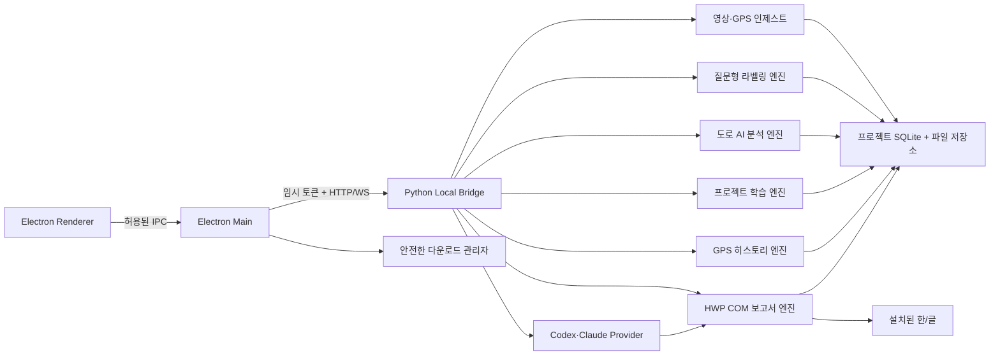

# TrafficSuperVision 통합 로컬 AI 도로점검 플랫폼 마스터 계획서

> 문서 상태: 역사적 v2.0 보관본 — 현재 구현 기준으로 사용하지 않음  
> 문서 버전: 2.0  
> 현재 단일 기준본: 루트 [`TRAFFIC_SUPER_VISION_MASTER_PLAN.md`](../../TRAFFIC_SUPER_VISION_MASTER_PLAN.md) v2.7  
> 보관 안내: 아래 본문은 v2.0 수립 당시 기록을 보존한 것이며, 본문의 `단일 마스터 계획서`·현재형 표현은 현재 상태를 뜻하지 않는다.  
> 대상 플랫폼: Windows 설치형 Electron 애플리케이션  
> 핵심 원칙: 로컬 영상 처리, 사용자 확인형 라벨링, 프로젝트별 모델, 증거 중심 GPS 재생, 한/글 COM 보고서 작성

## 1. 문서 목적

이 문서는 차량에 고정한 휴대폰으로 촬영한 주행 영상과 GPS 기록을 이용해 도로 파손, 시설물 이상, 낙하물, 식생 가림, 차선 도색 상태 등을 검지하고, 사용자의 간단한 질문 응답을 학습용 라벨로 전환하며, 결과를 지도·영상·CSV·HWP/HWPX 보고서로 연결하는 TrafficSuperVision 제품의 단일 마스터 계획서다.

TrafficSuperVision은 브라우저에서만 동작하는 웹 SaaS가 아니다. Electron으로 배포되는 Windows 설치형 서비스이며, 다음 기능을 한 제품 안에서 연결한다.

1. 로컬 파일과 영상 링크 수집
2. AI 후보 추출과 사용자 질문형 라벨링
3. 프로젝트별 데이터셋·모델 학습·검증·롤백
4. 도로 문제와 유지보수 필요 사항 검지
5. 이정표·터널명 OCR과 GPS 기반 위치 검증
6. GPS 지도·영상·사건 타임라인 재생
7. 원시·최종 CSV와 증거 패키지 내보내기
8. 설치된 한/글을 직접 제어하는 HWP/HWPX 보고서 작성
9. Codex·Claude 연결을 이용한 보고서 초안과 구조화 편집 계획 생성
10. 향후 로컬 언어모델을 추가할 수 있는 비활성 Provider 슬롯

최종 결과는 해당 영상을 촬영하지 않은 사람도 다음 내용을 증거와 함께 이해할 수 있어야 한다.

- 차량이 언제, 어디서, 어느 방향으로 이동했는가
- 이동 중 어떤 결함이나 유지보수 필요 지점이 발견되었는가
- AI가 무엇을 근거로 판단했고 사용자가 무엇을 승인·수정했는가
- 이정표나 터널명에 무엇이라고 쓰여 있었으며 실제 위치와 일치하는가
- 동일 지점이 여러 프레임에서 반복 검지된 경우 실제 사건은 몇 건인가
- 결과가 어떤 영상, 프레임, GPS, 라벨, 데이터셋, 모델 버전에서 만들어졌는가
- CSV와 HWP/HWPX 보고서에 어떤 근거가 반영되었는가

---

## 2. 제품 원칙과 범위

### 2.1 제품 원칙

- 원본 영상과 비전 모델 학습·추론은 사용자 PC에서 처리한다.
- AI가 확정 판정을 대신하지 않고 질문과 근거를 제시한다.
- 사용자 답변은 즉시 구조화 라벨이 되지만 모델 재학습은 자동 시작하지 않는다.
- 프로젝트 간 영상·라벨·모델을 자동으로 섞지 않는다.
- 지도, 영상, 타임라인, 사건 목록은 하나의 재생 시각으로 동기화한다.
- 원시 AI 결과와 사용자 최종 결과를 덮어쓰지 않고 함께 보존한다.
- 언어모델은 한/글 문서를 직접 수정하지 않고 검증 가능한 편집 계획만 생성한다.
- renderer에는 파일시스템, 쉘, COM, 비밀정보에 대한 직접 접근 권한을 주지 않는다.
- 실패 시 추정값을 만들어내지 않고 `미확인`, `보류`, `누락` 상태를 명시한다.

### 2.2 1차 사용자

- 프로젝트 관리자: 영상·GPS를 가져오고 분석과 학습을 실행
- 라벨 검토자: 질문 카드에 답하고 영역·유형·심각도를 수정
- 결과 검토자: 지도 히스토리와 증거를 확인
- 보고서 작성자: 기본 또는 사용자 양식으로 HWP/HWPX 보고서를 생성

1차 버전은 단일 Windows 사용자와 로컬 프로젝트를 기준으로 한다. 조직 계정, 웹 협업, 클라우드 모델 학습은 포함하지 않는다.

### 2.3 서비스 경계

제품 내부 기능은 다음 네 영역으로 분리한다.

- 수집·라벨링 서비스: 영상 링크, 로컬 파일, GPS, 질문 카드, 라벨
- 도로 분석 서비스: 검지, 분할, OCR, 위치 검증, 사건 병합, 모델 관리
- GPS 증거 히스토리 서비스: 지도, 영상, 타임라인, 사건 설명
- 보고서 서비스: CSV, 증거 패키지, HWP/HWPX, Codex·Claude Provider

초기에는 하나의 설치형 모듈형 모놀리스로 배포하되, 영역 간에는 버전이 있는 계약을 사용한다.

---

## 3. 전체 아키텍처



### 3.1 Electron 계층

- Electron + React + TypeScript + Vite로 제품 UI를 구성한다.
- renderer는 context isolation이 켜진 상태로 실행한다.
- node integration은 끈다.
- preload에서 프로젝트, 가져오기, 분석, 라벨링, 지도, 내보내기용 최소 IPC만 노출한다.
- renderer가 임의 경로, 임의 명령, 임의 URL 스킴을 전달하지 못하게 main process에서 다시 검증한다.
- 외부 링크는 허용 목록과 사용자 확인을 거쳐 기본 브라우저에서 연다.

### 3.2 Electron main process

- Python 로컬 브릿지의 시작·상태·종료를 감독한다.
- 매 실행마다 충분히 긴 임시 브릿지 토큰을 생성한다.
- 브릿지는 `127.0.0.1`에만 바인딩한다.
- 포트 충돌, 비정상 종료, 재시작, 로그 수집을 담당한다.
- 파일 선택, 저장 경로, 다운로드 경로를 main process가 소유한다.
- Codex·Claude CLI와 HWP COM 작업 요청은 검증된 인수 배열로만 실행하고 쉘 문자열 결합을 금지한다.

### 3.3 Python 로컬 브릿지

- FastAPI 기반 로컬 API와 WebSocket 작업 이벤트를 제공한다.
- 영상 분석, 모델 학습, GPS, CSV, HWP COM 작업을 background job으로 실행한다.
- 분석, 학습, 문서 편집을 서로 다른 작업 큐로 분리한다.
- 작업별 취소·일시정지·재개·실패 복구 상태를 저장한다.
- 임베디드 Python 런타임과 검증된 의존성을 Electron 설치본에 동봉한다.

### 3.4 데이터 저장

- 프로젝트 메타데이터와 상태는 SQLite에 저장한다.
- 영상, GPX, 프레임, 클립, 모델, 데이터셋, 보고서는 프로젝트별 디렉터리에 저장한다.
- SQLite는 원본 데이터 계약의 기준이며 CSV는 내보내기 산출물이다.
- 모든 주요 파일에 SHA-256과 생성 주체를 기록한다.

### 3.5 지도

- Electron renderer 안에서 MapLibre GL JS를 사용한다.
- 온라인 지도 타일은 공급자 설정을 통해 사용한다.
- 네트워크가 없으면 캐시된 타일 또는 단순 경로 배경에서 GPS 선과 사건을 계속 표시한다.
- 지도 타일 공급자와 역지오코딩 공급자는 별도 어댑터로 분리한다.

---

## 4. 실행 환경과 배포

### 4.1 기본 실행 환경

- Windows 10/11 x64
- Electron 설치형 애플리케이션
- NVIDIA GPU 권장, 현재 기준 RTX A2000 12GB
- FFmpeg 동봉
- Python 3.12 임베디드 런타임
- SQLite
- HWP/HWPX 보고서 기능 사용 시 한컴오피스와 `HWPFrame.HwpObject` COM 등록
- Codex·Claude 보고서 AI 사용 시 공식 CLI 설치·로그인·인터넷 연결

### 4.2 설치본

- electron-builder 기반 NSIS 설치본을 만든다.
- Electron, renderer assets, Python, FFmpeg, 기본 모델, DB migration을 포함한다.
- 사용자 데이터는 앱 설치 경로가 아닌 전용 데이터 디렉터리에 둔다.
- 앱 업데이트가 프로젝트 데이터나 모델을 덮어쓰지 않게 한다.
- 배포 전 Authenticode 서명을 연결한다.

### 4.3 첫 실행 점검

- GPU와 VRAM
- FFmpeg
- Python bridge
- 디스크 여유 공간
- 한컴오피스 COM
- Codex CLI
- Claude Code
- 인터넷·지도·역지오코딩

점검 실패 시 전체 앱을 막지 않고 관련 기능만 비활성화하고 해결 방법을 표시한다.

---

## 5. 촬영 및 입력 기준

### 5.1 권장 촬영 기준

- 휴대폰 후면 카메라
- 가로 화면
- 차량 전방을 바라보는 고정 거치
- 주간, 맑음 또는 흐림
- 1080p 이상
- MP4 또는 MOV
- 같은 시간대에 기록된 GPX
- 촬영 전 휴대폰과 GPS 기록 시각 동기화

야간, 비, 눈, 안개, 심한 역광, 손촬영 영상도 입력할 수 있지만 1차 성능 보장 대상에는 포함하지 않는다.

### 5.2 입력 종류와 지원 등급

| 등급 | 입력 | 지원 정책 |
|---|---|---|
| 공식 | 로컬 MP4/MOV | 항상 지원 |
| 공식 | 직접 MP4/MOV 다운로드 URL | HEAD/범위 요청과 MIME 검사 후 지원 |
| 공식 | 다운로드 가능한 Drive·Dropbox·OneDrive 공유 링크 | 공급자 어댑터로 지원 |
| 조건부 | 사용자가 권리를 가진 YouTube 링크 | 다운로드 가능 여부와 권리 확인 후 지원 |
| 최선형 | 일반 웹페이지 URL | 미디어 후보를 찾을 수 있을 때만 지원 |
| 제외 | DRM·암호화 스트림·권한 없는 비공개 영상 | 거부하고 대체 입력 방법 안내 |

### 5.3 영상 링크 처리

1. 사용자가 URL을 붙여넣는다.
2. 앱이 공급자와 링크 유형을 판별한다.
3. 파일명, 예상 용량, 길이, 해상도, 저장 위치를 미리 표시한다.
4. 사용자가 다운로드·분석 권한이 있음을 확인한다.
5. 안전한 임시 경로로 이어받기 가능한 다운로드를 수행한다.
6. 확장자가 아니라 파일 시그니처와 실제 MIME을 검사한다.
7. 실행 파일, 스크립트, HTML을 영상으로 취급하지 않는다.
8. SHA-256, 원본 URL, 공급자, 다운로드 시각, 검사 결과를 등록한다.
9. 검증된 파일만 프로젝트 입력 경로로 이동한다.

웹페이지 스크립트나 내려받은 파일을 자동 실행하지 않는다. 인증 쿠키와 브라우저 세션을 무단으로 읽지 않는다.

### 5.4 GPX 입력

- 영상과 함께 GPX를 선택하거나 링크로 가져온다.
- GPS가 없어도 분석은 가능하지만 위치·도로명·이정표 검증은 제한된다.
- GPS 원본은 수정하지 않고 해시와 시간대를 보존한다.

---

## 6. 검지 및 판정 범위

### 6.1 표준 사건 유형

| 코드 | 검지 대상 | AI가 찾아야 하는 것 | 기본 조치 |
|---|---|---|---|
| `POTHOLE` | 포트홀 | 노면의 구멍과 손상 영역 | 노면 보수 |
| `ROAD_SURFACE_DAMAGE` | 노면 균열·파손 | 균열, 망상 균열, 박리, 깨짐, 변형 | 노면 점검·보수 |
| `ROAD_DEBRIS` | 낙하물·장애물 | 타이어, 목재, 금속, 화물, 돌, 미상 물체 | 긴급 제거·안전 확인 |
| `MEDIAN_BARRIER_DAMAGE` | 중앙분리대·방호시설 파손 | 파손, 이탈, 기울어짐, 누락 | 시설 점검·복구 |
| `SIGN_DAMAGE` | 표지판 파손·전도 | 찌그러짐, 파손, 기울어짐, 전도 | 표지판 복구·교체 |
| `SIGN_VEGETATION_OCCLUSION` | 표지판 식생 가림 | 가지, 잎, 풀, 덩굴에 가려진 표지판 | 가지치기·삭초 |
| `ROADSIDE_MOWING_REQUIRED` | 도로변 과성장 | 갓길, 보도, 중앙부, 시설물 주변 침범 | 삭초·전정 |
| `GUIDE_SIGN_IDENTITY` | 이정표 식별 | 목적지, 방면, 화살표, 도로번호 | 위치 증거·검증 |
| `TUNNEL_IDENTITY` | 터널명 식별 | 터널 입구 명판의 한글·영문 명칭 | 위치 증거·검증 |
| `TUNNEL_NAME_OCCLUSION` | 터널명 식생 가림 | 터널명·명판을 가리는 수목 | 가지치기·삭초 |
| `LANE_MARKING_FADED` | 일반 차선 마모·소실 | 흰색·노란색 차선의 끊김·저대비·소실 | 차선 재도색 |
| `COLORED_GUIDANCE_FADED` | 색깔유도선 마모·소실 | 녹색·분홍색·파란색 유도선의 색 손실·끊김 | 유도선 재도색 |

한 프레임과 사건에는 여러 유형이 동시에 연결될 수 있다.

### 6.2 낙하물

- 먼저 도로 주행 가능 영역을 분할한다.
- 알려진 낙하물 유형을 객체 검지한다.
- 주행 영역 안의 미상 물체는 `UNKNOWN_DEBRIS` 후보로 만든다.
- 단일 프레임 반사·그림자·오염을 줄이기 위해 지속 프레임, 광학 흐름, 차량 이동에 따른 상대 위치를 사용한다.
- 차선 중앙 또는 진행 경로와 직접 겹치면 `긴급`을 제안한다.
- 낙하물과 긴급 후보는 질문 정책과 관계없이 사용자에게 반드시 확인한다.

### 6.3 차선·색깔유도선

- 도로와 차선 영역을 분할한다.
- 원근 보정 영역에서 연속성, 대비, 폭 변화, 색 채도, 소실 비율을 계산한다.
- 그림자, 젖은 노면, 차량 가림이 짧게 나타나는 구간은 제외한다.
- 여러 연속 프레임에서 같은 구간의 마모가 확인되어야 사건으로 승격한다.
- 일반 차선과 색깔유도선은 별도 유형으로 저장한다.
- 실제 재도색 필요 여부와 심각도는 질문 카드에서 사용자가 확정한다.

### 6.4 심각도

모든 사건에 AI 제안값과 사용자 최종값을 분리해 저장한다.

- 심각도: `경`, `중`, `심`, `긴급`
- 유지보수 조치
- 신뢰도
- 화면·도로 영역 대비 결함 면적
- 차로 또는 시설물 침범 비율
- 가림 비율
- 지속 프레임 수

단안 영상만으로 실제 폭·깊이를 cm 단위로 확정하지 않는다.

---

## 7. 비전·OCR·GPS 분석 파이프라인

### 7.1 모델 구성

- 개인 연구용 초기 결함 모델은 `YOLO26s-seg`, 입력 크기 1280px로 시작한다.
- 짧은 구간의 객체 연결에는 ByteTrack 계열 추적기를 사용한다.
- 도로·차선·식생 관계는 분할 마스크로 계산한다.
- 사용자의 한 번 클릭 영역 수정은 point-prompt 기반 `InteractiveSegmenter` 인터페이스로 처리한다.
- 한국어 이정표·터널명은 PaddleOCR 한국어 인식 모델을 초기값으로 사용한다.
- 얼굴·번호판 비식별화는 도로 결함 모델과 분리된 전용 검지 모델로 처리한다.
- 학습은 PyTorch 환경, 배포 추론은 검증된 ONNX 모델을 우선 사용한다.
- 모델 가중치 해시, 라벨 목록, 입력 크기, 전처리, 임계값을 manifest에 고정한다.

Ultralytics 계열은 개인 연구 단계의 초기 선택이다. 비공개 납품·상용 배포 전 AGPL 공개 조건을 수용하거나 Enterprise 라이선스를 취득하거나 허용 라이선스 모델로 교체한다.

### 7.2 처리 단계

1. 영상·GPX 검증과 프로젝트 등록
2. 시간 동기화
3. 장면 변화·흔들림·선명도 기반 후보 프레임 추출
4. 기본 5fps 분석
5. 의심 구간 전후 2초를 10fps로 재분석
6. 도로·차선·시설물·식생 분할
7. 결함·낙하물 검지
8. 이정표·터널명 OCR
9. GPS·도로·방향 기반 OCR 검증
10. 프레임 검지를 사건으로 병합
11. 질문 후보 생성·중복 제거
12. 사용자 질문 응답과 라벨 변환
13. 사건 재평가와 대표 증거 생성
14. 사용자 최종 검토
15. CSV·Trip Package·HWP/HWPX 생성

### 7.3 GPS 시간 동기화

- 영상 촬영 시작 시각과 GPX 시작 시각을 읽는다.
- UTC와 로컬 시간대를 명시적으로 처리한다.
- 사용자가 영상 첫 프레임과 지도 위치를 보며 오프셋을 조정할 수 있게 한다.
- 프레임 타임코드 사이의 GPS를 선형 보간한다.
- GPX 표본 간격이 10초를 넘거나 영상 시간 범위를 벗어나면 `GPS_MISSING`으로 기록한다.
- 위도, 경도, 고도, 속도, 진행 방향, 원본 시각을 보존한다.

### 7.4 이정표·터널명 OCR

1. 이정표 또는 터널 입구를 검지한다.
2. 문자 영역의 원근, 흔들림, 대비, 회전을 보정한다.
3. 여러 프레임을 비교해 가장 선명한 이미지 또는 합성 이미지를 고른다.
4. 한글, 영문, 숫자, 도로번호를 행 단위로 읽는다.
5. 목적지, 도로번호, 화살표, 한글·영문명을 구조화한다.
6. GPS, 현재 도로, 이동 방향, 주변 기준 시설물과 비교한다.

검증 상태는 다음 중 하나다.

- `VERIFIED`: 문자·GPS·도로·방향이 일치
- `PROBABLE`: 일부 글자가 불명확하지만 후보가 하나
- `UNVERIFIED`: 기준 자료 또는 신뢰도 부족
- `CONFLICT`: 문자와 GPS 후보 충돌
- `MANUAL_CONFIRMED`: 사용자가 최종 확정

명판이 식생에 가려졌으면 보이지 않는 글자를 억지로 복원하지 않고 OCR 사건과 가림 사건을 동시에 생성한다.

### 7.5 사건 병합

- 같은 유형, 3초 이내, GPS 20m 이내인 검지를 하나의 사건 후보로 묶는다.
- 짧은 구간에서는 추적 ID를 우선 사용한다.
- GPS가 없으면 추적이 이어진 프레임만 자동 병합한다.
- 서로 다른 원본 영상은 같은 위치라도 자동 병합하지 않는다.
- 사용자의 병합·분리 이력을 저장한다.
- 대표 프레임은 신뢰도, 선명도, 마스크 크기, 가림 정도를 함께 평가해 선택한다.

### 7.6 도로명·주소

- WGS84 좌표를 원본으로 보존한다.
- 사건 병합 후 대표 좌표만 역지오코딩한다.
- 공급자별 속도 제한과 캐시 정책을 지킨다.
- 네트워크가 없거나 공급자가 실패하면 좌표는 유지하고 도로명만 비운다.

---

## 8. 질문형 데이터 라벨링 프로그램

### 8.1 라벨링 책임

| 주체 | 역할 |
|---|---|
| 후보 추출 엔진 | 대표 프레임·클립 추출, AI 박스·마스크·OCR 선행 제안 |
| TrafficSuperVision 질문 UI | 어려운 기술 용어를 쉬운 질문과 선택지로 변환 |
| 사용자 | 예·아니오·판단 어려움, 유형·심각도·조치, 영역 수정 승인 |
| 데이터 운영 보조 | 링크 영상 목록화, 대량 후보 검수, 오탐·미탐 표본 감사 |
| 모델 평가 엔진 | 라벨 품질, 분포, 검증 세트, 성능 회귀 확인 |

사용자는 모든 프레임에 박스를 직접 그리지 않는다. AI가 먼저 영역을 제안하고 사용자는 질문에 답한다. 개발·초기 데이터 구축 과정에서는 접근 가능한 영상 링크를 분석해 후보 프레임, 선행 라벨, CVAT/YOLO 호환 데이터, QA 보고서를 만들 수 있다. 삭초·재도색·심각도처럼 정책 판단이 필요한 기준은 사용자의 대표 사례 승인으로 고정한다.

### 8.2 질문 카드

각 질문 카드는 동일 사건의 연속 프레임을 하나로 묶고 다음을 포함한다.

- 대표 이미지
- AI 박스·분할 마스크
- 앞뒤 프레임
- 2~5초 미리보기 클립
- GPS 지도 위치
- AI 예상 유형·심각도·신뢰도
- 답변이 학습에 어떻게 반영되는지에 대한 설명

예시 질문:

- `이 구간은 삭초가 필요한가요?`
- `표지판이 식생에 의해 가려졌나요?`
- `차선 재도색이 필요한 상태인가요?`
- `색깔유도선이 지워졌나요?`
- `도로 위 물체가 낙하물인가요?`
- `이 글자는 ○○터널이 맞나요?`
- `AI가 표시한 영역이 정확한가요?`

### 8.3 공통 응답

| 응답 | 라벨 변환 |
|---|---|
| `예` | AI 영역·유형을 승인 라벨로 저장 |
| `아니오` | 제안을 폐기하고 어려운 음성 예제로 저장 |
| `판단 어려움` | 학습에서 제외하고 보류 큐로 이동 |
| `영역 수정` | 사용자가 대상을 클릭하고 자동 재분할 후 재확인 |
| `유형 변경` | 제안 영역을 유지하고 올바른 유형 선택 |

삭초·재도색·시설물 파손을 승인하면 심각도와 권장 조치를 추가 질문한다. OCR 질문은 AI 원문, 위치 후보, 기준 명칭을 나란히 보여주고 사용자가 정답 또는 `모름`을 선택한다.

### 8.4 질문 정책

프로젝트별로 다음 모드를 선택할 수 있다.

- `학습 보조`: 기본값. 유형별 초기 30건 전수 질문
- `전수 검토`: 모든 사건 후보 질문
- `빠른 검토`: 불확실 후보만 질문

학습 보조 모드는 최근 30건의 사용자-AI 일치율이 90% 이상이면 다음 후보만 질문한다.

- 신뢰도 경계 구간
- 모델 간 판정 불일치
- 새로운 촬영 환경
- 낙하물과 긴급 사건
- 고신뢰 후보의 10% 무작위 품질표본

낙하물과 `긴급` 제안은 모든 모드에서 반드시 질문한다.

### 8.5 질문 상태

- `QUEUED`
- `ANSWERED_ACCEPT`
- `ANSWERED_REJECT`
- `ANSWERED_UNSURE`
- `EDITING_GEOMETRY`
- `CONFIRMED`
- `SUPERSEDED`

질문, 답변, 수정 전·후 영역, 사용자, 시각, 원본 모델을 모두 추적한다.

### 8.6 고급 라벨 편집

쉬운 질문만으로 해결되지 않는 경우에만 고급 편집기를 연다.

- 박스 이동·크기 조절
- 점 클릭 기반 마스크 재생성
- 브러시 추가·삭제
- 객체 분리·병합
- OCR 문자 수정
- 유형·세부 유형 변경
- 프레임 범위 조절

고급 편집 결과도 원본 AI 제안을 삭제하지 않는다.

### 8.7 외부 호환

- CVAT 프로젝트 내보내기
- COCO detection/segmentation
- YOLO detection/segmentation
- OCR 정답 JSON
- 라벨 QA CSV

외부 도구에서 수정한 라벨은 import 전 스키마와 프로젝트 소유권을 검증한다.

---

## 9. 프로젝트별 데이터셋·모델

### 9.1 프로젝트 격리

- 새 프로젝트는 공통 초기 모델을 복제해 시작한다.
- 한 프로젝트의 영상·라벨·데이터셋·모델은 다른 프로젝트에 자동으로 섞지 않는다.
- 공통 모델로 데이터를 보내는 기능은 1차에 제공하지 않는다.
- 모델과 데이터셋 파일 경로에 항상 `project_id`를 포함한다.
- API와 DB 쿼리는 프로젝트 소유권을 검사한다.

### 9.2 라벨 분류

- 승인 양성 라벨
- 승인 음성 라벨
- 판단 보류
- OCR 정답
- 고정 검증 세트
- 고정 테스트 세트

검토자가 수정한 결과를 자동 학습에 넣지 않고 `CONFIRMED` 상태만 사용한다.

### 9.3 데이터셋 버전

각 버전에는 다음을 저장한다.

- 포함 annotation ID
- 프로젝트 ID
- 클래스 분포
- 촬영일·노선·영상 분리 기준
- train/validation/test 목록
- 생성 설정
- 데이터셋 해시
- 이전 버전과의 차이

같은 영상의 인접 프레임을 서로 다른 분할에 넣지 않는다. 촬영일, 노선, 영상 단위로 60/20/20 분리한다.

### 9.4 재학습 시작

- 사용자가 `새 모델 학습`을 눌러야 시작한다.
- 새 확정 라벨 100건 이상일 때 버튼을 활성화한다.
- 학습 대상 유형별 검증 표본 30건 이상을 요구한다.
- 시작 전에 예상 시간, VRAM, 디스크, 클래스 불균형을 보여준다.
- 조건이 부족하면 모델 학습 대신 추가 질문 수집을 제안한다.

### 9.5 학습과 평가

- 활성 모델과 같은 검증 세트를 사용한다.
- 사건 단위 정밀도·재현율, 중복 사건, 오탐, 클래스별 혼동을 비교한다.
- 클래스별 재현율이 2%p 이상 하락하면 자동 승격하지 않는다.
- 중복 생성률 또는 오탐률이 증가하면 자동 승격하지 않는다.
- 후보 모델은 활성화 전 사용자가 비교 결과를 승인한다.

### 9.6 모델 상태

- `BASE`
- `TRAINING`
- `CANDIDATE`
- `ACTIVE`
- `REJECTED`
- `ARCHIVED`

이전 활성 모델은 보존하며 한 번의 사용자 조작으로 롤백할 수 있다.

### 9.7 희귀 사건 데이터

낙하물과 시설물 파손을 촬영하기 위해 실제 도로에 위험물을 놓지 않는다.

- 보유 영상 우선
- 이용 조건이 명확한 공개 데이터
- 폐쇄된 안전 구간의 제한적 재현
- 이미지 합성과 데이터 증강은 보조 수단
- 합성 데이터만으로 테스트 성능을 주장하지 않음

---

## 10. GPS 주행 히스토리 및 증거 재생

### 10.1 화면 구조

히스토리 화면은 하나의 `playback_time_ms`로 동기화된 다음 영역을 제공한다.

1. 영상 플레이어
2. GPS 지도와 주행 경로
3. 사건 타임라인
4. 사건 목록·필터
5. 증거 상세 카드

### 10.2 경로 재생

- 재생 전 전체 경로는 흐린 선으로 표시한다.
- 재생이 시작되면 출발점부터 현재 위치까지 진행 방향에 따라 색이 채워진다.
- 현재 차량 위치는 방향이 있는 마커로 표시한다.
- 지도 카메라는 차량 추적 또는 자유 이동을 지원한다.
- 일시정지, 탐색, 0.5배·1배·2배·4배 재생을 지원한다.
- GPS 누락 구간은 임의 직선으로 사실처럼 표시하지 않고 점선·경고 상태로 구분한다.

### 10.3 사건 상호 이동

- 지도 마커를 누르면 영상과 타임라인이 해당 시각으로 이동한다.
- 타임라인 사건을 누르면 지도와 영상이 이동한다.
- 영상의 검지 영역을 누르면 사건 상세가 열린다.
- 사건 목록을 누르면 지도 중심과 재생 위치가 이동한다.
- CSV의 사건 ID를 앱에 전달하면 같은 사건을 연다.
- 필터를 변경하면 지도, 타임라인, 목록이 함께 갱신된다.

### 10.4 증거 카드

- 발견 시각과 영상 타임코드
- 위·경도, 도로명, 진행 방향
- 원본 프레임
- AI 표시 프레임
- 사용자 최종 영역
- 얼굴·번호판이 흐림 처리된 공유용 이미지
- 전후 영상 클립
- AI 유형·신뢰도·심각도·조치
- 사용자 답변과 최종 판정
- OCR 원문과 검증된 이정표·터널명
- 모델·데이터셋·질문 ID

촬영하지 않은 사람도 이 카드만으로 사건 위치, 전후 상황, 판단 근거를 이해할 수 있어야 한다.

---

## 11. 사용자 검토 워크플로

사용자는 사건별로 다음 작업을 수행할 수 있다.

- 승인·반려
- 유형·세부 유형 변경
- 심각도·조치 변경
- 사건 병합·분리
- 대표 캡처 변경
- OCR 문자와 기준 시설물 수정
- 도로명·위치 메모 수정
- 얼굴·번호판 추가 흐림
- 학습 라벨 포함·제외

AI 원본, 질문 답변, 최종 검토값은 별도 필드와 이력으로 보존한다.

---

## 12. 데이터 계약

### 12.1 핵심 엔터티

| 엔터티 | 역할 |
|---|---|
| `Project` | 영상·데이터셋·모델·보고서를 격리하는 단위 |
| `Trip` | 한 번의 주행 영상·GPS·시간 범위 |
| `MediaAsset` | 영상, 프레임, 클립, 이미지 |
| `GpsTrackPoint` | 시각별 위치·속도·방향 |
| `ModelRun` | 한 번의 추론 실행 |
| `Detection` | 프레임 단위 AI 원시 검지 |
| `Incident` | 여러 Detection을 병합한 사건 |
| `OcrObservation` | OCR 원문·영역·신뢰도 |
| `PlaceVerification` | OCR과 위치 기준 자료의 비교 |
| `ReferenceAsset` | 이정표, 터널, 도로 기준 자료 |
| `LabelQuestion` | 질문 문구, 후보 사건, 제안 영역, 표시 자료, 정책 |
| `LabelAnswer` | 사용자 응답과 수정값 |
| `Annotation` | 학습에 사용하는 최종 라벨 |
| `DatasetVersion` | 포함 라벨, 분할, 통계, 해시 |
| `ModelVersion` | 기반 모델, 데이터셋, 성능, 승격 상태 |
| `MaintenanceAction` | AI 제안·사용자 확정 조치 |
| `EvidenceAsset` | 원본·표시·비식별화 이미지와 클립 |
| `ReviewAction` | 승인·반려·수정·병합 감사 이력 |
| `ReportDraft` | 보고서 문장과 구조화 내용 |
| `DocumentEditPlan` | 한/글에 적용할 허용 편집 목록 |
| `ProviderConnection` | Codex·Claude·미래 로컬 모델 상태 |

### 12.2 LabelQuestion

- `question_id`
- `project_id`
- `trip_id`
- `incident_id`
- `question_type`
- `prompt`
- `policy_mode`
- `proposed_class`
- `proposed_geometry`
- `confidence`
- `media_refs`
- `gps_ref`
- `mandatory_reason`
- `status`
- `created_at`

### 12.3 LabelAnswer

- `answer_id`
- `question_id`
- `answer`
- `selected_class`
- `selected_severity`
- `selected_action`
- `final_geometry`
- `ocr_text`
- `include_in_training`
- `answered_at`

### 12.4 Incident

- `schema_version`
- `project_id`
- `trip_id`
- `incident_id`
- `model_run_id`
- `incident_type`
- `incident_subtype`
- `start_time_ms`
- `representative_time_ms`
- `end_time_ms`
- `latitude`
- `longitude`
- `gps_status`
- `road_name`
- `travel_heading`
- `ai_confidence`
- `ai_severity`
- `final_severity`
- `ai_maintenance_action`
- `final_maintenance_action`
- `measurement_json`
- `ocr_text`
- `verified_place_name`
- `place_verification_status`
- `review_status`
- `representative_evidence_id`

### 12.5 DocumentEditPlan

허용 작업만 표현하는 버전형 JSON 계약으로 만든다.

- 문서 스냅샷 ID
- 대상 문단·표·셀·사진 슬롯 주소
- 작업 유형: 텍스트 채우기, 표 행 추가, 셀 채우기, 이미지 삽입, 지도 삽입
- 적용 전 기대값
- 적용할 값과 출처
- 스타일 보존 정책
- 미리보기 설명

임의 매크로, 임의 COM 메서드, 임의 파일 경로는 포함할 수 없다.

---

## 13. 프로젝트 파일과 내보내기

```text
project/
  project.sqlite3
  manifest.json
  input/
    videos/
    gps/
    sources.json
  analysis/
    frames/
    clips/
    detections/
  labels/
    questions/
    annotations/
    datasets/
  models/
    base/
    candidates/
    active/
    archived/
  evidence/
    internal/
    share/
  reports/
    drafts/
    hwpx/
    hwp/
    renders/
  exports/
    raw_detections.csv
    reviewed_incidents.csv
    label_questions.csv
    annotations.csv
    ocr_observations.csv
    route_points.csv
    maintenance_actions.csv
    report_payload.json
  logs/
```

### 13.1 CSV 원칙

- Excel 한글 호환을 위해 UTF-8 BOM 사용
- ISO 8601 시각과 영상 타임코드 함께 저장
- 위·경도는 WGS84
- AI 원본값과 사용자 최종값 분리
- 사건 행은 근거 이미지 또는 클립과 연결
- 스키마 버전을 manifest에 기록
- 데이터셋·모델·입력 영상 provenance 포함

### 13.2 Trip Package

다른 PC나 검토자에게 전달할 때는 다음을 묶는다.

- 검토 완료 사건
- 경로와 지도 데이터
- 비식별화 증거
- 전후 클립
- CSV
- report payload
- manifest

원본 영상 포함 여부는 사용자가 선택한다.

---

## 14. HWP/HWPX inline AI 보고서

### 14.1 지원 방식

- TrafficSuperVision 기본 점검보고서 제공
- 사용자가 보유한 HWP/HWPX 양식 지원
- 설치된 한/글에서 양식을 열거나 현재 열린 문서를 감지
- HWPML 구조, 표, 문단, 사진 영역, 기존 서식 분석
- 명시적 필드가 있으면 우선 사용
- 필드가 없으면 표 머리글, 인접 라벨, 빈 칸, 문단 의미를 기반으로 후보 슬롯 생성
- 후보가 여러 개면 자동 쓰지 않고 사용자에게 선택 요청

### 14.2 보고서 데이터

- 조사 개요
- 주행 일시·구간·거리
- GPS 경로 지도
- 유형별 집계
- 사건별 위치·심각도·조치
- 이정표·터널명 OCR과 검증 상태
- 대표 근거 이미지
- 비식별화 이미지
- 검토자 메모
- 모델·데이터셋·분석 버전

### 14.3 편집 절차

1. 사용자가 기본 또는 사용자 양식을 선택한다.
2. 보고서 엔진이 작업용 복사본과 원본 해시를 만든다.
3. 한/글 COM으로 문서 구조와 미리보기 스냅샷을 읽는다.
4. 규칙 엔진이 확정 가능한 표·사진·필드를 매핑한다.
5. 연결된 Codex·Claude가 필요한 설명문과 구조화 편집 계획을 제안한다.
6. 스키마·대상 주소·기대값을 검증한다.
7. 사용자에게 변경 위치와 내용을 미리 보여준다.
8. 사용자가 수락한 작업만 한/글 COM으로 적용한다.
9. 변경 내용 추적에서 수락·거절할 수 있게 한다.
10. 저장 후 다시 읽고 전 페이지 렌더링한다.
11. 누락, 겹침, 표 잘림, 페이지 넘침, 남은 빈 칸을 검사한다.
12. 검증 성공본만 최종 보고서로 이동한다.

### 14.4 COM 안전 원칙

- HWP COM은 별도 STA worker에서 실행한다.
- TrafficSuperVision이 연 문서·프로세스만 자동 제어한다.
- 작업 전 임시 복사본과 복구 저널을 만든다.
- 한 작업에서 서로 다른 편집 엔진을 섞지 않는다.
- 기대한 문서 스냅샷과 다르면 쓰기를 거부한다.
- 표, 스타일, 문단 번호, 필드, 그림, 페이지 제어를 보존한다.
- 실패 시 원본을 덮어쓰지 않고 작업본을 폐기한다.
- 강제 종료 후에도 저널을 읽어 미완료 작업을 복구·폐기할 수 있게 한다.

### 14.5 변경 검토

- 추가 내용과 삭제 내용을 구분 표시
- 변경 위치로 이동
- 항목별 수락·거절
- 전체 수락·거절
- 원본으로 롤백
- 저장 전·후 페이지 비교

언어모델은 COM을 직접 호출하지 않는다. 결정적 편집기가 검증된 `DocumentEditPlan`만 실행한다.

---

## 15. Codex·Claude Provider

### 15.1 1차 Provider

- `CodexCliProvider`
- `ClaudeCodeProvider`
- `LocalModelProvider` - 비활성, 준비 중

### 15.2 인증

- Codex는 공식 Codex CLI의 ChatGPT 로그인 흐름을 사용한다.
- Claude는 Claude Code의 공식 Console 또는 Pro/Max 로그인 흐름을 사용한다.
- TrafficSuperVision은 인증 파일, refresh token, 세션 쿠키를 직접 읽지 않는다.
- 로그인·로그아웃과 자격증명 저장은 각 공식 CLI가 소유한다.
- 앱은 CLI 설치·버전·연결 상태와 출력 전용 실행 결과만 확인한다.

### 15.3 실행 경계

- 보고서 초안용 임시 작업 디렉터리를 별도로 만든다.
- 승인 사건 JSON, OCR 결과, 비식별화 이미지, 문서 구조 요약만 제공한다.
- 전체 원본 영상과 불필요한 개인정보는 보내지 않는다.
- 전송 전 데이터 범위와 공급자를 사용자에게 보여주고 동의를 받는다.
- CLI는 프로젝트 소스나 임의 사용자 폴더가 아닌 제한된 임시 경로에서 실행한다.
- 출력은 `ReportDraft` 또는 `DocumentEditPlan` JSON 스키마로 검증한다.
- 비정형·불완전·대상 불명확 출력은 보고서 쓰기에 사용하지 않는다.

### 15.4 Provider 계약

- `get_status()`
- `start_login()`
- `disconnect()`
- `get_capabilities()`
- `generate_report_draft(context, schema)`
- `generate_document_edit_plan(context, schema)`
- `get_usage_summary()`

### 15.5 미래 로컬 모델

`LocalModelProvider`는 비활성 구현과 UI 슬롯만 제공한다.

- 현재 미지원 사유
- 요구되는 한국어 문서 품질
- 구조화 JSON 준수율
- HWP 양식 이해 능력
- 활성화 성능 게이트

위 내용을 코드 주석, Provider 문서, 계약 테스트에 남긴다. 충분한 모델이 나오면 UI·보고서 파이프라인 변경 없이 Provider만 추가한다.

---

## 16. 화면과 사용자 흐름

### 16.1 프로젝트 홈

- 프로젝트 생성·열기
- 최근 주행
- 승인 대기 질문
- 분석 진행률
- 심각·긴급 사건
- 활성 모델
- 보고서 상태

### 16.2 영상 가져오기

- 로컬 파일
- URL 붙여넣기
- 링크 지원 등급과 권리 확인
- 다운로드 진행률·재개
- 메타데이터와 SHA-256
- GPX 선택·동기화

### 16.3 질문 라벨링

- 질문 모드 선택
- 대표 이미지·클립·지도
- 예·아니오·판단 어려움·영역 수정
- 남은 질문 수
- 유형별 진행률
- 고급 라벨 편집기

### 16.4 분석

- 단계별 진행 상태
- 프레임·사건 수
- GPU 상태
- 예상 남은 시간
- 취소·재개
- 오류 로그

### 16.5 사건 검토

- 영상 오버레이
- 지도
- AI 원본·사용자 답변·최종값 비교
- 병합·분리
- OCR·위치 검증
- 비식별화

### 16.6 모델 관리

- 데이터셋 준비 상태
- 유형별 라벨 분포
- 학습 가능 조건
- 학습 시작
- 활성·후보 모델 성능 비교
- 승격·거부·롤백

### 16.7 GPS 히스토리

- 경로 진행 애니메이션
- 지도·영상·타임라인 동기화
- 사건 필터
- 증거 카드
- 공유용 보기

### 16.8 보고서

- 기본·사용자 양식 선택
- 한/글 연결 상태
- Codex·Claude 연결 상태
- 전송 데이터 확인
- 보고서 초안
- 편집 계획 미리보기
- 수락·거절·롤백
- HWP/HWPX 저장·렌더 검증

### 16.9 내보내기

- 원시 CSV
- 최종 CSV
- 라벨·데이터셋
- 비식별화 이미지
- 전후 클립
- Trip Package
- HWP/HWPX 보고서

---

## 17. 로컬 API와 IPC

### 17.1 주요 API

- `POST /projects`
- `GET /projects/{project_id}`
- `POST /projects/{project_id}/imports/inspect`
- `POST /projects/{project_id}/imports`
- `POST /projects/{project_id}/trips/{trip_id}/sync-gps`
- `POST /projects/{project_id}/analysis`
- `GET /jobs/{job_id}`
- `POST /jobs/{job_id}/cancel`
- `GET /projects/{project_id}/questions`
- `POST /projects/{project_id}/questions/{question_id}/answer`
- `POST /projects/{project_id}/questions/{question_id}/segment`
- `POST /projects/{project_id}/datasets`
- `POST /projects/{project_id}/models/train`
- `POST /projects/{project_id}/models/{model_id}/promote`
- `POST /projects/{project_id}/models/{model_id}/rollback`
- `GET /projects/{project_id}/history`
- `POST /projects/{project_id}/exports`
- `GET /providers`
- `POST /providers/{provider}/login`
- `POST /projects/{project_id}/reports/draft`
- `POST /projects/{project_id}/reports/plan`
- `POST /projects/{project_id}/reports/apply`
- `POST /projects/{project_id}/reports/accept`
- `POST /projects/{project_id}/reports/reject`

### 17.2 IPC 원칙

- renderer는 URL·파일·프로세스를 직접 다루지 않는다.
- preload가 typed request만 노출한다.
- main은 project ID, 경로, URL, 저장 대상, 작업 권한을 재검증한다.
- Python bridge 호출에는 임시 토큰을 넣는다.
- WebSocket은 작업 진행 이벤트만 보낸다.

---

## 18. 권장 저장소 구조

```text
TrafficSuperVision/
  apps/
    desktop/
      src/main/
      src/preload/
      src/renderer/
      src/map/
  bridge/
    api/
    jobs/
    ingest/
    analysis/
    labeling/
    training/
    geolocation/
    history/
    evidence/
    exports/
    reports/
    providers/
  packages/
    contracts/
    ipc/
    ui/
  ml/
    datasets/
    training/
    evaluation/
    models/
  templates/
    reports/
  tests/
    unit/
    integration/
    e2e/
    model/
    hwp/
  docs/
  TRAFFIC_SUPER_VISION_MASTER_PLAN.md
```

`superkorea` 저장소를 런타임 의존성이나 import 경로로 사용하지 않는다.

---

## 19. 개인정보·보안·감사

### 19.1 개인정보

- 원본은 로컬 프로젝트 내부에 유지한다.
- 공유용 이미지·클립·보고서에는 얼굴·번호판을 흐림 처리한다.
- 사용자가 누락 영역을 추가로 흐릴 수 있다.
- 언어모델에는 비식별화 자료와 최소 구조화 데이터만 전달한다.

### 19.2 다운로드 보안

- MIME·파일 시그니처·최대 용량 검사
- 임시 디렉터리와 경로 정규화
- path traversal 거부
- 실행 가능 파일 거부
- 웹페이지 스크립트 실행 금지
- DRM·권한 없는 비공개 콘텐츠 거부

### 19.3 로컬 서비스

- loopback 전용
- 실행별 임시 토큰
- CORS 허용 목록
- 요청 크기 제한
- 작업별 프로젝트 소유권 확인

### 19.4 감사 이력

- 입력 출처·해시
- 분석 설정·모델
- 질문·답변·영역 수정
- 데이터셋 버전
- 모델 학습·승격·롤백
- 보고서 편집 계획
- HWP 수락·거절·저장

---

## 20. 성능 목표와 품질 게이트

### 20.1 검지

표본 기준을 충족한 유형별로 다음을 목표로 한다.

- 사건 단위 재현율 90% 이상
- 검토 전 사건 단위 정밀도 80% 이상
- 동일 실제 사건 중복 생성률 5% 이하
- 테스트 세트와 학습 영상·노선 분리

유형별 독립 사건 250건 이상, 테스트 사건 50건 이상이 없으면 `표본 부족`으로 표시한다.

### 20.2 OCR·위치

- 육안 판독 가능 이정표·터널명 정규화 이름 정확도 90% 이상
- 기준 시설물 후보가 존재할 때 올바른 후보 선택 정확도 95% 목표
- 불확실 결과는 `UNVERIFIED`로 유지
- OCR 원문, 보정 이미지, 위치 검증 근거 보존

### 20.3 라벨링 UX

- 비전문 사용자가 별도 교육 없이 질문 카드 50건을 완료
- 동일 사건이 중복 질문되지 않음
- 모든 응답이 유효한 라벨 상태로 변환
- `판단 어려움`이 학습에 포함되지 않음
- 영역 수정의 이전·이후가 추적됨

### 20.4 GPS 히스토리

- 수동 오프셋 조정 후 영상·지도 시각 차이 2초 이하
- 지도, 영상, 타임라인, 목록의 상호 이동
- 진행선과 현재 위치가 탐색·재생 상태에 맞춰 갱신
- GPS 누락을 명시적으로 표시

### 20.5 처리 성능

- RTX A2000에서 1080p 1시간 영상을 2시간 이내 분석
- VRAM 부족 시 입력 크기·batch를 안전하게 낮추고 작업을 재개
- 중단 후 마지막 완료 단계에서 재개

### 20.6 HWP/HWPX

- 기본·사용자 양식 모두 열림
- 원본 서식, 표, 문단 번호, 그림 구조 보존
- 수락·거절·롤백 가능
- 강제 종료 후 복구 가능
- 최종 보고서 전 페이지 렌더 검증 통과
- 근거 이미지·사건 표·지도 누락 없음

---

## 21. 테스트 계획

### 21.1 단위 테스트

- URL 공급자 판별과 MIME 검사
- 영상 메타데이터와 시간대
- GPX 보간·누락
- 사건 병합·분리
- 질문 정책과 강제 질문
- 응답→라벨 변환
- OCR 정규화와 위치 후보 점수
- 데이터셋 프로젝트 격리
- 모델 승격 규칙
- CSV 인코딩·스키마
- DocumentEditPlan 검증

### 21.2 통합 테스트

- 로컬 파일
- 직접 URL
- Drive·Dropbox·OneDrive
- YouTube 조건부 입력
- 일반 웹 최선형 입력
- DRM·권한 없음 거부
- MP4+GPX 정상 입력
- GPS 없음·시각 불일치·중간 단절
- 질문 카드와 고급 영역 수정
- 학습 승인·후보 모델·롤백
- 인터넷 없는 지도·역지오코딩
- 앱 종료 후 작업 재개

### 21.3 UI E2E

- 프로젝트 생성→링크 입력→다운로드→질문→분석
- 질문 세 모드 전환
- 지도·영상·타임라인·목록 상호 이동
- 사건 승인·수정·반려
- 데이터셋 생성과 모델 학습 승인
- 비식별화 확인
- CSV·Trip Package 내보내기

### 21.4 모델 테스트

- 유형별 사건 정밀도·재현율
- 작은 물체와 먼 거리
- 그림자·젖은 노면·차량 가림 오탐
- OCR 문자와 정규화 이름
- 위치 충돌 후보
- 미상 낙하물과 노면 무늬
- 차선 마모와 일시 가림

### 21.5 Provider 테스트

- Codex·Claude CLI 미설치
- 미로그인·로그인 만료
- 네트워크 실패
- 비정형 출력
- 스키마 불일치
- 데이터 전송 동의 취소
- 임시 디렉터리 밖 접근 차단
- LocalModelProvider 비활성 계약

### 21.6 HWP/HWPX 테스트

- 기본·사용자 HWP/HWPX
- 열린 문서 감지
- 구조·표·필드 후보
- 편집 계획 수락·거절
- stale snapshot 쓰기 거부
- 잘못된 AI 계획 쓰기 거부
- 강제 종료·재시작 복구
- 저장 후 재읽기·전 페이지 렌더
- 표 잘림·사진 누락·페이지 넘침

### 21.7 보안 테스트

- renderer의 직접 파일·쉘·COM 접근 차단
- loopback 외부 접속 차단
- bridge 토큰 누락·오류
- path traversal
- 악성 확장자와 MIME 위장
- CLI 인수 주입
- 프로젝트 간 데이터 접근

### 21.8 최종 종단 테스트

실제 영상 한 건으로 다음 전체 흐름을 검증한다.

영상 링크 입력 → 다운로드·해시 → GPX 동기화 → 후보 질문 → 사용자 라벨 → 프로젝트 데이터셋 → 사용자 승인 학습 → 도로 분석 → 지도 히스토리 → 사건 검토 → CSV → Codex·Claude 보고서 초안 → 한/글 편집 미리보기 → 수락 → HWP/HWPX 저장·렌더 검증.

---

## 22. 구현 마일스톤

### M0 - 저장소·계약·Electron 보안 기반

- Electron main/preload/renderer
- Python bridge supervision
- 임시 토큰
- 프로젝트 DB와 migration
- 핵심 계약

완료 조건: 최소 실제 입력에서 생성된 Project·Trip·Incident·Question 객체를 UI에서 다시 읽을 수 있다.

### M1 - 안전한 영상 링크·로컬 파일 수집

- 입력 지원 등급
- 권리 확인
- 다운로드 재개
- MIME·해시
- GPX 등록

완료 조건: 공식·조건부·거부 링크 테스트가 구분되어야 한다.

### M2 - 영상·GPS·지도 수직 구현

- 영상 재생
- GPX 시간 보정
- 경로선·현재 위치
- 지도·영상 탐색 동기화

완료 조건: 실제 영상 재생에 따라 지도 마커와 진행 경로가 움직인다.

### M3 - 질문형 라벨링

- 후보 프레임·사건
- 질문 카드
- 세 질문 모드
- 응답→라벨
- 영역 수정
- CVAT/YOLO 내보내기

완료 조건: 비전문 사용자가 50건을 처리하고 유효 annotation을 생성한다.

### M4 - 핵심 도로 검지

- 포트홀
- 노면 파손
- 낙하물
- 사건 병합
- 대표 증거

완료 조건: 영상 입력부터 질문·사건·CSV까지 처리된다.

### M5 - 전체 유지보수 유형

- 방호시설
- 표지판
- 식생·삭초
- 차선·색깔유도선
- 심각도·조치

완료 조건: 모든 표준 유형이 같은 Incident 계약을 사용한다.

### M6 - OCR·위치 검증

- 이정표·터널 입구
- 한국어 OCR
- 기준 시설물 인덱스
- GPS·도로·방향 검증
- 명판 가림 동시 판정

완료 조건: OCR 원문과 검증 이름을 분리해 표시한다.

### M7 - 프로젝트 모델 관리

- 데이터셋 버전
- 사용자 승인 학습
- 성능 비교
- 승격·거부·롤백
- 프로젝트 격리

완료 조건: 프로젝트 A 모델이 B 데이터 없이 독립 학습·복구된다.

### M8 - GPS 증거 히스토리

- 경로 진행 애니메이션
- 지도·영상·타임라인·목록 동기화
- 증거 카드
- 촬영자 외 검토자 보기

완료 조건: 어느 화면에서 사건을 선택해도 동일 증거로 이동한다.

### M9 - CSV·비식별화·Trip Package

- 원시·최종 CSV
- 얼굴·번호판 흐림
- 클립·증거
- 공유 패키지

완료 조건: AI 원본과 사용자 확정 결과를 모두 재현한다.

### M10 - Codex·Claude와 HWP/HWPX

- Provider 슬롯과 공식 CLI 연결
- 보고서 데이터 전송 동의
- ReportDraft·DocumentEditPlan
- 한/글 COM 구조 분석
- 미리보기·수락·거절·롤백
- 저장·전 페이지 검증

완료 조건: 기본·사용자 양식에 실제 사건·지도·사진을 넣고 검증된 HWP/HWPX를 생성한다.

### M11 - 설치본·현장 수용

- NSIS 설치본
- 임베디드 Python·FFmpeg·모델
- self-check
- 실제 영상 종단 수용
- 성능 리포트
- Authenticode

완료 조건: 개발 도구가 없는 Windows PC에서 설치·분석·보고서 생성이 가능하다.

---

## 23. 주요 위험과 대응

| 위험 | 영향 | 대응 |
|---|---|---|
| 낙하물·시설 파손 데이터 부족 | 높은 미탐 | 공개·보유·안전 통제 데이터, 표본 부족 표시 |
| 사용자가 너무 많은 질문을 받음 | 라벨링 중단 | 사건 병합, 학습 보조·전수·빠른 모드 |
| 잘못된 사용자 라벨 | 모델 성능 하락 | 보류, 품질표본, 검증 세트, 수동 승격 |
| 프로젝트 데이터 혼합 | 잘못된 모델 | 경로·DB·API 프로젝트 격리 테스트 |
| OCR 흔들림 | 잘못된 지명 | 다중 프레임, 원근 보정, 위치 검증 |
| GPS 시각 불일치 | 잘못된 위치 | 오프셋 미리보기와 수동 보정 |
| 차선과 그림자 혼동 | 도색 오탐 | 지속성, 도로 마스크, 대비·색 결합 |
| 식생은 있으나 조치 불필요 | 과도한 삭초 사건 | 시설물·도로 침범 관계와 사용자 질문 |
| 일반 웹 링크 변화 | 다운로드 실패 | 지원 등급, 공급자 어댑터, 로컬 파일 대체 |
| 악성 링크·파일 | 로컬 침해 | MIME·magic·경로·실행 차단 |
| Codex·Claude 출력 오류 | 잘못된 보고서 | 구조화 스키마, 미리보기, 결정적 편집기 |
| CLI 로그인 만료 | 보고서 중단 | 명확한 연결 상태와 재로그인 |
| HWP COM 실패 | 문서 손상 | 작업본, 저널, stale 검사, 원본 보존 |
| 지도·지오코딩 제한 | 도로명 누락 | 좌표 우선, 캐시, 공급자 교체 |
| 비전 모델 라이선스 | 상용 배포 제한 | 배포 전 라이선스 게이트 또는 모델 교체 |
| 얼굴·번호판 노출 | 공유 위험 | 자동 흐림과 사용자 최종 검사 |

---

## 24. 1차 범위에서 제외

- 웹 브라우저형 멀티테넌트 SaaS
- 클라우드 GPU 비전 학습
- 프로젝트 간 자동 데이터 공유
- 조직 계정·동시 협업
- 모바일 전용 촬영 앱
- 실시간 주행 중 안전 경고
- 자동 유지보수 발주
- 법적·행정적 확정 판정
- 단안 영상 기반 실제 cm 단위 포트홀 깊이
- 로컬 언어모델 실제 구현
- 한컴오피스 없는 HWP/HWPX 직접 편집 fallback
- 야간·악천후 성능 보장
- 반복 주행 간 자동 변화 비교

Provider 슬롯, 데이터 계약, 비교용 필드는 후속 확장을 위해 미리 둔다.

---

## 25. 최종 완료 정의

다음 조건을 모두 만족해야 1차 통합 제품이 완성된 것으로 본다.

1. 로컬 영상과 지원 등급의 링크 영상을 안전하게 가져올 수 있다.
2. GPX를 영상과 동기화하고 누락 상태를 구분할 수 있다.
3. AI가 대표 이미지·영역·클립·GPS가 포함된 질문을 만든다.
4. 사용자가 예·아니오·판단 어려움·영역 수정으로 라벨을 확정한다.
5. 질문·답변·라벨·영상·프레임·사건·모델이 추적된다.
6. 프로젝트별 데이터셋과 모델이 다른 프로젝트와 격리된다.
7. 사용자 승인 없이 재학습이나 모델 승격이 일어나지 않는다.
8. 정의된 도로·시설물·식생·차선·낙하물 유형을 처리한다.
9. 이정표와 터널명을 OCR하고 GPS 기반 검증 상태를 표시한다.
10. 지도 경로가 재생 방향으로 채워지고 모든 화면이 같은 사건으로 이동한다.
11. 촬영하지 않은 사용자가 증거 카드만으로 사건을 이해할 수 있다.
12. 원시·최종 CSV, 라벨, 증거, Trip Package를 내보낼 수 있다.
13. 공유 자료의 얼굴·번호판이 비식별화된다.
14. Codex·Claude 공식 CLI 연결 상태를 확인하고 최소 데이터로 보고서 초안을 만든다.
15. AI 편집 계획이 스키마와 문서 대상 검사를 통과해야만 한/글에 적용된다.
16. 기본·사용자 HWP/HWPX 양식에서 미리보기·수락·거절·롤백이 동작한다.
17. 최종 HWP/HWPX가 재읽기와 전 페이지 렌더 검증을 통과한다.
18. 로컬 모델은 비활성 슬롯으로 존재하며 향후 Provider 추가가 가능하다.
19. 실제 영상 종단 테스트와 Windows 설치본 검증을 통과한다.

---

## 26. 기술 참고

- Electron: https://www.electronjs.org/docs/latest/
- FastAPI: https://fastapi.tiangolo.com/
- MapLibre GL JS: https://maplibre.org/maplibre-gl-js/docs/
- MapLibre 경로 애니메이션: https://maplibre.org/maplibre-gl-js/docs/examples/animate-a-line/
- PaddleOCR 한국어 인식: https://www.paddleocr.ai/main/en/version3.x/module_usage/text_recognition.html
- Ultralytics 분할 모델: https://docs.ultralytics.com/tasks/segment
- Ultralytics 라이선스: https://www.ultralytics.com/license
- ONNX Runtime CUDA: https://onnxruntime.ai/docs/execution-providers/CUDA-ExecutionProvider.html
- CVAT 데이터 관리: https://docs.cvat.ai/docs/dataset_management/
- Nominatim 이용 정책: https://operations.osmfoundation.org/policies/nominatim/
- Codex CLI 로그인: https://help.openai.com/en/articles/11381614-api-codex-cli-and-sign-in-with-chatgpt
- Claude Code 인증: https://docs.anthropic.com/en/docs/claude-code/getting-started
