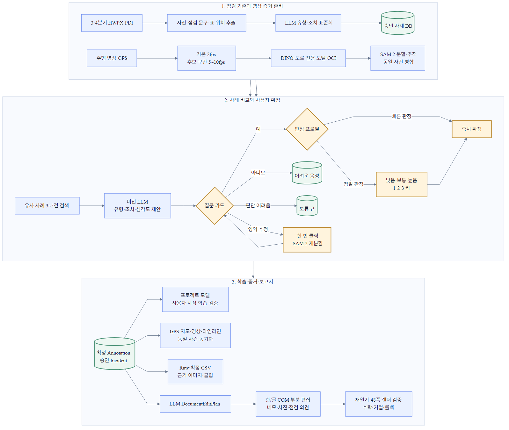
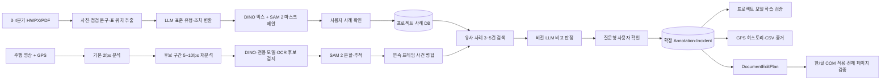
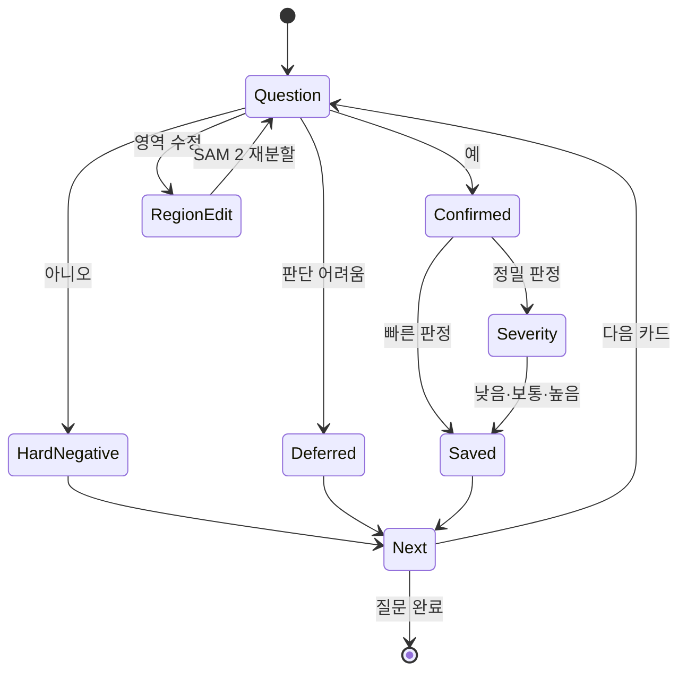
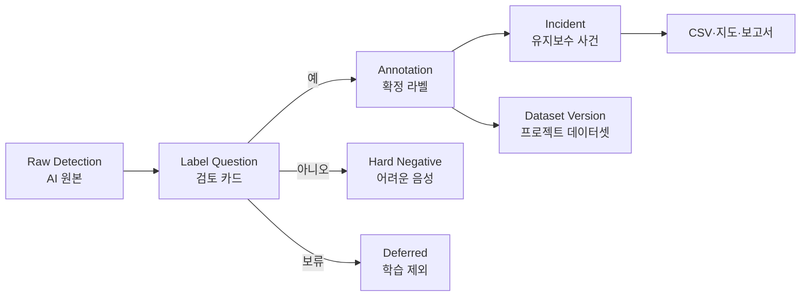

# TrafficSuperVision AI 자동 라벨링·도로점검·보고서 워크플로우

> 문서 상태: 목표 제품 워크플로우 및 구현 기준  
> 적용 범위: 3·4분기 점검자료 사례화, 주행 영상 검지, 질문형 라벨링, 프로젝트 모델, GPS 히스토리, CSV, HWP/HWPX 보고서  
> 중요 경계: 이 문서는 목표 동작을 정의한다. 각 단계가 실제 제품에서 검증되기 전에는 구현 완료나 검지 성능 확보를 의미하지 않는다.

## 1. 목적

TrafficSuperVision은 사용자가 직접 영상의 모든 프레임을 찾고 박스와 윤곽선을 그리는 프로그램이 아니다. 프로그램이 먼저 도로 문제 후보와 영역을 만들고, 사용자는 키보드나 단순 클릭으로 결과를 확인한다.

최종 목표는 다음과 같다.

1. 3·4분기 HWPX/PDF의 사진과 점검 문구를 실제 점검 사례로 변환한다.
2. 주행 영상을 촘촘하게 분석하되 동일 사건을 여러 질문으로 반복하지 않는다.
3. Grounding DINO, SAM 2, 도로 전용 모델, OCR과 비전 LLM의 역할을 분리한다.
4. 사용자는 `예`, `아니오`, `판단 어려움`, `영역 수정`과 선택적인 심각도만 입력한다.
5. 사용자 승인 후에만 정식 라벨과 유지보수 사건을 만든다.
6. 확정 사건을 GPS 지도, 영상, 타임라인, CSV와 기존 HWP/HWPX 양식에 동일하게 연결한다.

## 2. 전체 워크플로우 이미지



이미지는 전체 처리 순서를 요약한다. 아래 Mermaid 원본은 Markdown에서 구조를 직접 수정할 때 사용한다.



## 3. AI 구성요소별 역할

| 구성요소 | 담당 역할 | 담당하지 않는 역할 |
|---|---|---|
| HWPX/PDF 구조 분석기 | 사진, 문구, 표, 셀, 페이지, 노선과 기존 네모 표시 위치 추출 | 사진 속 도로 문제의 최종 판정 |
| LLM | 점검 문구 표준화, 사용자 명령 해석, 유사 사례 비교, 질문과 보고서 문장 제안 | 정확한 마스크 확정, 사용자 승인 없는 정답 생성, 한/글 직접 편집 |
| Grounding DINO | 자연어로 지시한 객체의 검토용 박스 제안 | 차선 퇴색 정도나 유지보수 심각도의 최종 판정 |
| SAM 2 | 박스·클릭을 기준으로 마스크 생성, 같은 대상을 전후 프레임에서 추적 | 대상 유형, 삭초 필요 여부, 심각도 판단 |
| 도로 전용 모델 | 포트홀, 균열, 노면 파손, 차선·색깔유도선 분할과 품질 후보 생성 | 검증되지 않은 결과의 자동 확정 |
| OCR | 이정표·터널명 원문 후보 추출 | GPS·노선과의 최종 일치 판정 |
| 규칙·관계 판정기 | 표지판과 식생 중첩률, 차선 대비, GPS 거리, 사건 병합 계산 | 현장 맥락을 무시한 단독 최종 판정 |
| 사용자 | AI 제안 승인·거절·보류, 필요한 경우 영역·유형·심각도 수정 | 모든 프레임 탐색과 윤곽선 수작업 |
| 한/글 COM 편집기 | 검증된 편집 계획을 기존 문서의 정확한 위치에 결정적으로 적용 | 보고서 내용의 자율적 생성 |

## 4. 단계 0 — 프로젝트와 판정 프로필 선택

영상 또는 보고서 자료를 처리하기 전에 프로젝트를 선택한다. 영상, 라벨, 모델, 보고서는 프로젝트 간 자동으로 섞지 않는다.

### 4.1 빠른 판정

- 심각도 입력을 받지 않는다.
- `예`, `아니오`, `판단 어려움`을 누르면 즉시 저장하고 다음 질문으로 이동한다.
- 최종 심각도는 `미평가`로 저장한다.
- 빠른 초기 데이터 정리와 문제 존재 여부 확인에 사용한다.

### 4.2 정밀 판정

- 문제를 `예`로 확인하면 같은 카드에서 `낮음`, `보통`, `높음`을 선택한다.
- 심각도 선택 즉시 저장하고 다음 질문으로 이동한다.
- 드롭다운이나 별도 목록을 열지 않는다.
- 유지보수 우선순위와 보고서 심각도까지 필요한 프로젝트에 사용한다.

### 4.3 질문 정책

- `학습 보조`: 초기 표본을 전수 질문한 뒤 불확실 후보와 품질 표본을 중심으로 질문한다.
- `전수 검토`: 모든 사건 후보를 질문한다.
- `빠른 검토`: 불확실 후보만 질문한다.
- 낙하물과 `긴급` 제안은 모든 정책에서 반드시 질문한다.

## 5. 단계 A — 3·4분기 점검자료 사례화

### 5.1 원본 등록

각 HWPX/PDF에 다음 정보를 기록한다.

- 원본 파일명
- 분기
- 파일 크기
- MIME 및 magic 검사 결과
- SHA-256
- 페이지 수
- 표·그림 수
- 등록 시각
- 사용 권한과 개인정보 확인 상태

원본은 변경하지 않는다. 추출 자료와 사용자가 확정한 라벨은 별도 파생 데이터로 저장한다.

### 5.2 문서 구조 추출

HWPX에서는 다음 구조를 추출한다.

- 문단과 표의 순서
- 표 번호, 행, 열
- 셀의 원문
- 그림의 바이너리와 연결 관계
- 사진 슬롯 크기와 배치
- 노선명과 점검 위치
- 점검 결과 평가표
- 점검 의견과 자문 문구
- 네모 표시 또는 평가 기호가 있는 셀

PDF는 HWPX가 실제로 어떻게 보이는지 확인하는 렌더 기준본으로 사용한다.

### 5.3 사진과 캡션 연결

사진을 단순히 순서대로 분리하지 않는다. 다음 관계를 보존한다.

```text
문서 → 분기 → 노선 → 페이지 → 표 → 셀 → 사진 슬롯 → 사진 → 캡션 → 점검 의견
```

같은 사진이 반복 사용됐는지 SHA-256과 지각 해시로 확인한다. 반복 사진은 원본 위치를 모두 보존하되 학습 표본에서는 중복 가중치를 제거한다.

### 5.4 점검 문구 표준화

LLM은 원문을 다음과 같은 표준 계약으로 제안한다.

```json
{
  "issue_type": "ROAD_DEBRIS",
  "maintenance_required": true,
  "suggested_action": "낙하물 제거",
  "source_quarter": "2025-Q3",
  "route_name": "구리-포천",
  "source_page": 12,
  "source_table": 3,
  "source_cell": "r4c2",
  "label_status": "weak_label"
}
```

LLM이 만든 유형과 조치는 원문을 대체하지 않는다. 원문, 표준화 결과, 모델 버전과 사용자 수정값을 모두 보존한다.

### 5.5 보고서 사진의 자동 영역 제안

1. Grounding DINO가 사진에서 낙하물, 표지판, 식생, 시설물 등 객체 박스를 제안한다.
2. SAM 2가 박스 안의 물체 윤곽을 마스크로 만든다.
3. 도로 파손·차선처럼 DINO에 부적합한 항목은 전용 모델이 후보 영역을 제안한다.
4. 사용자는 결과를 승인하거나 대상 위를 한 번 클릭해 SAM 2 재분할을 요청한다.
5. 사용자 승인 후에만 사례 DB의 확정 라벨이 된다.

### 5.6 사례 데이터 상태

- `weak_label`: 문서 문구에서 자동 변환했으나 사람이 확인하지 않음
- `approved_reference`: 사용자가 유형과 영역을 승인함
- `hard_negative`: AI 제안이 틀렸다고 사용자가 확인함
- `deferred`: 근거 부족으로 보류함
- `excluded`: 개인정보, 권리, 중복 또는 품질 문제로 사용하지 않음

## 6. 단계 B — 주행 영상과 GPS 가져오기

### 6.1 입력 검증

- 로컬 파일 또는 허용된 링크의 출처를 확인한다.
- 영상 길이, 해상도, 코덱, 프레임률과 예상 처리 용량을 표시한다.
- SHA-256과 원본 경로를 기록한다.
- 웹페이지 스크립트와 내려받은 실행 파일은 실행하지 않는다.
- 원본 영상은 읽기 전용으로 취급한다.

### 6.2 GPS 연결

GPS가 영상에 포함되지 않았다면 GPX를 연결한다.

- 영상 시작 시각과 GPX 시각의 오프셋
- 시간대
- 위치 누락 구간
- 비정상적인 점프
- 원본 GPX 해시
- 사용자가 적용한 보정값

GPS가 없거나 해당 시각이 범위를 벗어나면 위치를 추측하지 않고 `위치 없음`으로 표시한다.

## 7. 단계 C — 프레임 추출과 후보 구간 선정

### 7.1 기본 프레임 분석

기본값은 초당 2프레임이다.

- 장면 변화
- 선명도
- 흔들림
- 노출 상태
- 도로 영역
- 표지판·시설물 출현
- 노면 변화
- OCR 가능 영역

3초에 한 장만 분석하면 시속 100km 주행 시 약 83m 간격이 되므로 작은 포트홀이나 낙하물을 놓칠 수 있다.

### 7.2 정밀 재분석

후보 신호가 나타난 구간은 초당 5~10프레임으로 다시 분석한다.

- 도로 위 객체 출현
- 노면 형태 급변
- 차선 대비 또는 연속성 급감
- 표지판 출현
- 식생과 시설물 중첩
- 터널 입구
- OCR 가능한 글자
- 모델 간 판정 불일치

전체 영상을 무조건 고프레임으로 분석하지 않고 필요한 구간만 촘촘하게 처리한다.

## 8. 단계 D — 유형별 검지

### 8.1 낙하물

1. DINO 또는 낙하물 전용 모델이 객체 박스를 제안한다.
2. SAM 2가 실제 윤곽과 전후 프레임의 이동을 추적한다.
3. 차로 내부, 갓길, 중앙분리대 주변 위치를 구분한다.
4. 여러 프레임의 같은 물체를 한 사건으로 묶는다.
5. 신뢰도와 관계없이 사용자에게 반드시 질문한다.

### 8.2 포트홀·노면 파손

1. 도로 영역을 먼저 분리한다.
2. 도로 결함 전용 모델이 파임, 균열, 단차와 파손 후보를 찾는다.
3. SAM 2가 후보 영역을 다듬는다.
4. 맨홀, 보수 흔적, 그림자, 반사와 구분한다.
5. 근거가 부족하면 자동 확정하지 않고 검토 질문으로 보낸다.

### 8.3 표지판 식생 가림과 삭초 필요

1. 표지판과 식생을 각각 탐지한다.
2. 두 영역을 각각 분할한다.
3. 식생이 표지판의 실제 문자·기호 영역을 얼마나 가리는지 계산한다.
4. 단순히 근처에 나무가 있는 경우와 실제 판독을 방해하는 경우를 구분한다.
5. 3·4분기 유사 사례와 비교해 `삭초 필요`를 제안한다.

### 8.4 차선·색깔유도선 퇴색

DINO가 단독 판정하지 않는다.

1. 차선 또는 색깔유도선 영역을 전용 분할 모델로 찾는다.
2. 주변 노면과의 명도·색상 대비를 측정한다.
3. 선의 연속성과 끊김을 측정한다.
4. 역광, 그림자, 젖은 노면과 카메라 노출을 보정한다.
5. 여러 프레임에서 같은 저하가 지속되는지 확인한다.
6. 정상 사례와 퇴색 사례를 비교해 재도색 필요 후보를 만든다.

### 8.5 이정표와 터널명

1. 표지판 또는 터널 입구를 탐지한다.
2. OCR 원문과 복수 후보를 저장한다.
3. GPS, 노선, 진행 방향과 예상 시설물 목록을 비교한다.
4. OCR 원문과 검증된 명칭을 별도 필드로 보존한다.
5. 식생이 명칭을 가렸다면 식생 가림 사건도 함께 연결한다.

## 9. 단계 E — 연속 프레임의 사건 병합

동일 사건이 여러 질문으로 반복되지 않도록 다음 조건을 함께 사용한다.

- 시간 간격
- GPS 거리
- 박스·마스크 중첩률
- 화면상의 이동 방향
- 객체 외형 유사도
- 검지 유형
- 카메라 이동량
- OCR 문자열 유사도

병합된 사건은 다음 근거를 가진다.

- 첫 출현 프레임
- 가장 선명한 프레임
- 가장 가까이 촬영된 프레임
- 마지막 출현 프레임
- 2~5초 미리보기 클립
- 병합된 프레임 수
- 프레임별 모델 점수
- GPS 위치 범위
- 병합 근거

## 10. 단계 F — 유사 사례 검색과 비전 LLM 판정

### 10.1 사례 검색

현재 사건의 대표 프레임과 사례 DB의 사진을 임베딩으로 비교한다. 가장 가까운 사례 3~5개만 선택한다.

검색 조건에는 다음이 포함될 수 있다.

- 시각적 유사도
- 표준 점검 유형
- 도로 시설물 종류
- 촬영 거리와 화각
- 원래 점검 문구
- 유지보수 조치

### 10.2 비전 LLM 입력

- 현재 사건 대표 프레임 3~5장
- DINO 박스
- SAM 2 마스크
- 도로 전용 모델 결과
- OCR 원문
- GPS와 노선 요약
- 유사 보고서 사례 3~5건
- 프로젝트 점검 기준

전체 원본 영상이나 보고서 전체를 매번 전송하지 않는다.

### 10.3 구조화 판정

```json
{
  "issue_type": "ROAD_DEBRIS",
  "maintenance_required": true,
  "confidence": 0.86,
  "suggested_severity": "high",
  "reason": "주행 차로 안쪽에 차량 통행을 방해할 수 있는 물체가 확인됨",
  "needs_user_review": true
}
```

JSON 스키마가 유효하다는 사실은 판정 내용이 정확하다는 뜻이 아니다. 모든 결과는 사용자 승인 전까지 검토용 제안이다.

## 11. 단계 G — 질문형 라벨링

### 11.1 질문 카드 구성

한 화면에서 다음 정보를 확인할 수 있어야 한다.

- 대표 이미지
- AI 박스와 마스크
- 전후 프레임
- 짧은 미리보기 클립
- 동일 사건으로 묶인 프레임 수
- GPS 위치
- AI 예상 유형·신뢰도
- 유사한 3·4분기 사례
- AI 추천 심각도와 근거
- 현재 질문 번호와 남은 수
- 키보드 단축키

### 11.2 공통 키

| 키 | 동작 |
|---|---|
| `Y` | 예 |
| `N` | 아니오 |
| `U` | 판단 어려움 |
| `E` | 영역 수정 |
| `1` | 낮음 |
| `2` | 보통 |
| `3` | 높음 |

### 11.3 판정 상태 전이



### 11.4 답변 처리

- `예`: 유형과 영역을 승인한다.
- `아니오`: AI 제안을 폐기하고 어려운 음성 예제로 저장한다.
- `판단 어려움`: 학습에서 제외하고 보류 큐로 이동한다.
- `영역 수정`: 사용자가 대상을 한 번 클릭하면 SAM 2가 새 마스크를 제안한다.
- `유형 변경`: AI 원본 유형을 유지하면서 사용자 최종 유형을 별도로 저장한다.

## 12. 심각도 처리 원칙

AI·YOLO·LLM의 심각도는 `추천값`이며 사용자 확정값과 분리한다.

```text
AI 제안: 낙하물 / 높음 / 모델 점수 0.86
사용자 확정: 낙하물 / 보통
보고서·최종 CSV: 보통
감사 기록: AI 높음 → 사용자 보통
```

심각도는 물체 크기만으로 결정할 수 없다.

- 차로 내부인지 갓길인지
- 통행을 실제로 방해하는지
- 차량이 안전하게 피할 수 있는지
- 파손이 확장될 가능성이 있는지
- 시설물 기능이 상실됐는지
- 즉시 조치가 필요한지

빠른 판정에서는 심각도를 `미평가`로 저장한다. 정밀 판정에서는 사용자가 `1`, `2`, `3` 중 하나를 선택해야 확정된다.

## 13. 데이터 상태와 승인 경계



사용자 승인 전에는 다음을 생성하거나 변경하지 않는다.

- 확정 Incident
- 학습 Annotation
- 학습 데이터셋 멤버
- 활성 모델
- 보고서 확정 사건

## 14. 프로젝트 모델 학습·검증

1. 승인 라벨, 어려운 음성, 보류 라벨을 분리한다.
2. 동일 영상 구간과 반복 사진의 중복을 제거한다.
3. 같은 사건이 학습과 검증 세트에 동시에 들어가지 않도록 나눈다.
4. 고정 검증 세트를 만든다.
5. 사용자에게 유형별 분포와 GPU·시간·디스크 요구량을 보여준다.
6. 사용자가 `새 모델 학습`을 눌러야 학습을 시작한다.
7. 새 모델과 활성 모델을 동일 검증 세트에서 비교한다.
8. 유형별 재현율 하락, 오탐 증가, 중복 검지 증가를 검사한다.
9. 자동 승격하지 않고 사용자가 활성 모델을 선택한다.
10. 이전 모델을 보존해 롤백할 수 있게 한다.

보고서에서 추출한 약한 라벨은 사용자 확정 라벨과 동일한 가중치로 바로 학습에 넣지 않는다.

## 15. GPS 지도·영상·사건 히스토리

모든 화면은 하나의 재생 시각과 사건 ID를 공유한다.

- 영상 재생 시 경로 선이 진행 방향으로 채워진다.
- 현재 차량 위치가 지도에서 이동한다.
- 사건 위치에 도달하면 근거 카드가 표시된다.
- 지도 마커, 영상 박스, 타임라인과 사건 목록을 누르면 같은 사건과 시각으로 이동한다.
- GPS가 없는 사건은 지도에 임의로 배치하지 않는다.

사건 상세에는 다음을 표시한다.

- 원본 이미지
- 검지 표시 이미지
- 비식별화 이미지
- 전후 클립
- GPS 좌표와 도로 위치
- OCR 원문과 검증 명칭
- AI 원본 제안
- 사용자 최종 판정
- 권장 유지보수 조치
- 모델·데이터셋 버전

## 16. CSV·JSON·증거 내보내기

| 파일 | 내용 |
|---|---|
| `raw_detections.csv` | 사용자 확인 전 AI 원본 후보 |
| `label_questions.csv` | 질문 문구, 정책, 표시 근거 |
| `annotations.csv` | 사용자 확정 학습 라벨 |
| `reviewed_incidents.csv` | 승인된 유지보수 사건 |
| `ocr_observations.csv` | OCR 원문, 후보, 검증 명칭 |
| `route_points.csv` | 전체 GPS 경로와 영상 시각 |
| `maintenance_actions.csv` | 사건별 권장·확정 조치 |
| `report_payload.json` | 보고서 초안용 구조화 데이터 |
| `manifest.json` | 원본, 모델, 데이터셋, 내보내기 provenance |

공유용 패키지에는 비식별화 근거만 포함하고 얼굴·번호판이 있는 원본 근거는 별도로 보호한다.

## 17. HWP/HWPX 보고서 작성

### 17.1 양식 해석

3·4분기 HWPX의 표, 셀, 사진 슬롯과 네모 표시 위치를 구조 주소로 등록한다. 필드명이나 책갈피가 없더라도 다음 주소로 대상을 식별할 수 있어야 한다.

```text
문서 해시 / 섹션 / 문단 / 표 / 행 / 열 / 사진 슬롯 / 원문 지문
```

### 17.2 LLM 편집 계획

LLM은 문서를 직접 고치지 않고 다음과 같은 `DocumentEditPlan`을 생성한다.

```json
{
  "document_sha256": "원본 문서 해시",
  "operations": [
    {
      "operation": "mark_checkbox",
      "target": "route-03/table-01/r5c3",
      "incident_id": "승인 사건 ID"
    },
    {
      "operation": "insert_photo",
      "target": "route-03/photo-slot-02",
      "evidence_id": "비식별화 사진 ID"
    },
    {
      "operation": "replace_text",
      "target": "route-03/opinion-cell",
      "text": "점검 의견과 권장 조치"
    }
  ]
}
```

각 조작은 승인된 Incident와 실제 문서 대상에 연결돼야 한다. 존재하지 않는 사건, 셀 또는 사진 슬롯을 참조하면 계획 전체를 거부한다.

### 17.3 미리보기·적용·검증

1. 설치된 한/글에서 양식을 연다.
2. 선택 문서의 해시와 구조를 다시 확인한다.
3. 표, 문장, 사진, 지도와 네모 표시의 적용 위치를 미리 보여준다.
4. 사용자가 수락하면 COM 편집기가 필요한 위치만 수정한다.
5. 원본과 다른 이름으로 저장한다.
6. 저장 문서를 다시 연다.
7. 문서 구조와 삽입 항목을 다시 읽는다.
8. 48쪽 전체를 렌더링한다.
9. 표 잘림, 사진 누락, 글자 겹침, 페이지 넘침과 원본 서식 손상을 검사한다.
10. 문제가 있으면 적용 전 상태로 롤백한다.

기존 표, 글꼴, 문단, 번호, 페이지, 좌우 사진 2열 구조와 점검 양식을 임의로 재설계하지 않는다.

## 18. 예시 1 — 낙하물

1. 기본 2fps 분석에서 도로 위 객체 후보가 발견된다.
2. 해당 구간을 10fps로 다시 분석한다.
3. DINO가 객체 박스를 만들고 SAM 2가 윤곽과 이동을 추적한다.
4. 12개 프레임을 하나의 낙하물 사건으로 병합한다.
5. 3·4분기 낙하물 사례 3건을 검색한다.
6. LLM이 `낙하물, 제거 필요, 심각도 높음 제안`을 만든다.
7. 낙하물은 강제 검토 대상이므로 질문 카드에 표시한다.
8. 사용자가 `Y`와 `2`를 누른다.
9. AI 심각도 `높음`과 사용자 확정 `보통`을 모두 저장한다.
10. GPS 지도, CSV와 HWPX의 해당 노선 점검표에 같은 Incident ID로 연결한다.

## 19. 예시 2 — 색깔유도선 퇴색

1. 차선 전용 모델이 색깔유도선 영역을 분할한다.
2. 여러 프레임에서 색상 대비와 연속성을 측정한다.
3. 그림자와 노면 반사를 보정한다.
4. 단발성 노출 문제가 아니라 동일 구간에서 퇴색이 지속되는지 확인한다.
5. 3·4분기 재도색 사례와 비교한다.
6. LLM이 `색깔유도선 재도색 필요 후보`를 제안한다.
7. 사용자가 빠른 판정이면 `Y`만 누르고 심각도는 `미평가`로 저장한다.
8. 정밀 판정이면 `Y` 후 `1`, `2`, `3` 중 하나를 선택한다.
9. 승인 사건을 지도·CSV와 보고서 사진 슬롯에 연결한다.

## 20. 실패·불확실성 처리

- 모델이 없으면 `모델 사용 불가`로 표시하고 성공한 것처럼 저장하지 않는다.
- 검지 결과가 0건이면 `0건 검지`와 `분석 실패`를 구분한다.
- OCR 불일치는 원문을 버리지 않고 후보와 검증 상태를 보존한다.
- GPS가 없으면 위치를 추측하지 않는다.
- SAM 2가 마스크를 만들지 못하면 원래 박스를 유지하고 사용자에게 알린다.
- LLM JSON이 스키마를 통과하지 못하면 라벨과 문서를 수정하지 않는다.
- HWPX 대상 주소가 바뀌거나 원본 해시가 다르면 편집 계획을 다시 생성한다.
- 사용자 승인 없이 학습, 모델 승격과 보고서 확정을 시작하지 않는다.

## 21. 완료 기준

### 사례 구축

- 3·4분기 사진, 캡션, 점검 의견, 노선과 표 위치를 추적할 수 있다.
- 반복 사진과 개인정보·권리 문제가 있는 자료를 구분한다.
- 약한 라벨과 사용자 확정 라벨이 분리된다.

### 영상 분석

- 기본 2fps와 후보 구간 5~10fps 분석이 구분된다.
- 동일 사건의 연속 프레임이 여러 질문으로 반복되지 않는다.
- 대표 프레임, 전후 근거와 2~5초 클립을 생성한다.

### 라벨링

- 빠른 판정은 한 번의 답변으로 다음 카드로 이동한다.
- 정밀 판정은 답변 후 `1`, `2`, `3` 한 번으로 다음 카드로 이동한다.
- 드롭다운이나 별도 심각도 목록을 열 필요가 없다.
- 영역 수정은 한 번 클릭과 SAM 2 재분할로 처리된다.
- 낙하물과 긴급 후보는 반드시 사용자에게 표시된다.

### 데이터 안전

- 사용자 승인 전 확정 Annotation과 Incident는 0건이다.
- AI 제안과 사용자 최종값을 각각 추적할 수 있다.
- 원본 영상, 프레임, 질문, 답변, 라벨, 사건, 모델과 보고서가 ID와 해시로 연결된다.

### 보고서

- 3·4분기 양식의 표, 네모 표시, 사진 위치와 점검 의견 구조를 유지한다.
- LLM은 편집 계획만 만들고 한/글 COM 편집기가 적용한다.
- 저장 후 재열기와 전체 페이지 렌더 검증을 통과한다.
- 수락, 거절과 롤백이 가능하다.

## 22. 권장 구현 순서

1. 3·4분기 HWPX 구조 주소와 사진·캡션 추출
2. 사례 DB와 약한 라벨 사용자 확인 화면
3. 빠른 판정·정밀 판정의 단일 동작 UX
4. 실제 영상 2fps 인덱싱과 후보 구간 재분석
5. 낙하물 DINO·SAM 2 수직 슬라이스
6. 포트홀·노면 파손 전용 모델 수직 슬라이스
7. 표지판·식생 관계 판정 수직 슬라이스
8. 사건 병합과 대표 근거·클립
9. 유사 사례 검색과 비전 LLM 구조화 판정
10. 프로젝트 데이터셋·학습·검증·승격·롤백
11. GPS 지도·영상·타임라인 동기화
12. HWPX 편집 계획, 네모 표시, 사진·의견 삽입과 48쪽 검증

## 23. 용어

- `Raw Detection`: 사용자 확인 전 AI 원본 후보
- `Weak Label`: 보고서 문구 등에서 자동 변환했지만 사람이 확인하지 않은 라벨
- `Annotation`: 사용자가 확정한 학습용 유형·영역·OCR·조치 라벨
- `Incident`: 위치와 유지보수 조치를 포함한 승인 사건
- `Hard Negative`: AI가 문제라고 제안했지만 사용자가 아니라고 확정한 어려운 음성 예제
- `Deferred`: 근거 부족으로 보류하고 학습에서 제외한 항목
- `DocumentEditPlan`: LLM이 제안한 구조화된 한/글 부분 편집 목록
- `Provenance`: 원본, 모델, 라벨, 편집과 내보내기의 출처·버전·해시 기록
