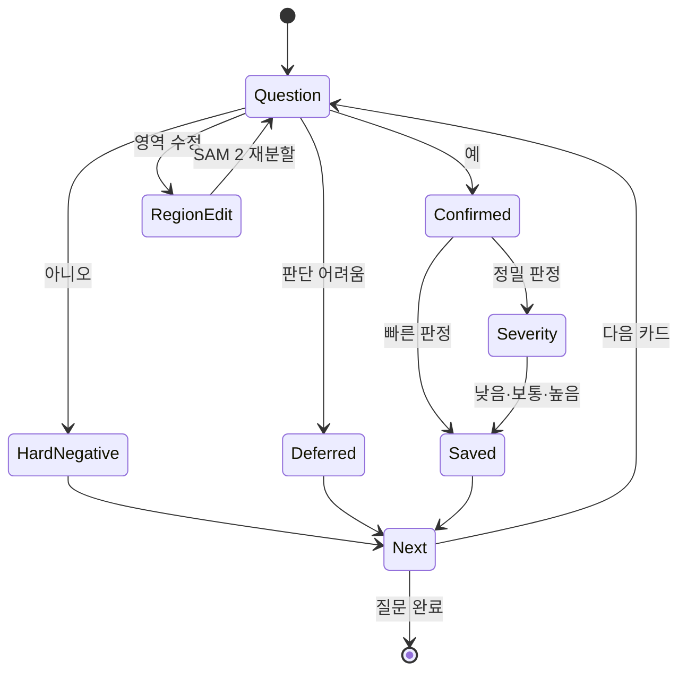
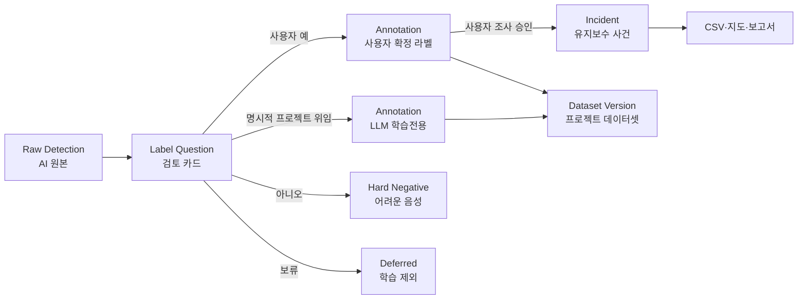

# TrafficSuperVision AI 자동 라벨링·도로점검·보고서 워크플로우

> 문서 상태: 목표 제품 워크플로우 및 구현 기준  
> 적용 범위: 3·4분기 점검자료 사례화, 주행 영상 검지, 질문형 라벨링, 프로젝트 모델, GPS 히스토리, CSV, HWP/HWPX 보고서  
> 중요 경계: 이 문서는 목표 동작을 정의한다. 각 단계가 실제 제품에서 검증되기 전에는 구현 완료나 검지 성능 확보를 의미하지 않는다.
> 현재 검증 기준일: 2026-07-31

## 1. 목적

TrafficSuperVision은 사용자가 직접 영상의 모든 프레임을 찾고 박스와 윤곽선을 그리는 프로그램이 아니다. 프로그램이 먼저 도로 문제 후보와 영역을 만들고, 사용자는 키보드나 단순 클릭으로 결과를 확인한다.

최종 목표는 다음과 같다.

1. 3·4분기 HWPX/PDF의 사진과 점검 문구를 실제 점검 사례로 변환한다.
2. 주행 영상을 촘촘하게 분석하되 동일 사건을 여러 질문으로 반복하지 않는다.
3. Grounding DINO, SAM 2, 도로 전용 모델, OCR과 비전 LLM의 역할을 분리한다.
4. 사용자는 직접 `예`, `아니오`, `판단 어려움`, `영역 수정`과 선택적인 심각도를 입력하거나, 비긴급 학습 후보에 한해 구조화 LLM 학습보조를 프로젝트 범위로 명시적으로 허용한다.
5. 사용자 승인 또는 명시적 LLM 학습 위임 후에만 학습 라벨을 만든다. 유지보수 Incident와 보고서 사실은 항상 사용자 승인 뒤에만 만든다.
6. 확정 라벨로 프로젝트 전용 모델을 학습하고 고정 검증 세트와 새 실제 영상에서 반복 QA한다.
7. 검증·승격된 모델의 도로 조사 결과를 다시 사용자 확인으로 확정한다.
8. 확정 사건을 GPS 지도, 영상, 타임라인, CSV와 기존 HWP/HWPX 양식에 동일하게 연결한다.

### 1.1 순서가 바뀌면 안 되는 제품 루프

`3·4분기 약한 사례 DB → 사용자 승인 reference → 영상 AI 후보 → 사용자 확정 또는 명시적 LLM 학습보조 Annotation → DatasetVersion → 명시적 모델 학습 → 고정 검증·사용자 승격 → 새 영상 도로 조사 → 사용자 승인 Incident → 지도·CSV·증거 → 최종 HWPX`가 제품의 주 경로다.

HWPX는 학습 원천을 제공하는 첫 입력인 동시에 승인 조사 결과를 담는 마지막 출력이지만, 중간의 라벨·모델·검증 단계를 대신하지 않는다. 비전 LLM이 자동으로 고른 항목은 먼저 `제안/약한 라벨`이다. 사용자가 프로젝트 범위의 학습 위임을 명시한 경우에만 비긴급 후보를 `structured_llm_assisted` 학습 Annotation으로 승격할 수 있으며, 이 경우에도 Incident·보고서 사건은 만들지 않는다.

이 루프에는 서로 대체할 수 없는 다섯 결과가 있다.

1. `CandidateProposal`: sample 사진과 실제 영상 프레임을 비교한 LLM·검지기의 검토 후보
2. `Annotation`: 사용자 또는 명시적으로 위임된 LLM 보조가 확정한 학습용 사건 라벨
3. `Promoted ModelVersion`: 고유 사건 라벨로 실제 CUDA 학습·고정 검증·사용자 승격을 마친 프로젝트 모델
4. `Survey ReviewEvent`: 승격 모델이 학습·검증과 다른 실제 영상에서 만든 조사 후보
5. `Approved Incident`: 새 조사 영상의 오탐·누락 QA까지 거쳐 사용자가 최종 승인한 유지보수 사실

`CandidateProposal`만 생긴 상태를 “모델 생성”이라고 부르지 않고, `Promoted ModelVersion`이 후보를 냈다는 이유만으로 “도로조사 완료”라고 부르지 않는다. 새 조사 영상의 전체 2fps 시간축에서 오탐·누락을 확인하고, 오류를 다음 DatasetVersion으로 되돌려 재학습·재승격·재조사를 반복한 뒤 승인한 Incident만 지도·CSV·증거·HWPX의 사실값으로 사용한다.

사용자 확인 전 `weak_unconfirmed` 사례도 이미 발견된 영상 후보의 비전 LLM 비교 문맥 3~5건에는 약한 상태 그대로 사용할 수 있다. 그러나 첫 프로젝트 모델이 없는 동안 실제 영상의 불변 2fps 프레임을 역으로 훑어 review-only 후보를 더 만드는 로컬 CLIP bootstrap은 사용자 승인 3·4분기 사진만 사용한다. 이는 DINO·OCR 후보와 질문 큐를 보강할 뿐 학습된 전용 검지기나 승격 모델이 아니다. 승인 reference도 현재 영상의 고유 승인 Annotation 100건 또는 유형별 독립 validation 30건으로 세지 않는다.

### 1.2 현재 검증된 경계

- 3·4분기 HWPX/PDF는 3분기 123건과 4분기 149건, 합계 272건의 사진·캡션·노선·점검 의견·구조 주소·PDF 페이지를 결속했다. 이는 약한 사례 DB 구축 증거이며 사용자 승인 `approved_reference`는 아직 `0`건이다.
- 실제 HWPX/PDF 4개의 SHA-256과 3·4분기 각각 48쪽·24 page-pair·72 table 구조를 sample-template attestation으로 고정했다. 이 양식 감사와 reference 승인은 별도이며, 약한 사례 272건은 사용자 확인 전 학습 게이트에 들어가지 않는다.
- 승인 reference의 DatasetVersion snapshot은 분기, 문서/사진 SHA·사진 크기, section/picture/table/cell ID와 행·열, 점검/사진 페이지, 사진 슬롯, semantic cell, 네모·평가 마커 대상, 원래 캡션·노선·점검 의견을 직접 동결하고 `source_address_sha256`·`approved_reference_member_sha256`으로 재검증한다. TrainingJob auxiliary seed는 이 주소 스냅샷을 그대로 보존하며 변조·stale revision·cross-project·중복 사진을 거부한다. 승인 reference도 current-video TRAIN 100건과 fixed validation 30건에는 합산하지 않는다.
- 실제 영상 v36은 162개 2fps dense frame과 27개 8fps 후보 frame을 만들고, DINO prediction 32건·SAM2 prompt 16건/mask 14건·추적 후보 12건/추적 frame 71건을 거쳐 시간축 병합 질문 7건을 생성했다. 각 후보에는 512차원 로컬 CLIP 검색으로 찾은 3·4분기 약한 사례 5건이 결속됐고 재시작 뒤에도 같은 질문 큐를 복구했다. 현재 전용 프로젝트 detector가 없어 해당 capability는 부분 실패로 기록됐으며, 수동 프레임 확인에서 오탐 가능성이 높아 확정 truth·Annotation·Incident는 `0`건을 유지한다.
- 실제 330초 영상은 659개 2fps frame·48개 8fps frame·DINO 64·SAM2 mask 11/추적 frame 68·질문 17·유사 사례 85건으로 `awaiting_review`에 도달했다. 이어 seed recall 수정 뒤 실제 13.783초 v38은 dense detector/OCR 후보 0건이어도 scene seed 1건을 8fps 8frame→DINO 1→SAM2 mask 1/추적 frame 6→ReviewEvent/질문 1→유사 사례 5건으로 보존하고 재시작 load 1/reject 0을 통과했다. 두 실행 모두 승인 전 truth는 0이며 전용 모델 성능 검증을 뜻하지 않는다.
- v38 대표 이미지(SHA-256 `02bfbe66c6056d60ba9017b973b4fb360946c885cdbc8a13e29f1c9608f4ce5d`)는 로컬 육안 QA에서 화면이 가려지고 흐려 도로 결함을 판정할 수 없는 `likely_false_positive_unusable_obscured_frame`였다. 이 관찰은 Annotation·Incident를 만들지 않으며, 실제 독립 영상의 오탐·미탐을 다음 학습 주기로 환류해야 한다는 실패 사례로 보존한다.
- visual-quality v40은 실제 `20250905_122849.mp4`의 지속 비도로/판정불가 window 3/3을 `unusable_visual_evidence`로 차단하고 DINO·SAM2·질문·truth를 모두 0으로 유지했다. 반대로 실제 2.809522초 `20250905_095953.mp4` v41은 2fps 6frame→8fps 22frame→품질 선별 3→DINO 3→SAM2 mask 3/추적 frame 6→시간축 질문 1→유사 사례 5건으로 `awaiting_review/success`에 도달했고 재시작 load 1/reject 0·멱등 재사용을 통과했다. proof SHA-256은 `821ef9ecb40bd41b004751a9d431832fe09be5dbc570b11ef80425e91d85845c`다.
- v41의 `median_barrier_damage` 제안은 대표 이미지 SHA-256 `908480880225bab3e9616b4711682aff1c4abc90e4d428b93a195aa7e366679d` 육안 QA에서 근거가 보이지 않는 잠재 false positive다. 이는 검토 질문으로는 유효하지만 결함·Annotation·Incident가 아니다. 사용자 `아니오` 또는 명시적으로 허용된 비긴급 LLM 학습 위임 뒤에만 hard negative 학습 라벨이 될 수 있다.
- 최신 v42는 실제 330.026초 `천안논산 논산방향.mp4`를 잘림 없는 2fps 659frame→24개 후보 창의 8fps 392frame→품질 평가 168/선택 67→review-only DINO 86→SAM2 mask 16/추적 frame 28→시간 병합 56질문→약한 유사 사례 280건으로 연결했다. 동일 Job 재시작 load 1/reject 0과 Job 개수 1→1 멱등 재생을 통과했으며 proof SHA-256은 `38d1738e2513c017e17f59d2de790bdcc496547833f3676f20cee1dbd7a2fbca`다. 질문 큐의 O(N²) evidence 재검증은 overlay load 1회·ReviewEvent resolver 1회·item resolver 0회의 원자 batch로 고쳤고 집중 회귀 `134 passed`를 통과했다.
- v42의 승인 reference는 0건, 전용 프로젝트 detector 결과는 0건(`local_vision_inference_failed`), 구조화 비전 LLM은 Provider 미설정으로 56건 모두 미실행이다. DINO 육안 표본에서는 정상 중앙분리대·차량 부위·노면 화살표를 파손/낙하물로 잡은 오탐 가능성이 높았고, 별도 dense OCR의 `세종`·`전주` 후보만 실제 표지판 글자와 일치했다. 따라서 56건은 낮은 정밀도의 review-only 질문 큐이며 모델·Incident·도로조사 완료가 아니다. 사용자 답변·Annotation·Incident·학습·보고서 truth는 모두 0건이다.
- 추가 TRAIN 후보 v43은 실제 `천안논산 천안방향 논산시점.mp4` 450.723초 전체를 2fps 901frame→8fps 771frame→품질 근거 120→DINO 220→SAM2 prompt 233/mask 206·15 batch→143개 시간 병합 질문으로 연결했다. 143사건 유사 사례 저장이 기존 2MiB Job record를 넘겨 worker가 죽고 `running`으로 고착되는 P0를 실제로 발견했다. 완료 upstream을 보존한 채 로컬 CLIP을 계산 식별자에 포함된 고정폭 8 CUDA batch와 `[128, 15]` 전 사건 처리로 바꾸고, 카드당 사례 3건의 필수 주소·문구·점수만 저장해 중복 목록을 제거했다. 레코드는 유한 8MiB와 64KiB 실패 reserve를 사용하며 초과 실패도 worker 생존·재시작이 가능한 hash-bound 상태로 남긴다.
- 같은 v43 Job은 `similar_case_search` 2번째 시도부터 복구해 143/143 후보와 약한 사례 429건, 사람 질문 143건으로 `awaiting_review/success`에 도달했다. proof SHA-256은 `d0b39bdf322321f2c658a691e8f6b2bcd5eb2059f67bc71359d3411f8065d98b`, visual index manifest SHA-256은 `1c908b01fcb4936b54c2c693ebfd8f01d69cde9fde4d3088d6f9d9bc96a3cd8a`이며 restart load 1/reject 0이다. Provider는 설정하지 않아 호출 0, 구조화 제안 0/not-run 143이고 승인 reference·Annotation·Incident·학습·보고서 truth는 모두 0이다. v42+v43의 199개 질문은 CandidateProposal 풀일 뿐 100건 TRAIN gate를 충족한 Annotation이 아니다.
- v21b는 후보 6/6의 Provider 시각 근거와 최소 320×256 문맥 revision을 준비하고 재시작 복구를 확인했다. 사용자 privacy 승인 전 상태이며 해당 재개본 Provider 호출 `0`, Annotation·Incident `0`이다.
- 보고서 전용 비식별화 registry·API·IPC·검토 UI와 `local_user` 승인 계약, 프로젝트 저장소 registry·stable folder snapshot, capacity plan v2와 path-free 작업 root를 검증했다. 현재 NAS 51개 output 계획은 예상 artifact `144,792,092,672 bytes`와 누적 stage-delta 안전 여유 `71,770,308,608 bytes`, 합계 `216,562,401,280 bytes`(`201.689453 GiB`)를 요구하며 NAS 가용량 `2,008,195,579,904 bytes`는 이를 충족한다. 직렬 dense staging 최대치는 `17,716,740,096 bytes`이고 앱 관리 E: staging 가용량 `35,516,665,856 bytes`도 충분하다. 전체 batch는 용량 부족이 아니라 실제 운영 분석 실행·결과 위치 등록·권리 확인을 아직 하지 않아 미실행이다.
- 승인 답변은 대표 이미지 SHA-256·최종 box·선택적 SAM2 polygon/mask/track과 권한을 경로 없이 hash-chain에 저장한다. `structured_llm_assisted`는 프로젝트 위임 또는 질문별 사용자 승인과 ReviewEventSet·Provider·모델·입력·프롬프트·요청·실행·첨부·제안 해시가 모두 결속된 경우에만 새 DatasetVersion의 학습 멤버가 된다. 프로젝트 위임은 선택한 Codex/Claude와 명시적 전송 동의가 일치하고 검토된 비식별 시각 근거 4~6장이 있을 때만 유효하며, Provider 불일치·메타데이터 전용 제안·낙하물·긴급 후보는 사람 질문으로 되돌린다. provenance가 없는 과거 structured 레코드는 감사용으로만 읽는다.
- 초기 학습영상의 사용자 `yes/edit`도 곧바로 Incident가 되지 않는다. `materialize_analysis_job_ids`는 positive/negative/held Annotation만 만들고 Incident 권한은 기본 빈 집합이다. 승격 모델이 학습·고정 검증과 다른 실제 영상에서 실행됐고 불변 전체 2fps discovery, 모델·DatasetVersion·artifact·고정 검증·source lineage, ReviewEventSet·question catalog와 최종 누락 QA가 모두 재검증된 조사만 별도 authority SHA로 Incident를 투영한다. 이 경계와 위조 차단을 포함한 모델 폐쇄루프 통합 회귀 `185 passed`를 확인했다.
- 반복 QA의 새 DatasetVersion은 승격 모델의 immutable fixed-validation AnalysisJob을 그대로 상속한다. 새 survey FP/FN은 train으로만 배정하고, fixed set 변경·누락이나 TRAIN과 질문/source/candidate/image/mask/proposal 계보가 겹치면 trainer 호출 전에 거부한다. 새 문제 유형은 부모 고정 검증 버전·membership/validation hash·추가 validation 작업을 결속한 별도 사용자 승인과 유형별 사용자 확정 양성 30건이 있어야 immutable 자식 버전으로 확장되며, 기존 유형과 truth를 제거하거나 재해석할 수 없다. 승격은 유형별 재현율 0.80·정밀도 0.50 절대 하한과 기존 대비 재현율·오탐·중복 회귀 차단을 모두 적용한다.
- Annotation→DatasetVersion→비동기 CUDA TrainingJob→ModelVersion은 프로젝트·PipelineJob·AnalysisJob·ReviewEventSet/Event·질문·source/candidate/image/mask/proposal·답변/위임 권한을 canonical graph와 root SHA-256으로 결속한다. lineage 없는 과거 라벨은 학습 불가 감사 기록으로만 유지하고, cross-project·cross-job·stale revision·TRAIN↔fixed-validation overlap은 trainer 전에 차단한다. 승격 모델은 새 PipelineJob 시작 시점의 ModelVersion·DatasetVersion·artifact·fixed validation·dataset provenance graph를 정확히 고정해 실행 도중 다른 모델로 바뀌지 않는다.
- 오프라인 로컬 D-FINE small/RT-DETR-v2 객체검지 학습 adapter를 production lifecycle에 연결하고, 공식 `ustc-community/dfine-small-coco` revision `f79e65b5fbb33ceb9d3ebba042955d7410c608f8`을 Apache-2.0·SHA-256 inventory로 고정한 로컬 Model Pack을 설치했다. RTX A2000 12GB/CUDA 12.8에서 trainer `ready`와 COCO backbone→12개 표준 조사 유형 head 재초기화 오프라인 로드를 확인했다. 다만 실제 100개 학습 geometry와 유형별 30개 고정 검증 geometry가 아직 0이므로 CUDA 학습 자체는 실행하지 않았다. CLIP centroid head는 계속 보조 분류기일 뿐 객체검지 모델을 대신하지 않는다.
- 작은 frozen bridge와 대형 ML 의존성을 분리하는 외부 runtime-pack loader·오프라인 원자 설치기·child worker 재검증과 hash-pinned D-FINE subprocess 경계를 구현했다. 현재 개발 환경의 CPython 3.9.13/Torch 2.7.0+cu128/CUDA 12.8 기능 호환은 확인했지만, 원본 cp39 wheelhouse·wheel SHA-256·검토된 SPDX/NOTICE·OpenCV headless 결정·상업 이용/재배포 승인이 없으므로 ambient `site-packages`를 생산용 full runtime pack으로 조립하지 않았다.
- 실제 사용자 승인 sample reference와 현재 영상 라벨, DatasetVersion, CUDA 학습 후보, 고정 검증 비교, 승격 모델, 별도 실제 영상 조사, 승인 Incident, HWP COM 적용·재열기·48쪽 전체 렌더는 실행하지 않았다.
- exact report application은 draft와 48쪽 render validator의 binding hash가 다르면 HWPX·PDF·PNG를 전부 롤백한다. 실제 승인 Incident가 없으므로 이 계약 테스트는 실제 한/글 COM 종단 증거가 아니다.

## 2. 전체 워크플로우 이미지


이미지는 전체 처리 순서를 요약한다. 아래 Mermaid 원본은 Markdown에서 구조를 직접 수정할 때 사용한다.

```mermaid
flowchart LR
    A["3·4분기 HWPX/PDF"] --> B["사진·점검 문구·표 위치 추출"]
    B --> C["LLM 표준 유형·조치 변환"]
    C --> D["DINO 박스 + SAM 2 마스크 제안"]
    D --> E["사용자 사례 확인"]
    E --> F[("프로젝트 사례 DB")]

    G["주행 영상 + GPS"] --> H["기본 2fps 분석"]
    H --> I["후보 구간 5~10fps 재분석"]
    I --> J["DINO·전용 모델·OCR 후보 검지"]
    J --> K["SAM 2 분할·추적"]
    K --> L["연속 프레임 사건 병합"]

    F --> M["유사 사례 3~5건 검색"]
    L --> M
    M --> N["비전 LLM 비교 판정"]
    N --> O{"라벨 확정 권한"}
    O -->|사용자 직접 검토| P[("사용자 확정 Annotation")]
    O -->|명시적 LLM 학습보조| PA[("LLM 학습전용 Annotation")]
    PA --> Q
    P --> Q["DatasetVersion"]
    Q --> U["사용자 시작 CUDA 학습"]
    U --> UV["고정 validation 비교"]
    UV --> V["사용자 승격·거절·롤백"]
    V --> W["학습·검증과 다른 실제 영상 조사"]
    W --> WX{"조사 질문·전체 2fps 누락 QA"}
    WX -->|"사용자 승인 사건"| PI[("사용자 승인 Incident")]
    WX -->|"오탐 hard negative·누락 false negative"| Q
    PI --> R["GPS 히스토리·CSV·증거"]
    PI --> S["최종 조사 결과 DocumentEditPlan"]
    S --> T["한/글 COM 적용·전체 페이지 검증"]
```



## 3. AI 구성요소별 역할

| 구성요소 | 담당 역할 | 담당하지 않는 역할 |
|---|---|---|
| HWPX/PDF 구조 분석기 | 사진, 문구, 표, 셀, 페이지, 노선과 기존 네모 표시 위치 추출 | 사진 속 도로 문제의 최종 판정 |
| LLM | 점검 문구 표준화, 사용자 명령 해석, 유사 사례 비교, 질문·학습전용 라벨·보고서 문장 제안 | 정확한 마스크 확정, 낙하물·긴급·Incident·보고서 사실 자동 확정, 한/글 직접 편집 |
| Grounding DINO | 자연어로 지시한 객체의 검토용 박스 제안 | 차선 퇴색 정도나 유지보수 심각도의 최종 판정 |
| SAM 2 | 박스·클릭을 기준으로 마스크 생성, 같은 대상을 전후 프레임에서 추적 | 대상 유형, 삭초 필요 여부, 심각도 판단 |
| 도로 전용 모델 | 포트홀, 균열, 노면 파손, 차선·색깔유도선 분할과 품질 후보 생성 | 검증되지 않은 결과의 자동 확정 |
| OCR | 이정표·터널명 원문 후보 추출 | GPS·노선과의 최종 일치 판정 |
| 규칙·관계 판정기 | 표지판과 식생 중첩률, 차선 대비, GPS 거리, 사건 병합 계산 | 현장 맥락을 무시한 단독 최종 판정 |
| 사용자 | AI 제안 승인·거절·보류, 필요한 경우 영역·유형·심각도 수정 | 모든 프레임 탐색과 윤곽선 수작업 |
| 한/글 COM 편집기 | 검증된 편집 계획을 기존 문서의 정확한 위치에 결정적으로 적용 | 보고서 내용의 자율적 생성 |

## 4. 단계 0 — 프로젝트와 판정 프로필 선택

영상 또는 보고서 자료를 처리하기 전에 프로젝트를 선택한다. 영상, 라벨, 모델, 보고서는 프로젝트 간 자동으로 섞지 않는다.

### 4.0 라벨 확정 권한

- `사용자 직접 검토`: 모든 질문을 빠른·정밀 카드에서 사용자가 확정한다.
- `구조화 LLM 학습보조`: 사용자가 프로젝트 범위에서 명시적으로 위임한 뒤, 실제 후보 이미지와 3·4분기 유사 사례 3~5건을 본 구조화 LLM이 비긴급 후보의 학습 라벨만 확정한다.
- LLM 학습보조 라벨은 `structured_llm_assisted` 출처로 사용자 라벨과 분리하고, 모델·프롬프트·입력 이미지/사례 해시와 원래 제안을 보존한다.
- 모든 질문이 비긴급 LLM 학습보조 대상으로 완전히 위임됐고 후보 순서·위임 revision·답변 원장·질문 큐·AnalysisJob 증거가 일치하면 PipelineJob은 서버 검증을 거쳐 빈 `검토 완료` 동작 없이 DatasetVersion·파생 산출물로 진행한다. 일부만 위임됐거나 낙하물·긴급·사람 질문이 남으면 반드시 질문 화면에서 멈춘다.
- 낙하물·긴급 후보, 심각도 최종값, 운영 조사 Incident와 HWPX 사실값은 위임 대상이 아니며 반드시 사용자 확인을 거친다.
- 사용자가 위임을 철회하거나 라벨을 수정하면 새 revision을 만들고 기존 LLM 라벨은 superseded로 보존한다.

### 4.1 빠른 판정

- 심각도 입력을 받지 않는다.
- `예`, `아니오`, `판단 어려움`을 누르면 즉시 저장하고 다음 질문으로 이동한다.
- 최종 심각도는 `미평가`로 저장한다.
- 빠른 초기 데이터 정리와 문제 존재 여부 확인에 사용한다.

### 4.2 정밀 판정

- 문제를 `예`로 확인하면 같은 카드에서 `낮음`, `보통`, `높음`을 선택한다.
- 심각도 선택 즉시 저장하고 다음 질문으로 이동한다.
- 드롭다운이나 별도 목록을 열지 않는다.
- 유지보수 우선순위와 보고서 심각도까지 필요한 프로젝트에 사용한다.

### 4.3 질문 정책

- `학습 보조`: 초기 표본을 전수 질문한 뒤 불확실 후보와 품질 표본을 중심으로 질문한다.
- `전수 검토`: 모든 사건 후보를 질문한다.
- `빠른 검토`: 불확실 후보만 질문한다.
- 낙하물과 `긴급` 제안은 모든 정책에서 반드시 질문한다.

## 5. 단계 A — 3·4분기 점검자료 사례화

### 5.1 원본 등록

각 HWPX/PDF에 다음 정보를 기록한다.

- 원본 파일명
- 분기
- 파일 크기
- MIME 및 magic 검사 결과
- SHA-256
- 페이지 수
- 표·그림 수
- 등록 시각
- 사용 권한과 개인정보 확인 상태

원본은 변경하지 않는다. 추출 자료와 사용자가 확정한 라벨은 별도 파생 데이터로 저장한다.

### 5.2 문서 구조 추출

HWPX에서는 다음 구조를 추출한다.

- 문단과 표의 순서
- 표 번호, 행, 열
- 셀의 원문
- 그림의 바이너리와 연결 관계
- 사진 슬롯 크기와 배치
- 노선명과 점검 위치
- 점검 결과 평가표
- 점검 의견과 자문 문구
- 네모 표시 또는 평가 기호가 있는 셀

PDF는 HWPX가 실제로 어떻게 보이는지 확인하는 렌더 기준본으로만 사용하며 PDF 사진을 별도 학습 사례로 중복 등록하지 않는다. 현재 실제 자료 감사 결과는 3분기 HWPX 123건, 4분기 HWPX 149건으로 총 272개 사진 사례이고, 두 동반 PDF는 각각 48쪽이다. 모든 사례가 HWPX 사진 주소와 대응 PDF 페이지에 결속됐으며 PDF 추가 사례 수는 0건이다. PDF 누락·해시 변경·파손·48쪽 불일치는 해당 분기 시각 인덱스를 차단한다.

### 5.3 사진과 캡션 연결

사진을 단순히 순서대로 분리하지 않는다. 다음 관계를 보존한다.

```text
문서 → 분기 → 노선 → 페이지 → 표 → 셀 → 사진 슬롯 → 사진 → 캡션 → 점검 의견
```

같은 사진이 반복 사용됐는지 SHA-256과 지각 해시로 확인한다. 반복 사진은 원본 위치를 모두 보존하되 학습 표본에서는 중복 가중치를 제거한다.

### 5.4 점검 문구 표준화

LLM은 원문을 다음과 같은 표준 계약으로 제안한다.

```json
{
  "issue_type": "ROAD_DEBRIS",
  "maintenance_required": true,
  "suggested_action": "낙하물 제거",
  "source_quarter": "2025-Q3",
  "route_name": "구리-포천",
  "source_page": 12,
  "source_table": 3,
  "source_cell": "r4c2",
  "label_status": "weak_label"
}
```

LLM이 만든 유형과 조치는 원문을 대체하지 않는다. 원문, 표준화 결과, 모델 버전과 사용자 수정값을 모두 보존한다.

### 5.5 보고서 사진의 자동 영역 제안

1. Grounding DINO가 사진에서 낙하물, 표지판, 식생, 시설물 등 객체 박스를 제안한다.
2. SAM 2가 박스 안의 물체 윤곽을 마스크로 만든다.
3. 도로 파손·차선처럼 DINO에 부적합한 항목은 전용 모델이 후보 영역을 제안한다.
4. 사용자는 결과를 승인하거나 대상 위를 한 번 클릭해 SAM 2 재분할을 요청한다.
5. 사용자 승인 후에만 사례 DB의 확정 라벨이 된다.

### 5.6 사례 데이터 상태

- `weak_label`: 문서 문구에서 자동 변환했으나 사람이 확인하지 않음
- `approved_reference`: 사용자가 유형과 영역을 승인함
- `hard_negative`: AI 제안이 틀렸다고 사용자가 확인함
- `deferred`: 근거 부족으로 보류함
- `excluded`: 개인정보, 권리, 중복 또는 품질 문제로 사용하지 않음

## 6. 단계 B — 주행 영상과 GPS 가져오기

### 6.1 입력 검증

- 로컬 파일 또는 허용된 링크의 출처를 확인한다.
- 영상 길이, 해상도, 코덱, 프레임률과 예상 처리 용량을 표시한다.
- SHA-256과 원본 경로를 기록한다.
- 웹페이지 스크립트와 내려받은 실행 파일은 실행하지 않는다.
- 원본 영상은 읽기 전용으로 취급한다.

### 6.2 GPS 연결

GPS가 영상에 포함되지 않았다면 GPX를 연결한다.

- 영상 시작 시각과 GPX 시각의 오프셋
- 시간대
- 위치 누락 구간
- 비정상적인 점프
- 원본 GPX 해시
- 사용자가 적용한 보정값

GPS가 없거나 해당 시각이 범위를 벗어나면 위치를 추측하지 않고 `위치 없음`으로 표시한다.

### 6.3 프로젝트 결과 저장소

- 프로젝트 설정의 결과 위치는 서버가 등록하고 해시 검증한 `output_location_id`로만 선택한다. renderer와 공개 API에는 실제 저장 경로를 반환하지 않는다.
- 파일 또는 폴더를 승인할 때 작업 시작 시점의 저장소 binding을 고정한다. 같은 PipelineJob의 후보·마스크·클립·Provider 근거·보고서 파생본은 이 binding 아래의 작업별 category root를 사용한다.
- 분석 근거의 owner는 해당 PipelineJob이고, 프로젝트 모델 artifact의 owner는 명시적 학습 시작 때 새로 만든 training job이다. 모델은 학습 원천 PipelineJob의 과거 저장 위치를 상속하지 않는다.
- 폴더 입력은 stable snapshot의 모든 지원 최상위 MP4/MOV를 결정적 순서로 검증하고 파일당 하나의 PipelineJob을 만든다. `trafficvisson.pipeline-capacity-plan.v2`는 단계별 category/frame/fixed-byte 예상과 hard ceiling, 기본 4GiB 및 단계별 상향 revision의 누적 양수 delta, 같은 물리 볼륨의 batch/job 예약을 영속 계획으로 관리한다. stage가 실제 발견량으로 상향되면 쓰기 전에 불변 same-volume revision을 저장하고 남은 공유 headroom을 그 delta만큼 차감한다. hard ceiling 또는 가용량을 넘으면 `blocked_storage`/`storage_blocked`로 차단한다. 프로젝트 모델 학습과 HWP COM·48쪽 렌더는 별도 capacity preflight를 통과해야 한다.
- 중앙 원장에는 path-free locator와 root identity·manifest 해시만 저장한다. 재시작 후 다시 resolve하고 root swap·cross-project·변조·symlink/reparse를 거부한다.

## 7. 단계 C — 프레임 추출과 후보 구간 선정

### 7.1 기본 프레임 분석

기본값은 초당 2프레임이다.

- 장면 변화
- 선명도
- 흔들림
- 노출 상태
- 도로 영역
- 표지판·시설물 출현
- 노면 변화
- OCR 가능 영역

3초에 한 장만 분석하면 시속 100km 주행 시 약 83m 간격이 되므로 작은 포트홀이나 낙하물을 놓칠 수 있다.

### 7.2 정밀 재분석

후보 신호가 나타난 구간은 초당 5~10프레임으로 다시 분석한다.

- 도로 위 객체 출현
- 노면 형태 급변
- 차선 대비 또는 연속성 급감
- 표지판 출현
- 식생과 시설물 중첩
- 터널 입구
- OCR 가능한 글자
- 모델 간 판정 불일치

전체 영상을 무조건 고프레임으로 분석하지 않고 필요한 구간만 촘촘하게 처리한다.

### 7.3 dense 후보의 영속 증거 계약

2fps 모델이 만든 후보 ID를 기존 희소 `AnalysisJob` 후보인 것처럼 위장하지 않는다. 다음 두 계층을 별도 불변 manifest로 저장한다.

1. `CandidateEvidenceSet`: 2fps detector·OCR·승격 프로젝트 모델·승인 사례 검색의 프레임별 원시 제안, 모델/데이터셋/manifest 해시와 5~10fps 재분석 근거를 보존한다.
2. `ReviewEventSet`: SAM2·시간축 병합 뒤 실제 질문 하나가 되는 사건 후보의 대표 JPEG, 2~5초 MP4, 첫/대표/마지막 시각, 원본 evidence ID, OCR·박스·마스크·유사 사례·LLM revision을 보존한다.

질문·답변·Incident·CSV·HWPX는 최종 `ReviewEventSet`의 content-derived candidate ID와 manifest SHA-256을 사용한다. 기존 `AnalysisJob` 원본 레코드는 수정하지 않고 composite resolver가 기존 후보와 새 evidence namespace를 모두 재해시해 연다. 승격 프로젝트 모델이 2fps에서 후보를 찾았더라도 `ReviewEventSet → 질문 → 사용자 승인`을 통과하기 전 확정 Annotation·Incident·학습 membership·보고서 사건은 모두 0건이다.

## 8. 단계 D — 유형별 검지

### 8.1 낙하물

1. DINO 또는 낙하물 전용 모델이 객체 박스를 제안한다.
2. SAM 2가 실제 윤곽과 전후 프레임의 이동을 추적한다.
3. 차로 내부, 갓길, 중앙분리대 주변 위치를 구분한다.
4. 여러 프레임의 같은 물체를 한 사건으로 묶는다.
5. 신뢰도와 관계없이 사용자에게 반드시 질문한다.

### 8.2 포트홀·노면 파손

1. 도로 영역을 먼저 분리한다.
2. 도로 결함 전용 모델이 파임, 균열, 단차와 파손 후보를 찾는다.
3. SAM 2가 후보 영역을 다듬는다.
4. 맨홀, 보수 흔적, 그림자, 반사와 구분한다.
5. 근거가 부족하면 자동 확정하지 않고 검토 질문으로 보낸다.

### 8.3 표지판 식생 가림과 삭초 필요

1. 표지판과 식생을 각각 탐지한다.
2. 두 영역을 각각 분할한다.
3. 식생이 표지판의 실제 문자·기호 영역을 얼마나 가리는지 계산한다.
4. 단순히 근처에 나무가 있는 경우와 실제 판독을 방해하는 경우를 구분한다.
5. 3·4분기 유사 사례와 비교해 `삭초 필요`를 제안한다.

### 8.4 차선·색깔유도선 퇴색

DINO가 단독 판정하지 않는다.

1. 차선 또는 색깔유도선 영역을 전용 분할 모델로 찾는다.
2. 주변 노면과의 명도·색상 대비를 측정한다.
3. 선의 연속성과 끊김을 측정한다.
4. 역광, 그림자, 젖은 노면과 카메라 노출을 보정한다.
5. 여러 프레임에서 같은 저하가 지속되는지 확인한다.
6. 정상 사례와 퇴색 사례를 비교해 재도색 필요 후보를 만든다.

### 8.5 이정표와 터널명

1. 표지판 또는 터널 입구를 탐지한다.
2. OCR 원문과 복수 후보를 저장한다.
3. GPS, 노선, 진행 방향과 예상 시설물 목록을 비교한다.
4. OCR 원문과 검증된 명칭을 별도 필드로 보존한다.
5. 식생이 명칭을 가렸다면 식생 가림 사건도 함께 연결한다.

## 9. 단계 E — 연속 프레임의 사건 병합

동일 사건이 여러 질문으로 반복되지 않도록 다음 조건을 함께 사용한다.

- 시간 간격
- GPS 거리
- 박스·마스크 중첩률
- 화면상의 이동 방향
- 객체 외형 유사도
- 검지 유형
- 카메라 이동량
- OCR 문자열 유사도

병합된 사건은 다음 근거를 가진다.

- 첫 출현 프레임
- 가장 선명한 프레임
- 가장 가까이 촬영된 프레임
- 마지막 출현 프레임
- 2~5초 미리보기 클립
- 병합된 프레임 수
- 프레임별 모델 점수
- GPS 위치 범위
- 병합 근거

## 10. 단계 F — 유사 사례 검색과 비전 LLM 판정

### 10.1 사례 검색

현재 사건의 대표 프레임과 사례 DB의 사진을 임베딩으로 비교한다. 가장 가까운 사례 3~5개만 선택한다.

검색 조건에는 다음이 포함될 수 있다.

- 시각적 유사도
- 표준 점검 유형
- 도로 시설물 종류
- 촬영 거리와 화각
- 원래 점검 문구
- 유지보수 조치

### 10.2 비전 LLM 입력

- 현재 사건의 실제 전 프레임·대표 프레임·후 프레임
- DINO 박스
- 대표 프레임 위의 실제 SAM 2 polygon 마스크
- 도로 전용 모델 결과
- OCR 원문
- GPS와 노선 요약
- 유사 보고서 사례 3~5건
- 프로젝트 점검 기준

현재 영상 근거는 `전 프레임 | 대표 프레임+DINO 박스 / SAM 2 마스크 | 후 프레임`의 결정적 2×2 몽타주 한 장으로 만든다. 시간 병합 질문 ID와 SAM 2 제안 ID가 다른 DINO 후보는 temporal peak·parent/evidence ID·원본 이미지 해시·proposal 해시가 일치하는 alias manifest로 먼저 결속한다. 모든 픽셀은 서버가 원본 artifact를 다시 해시해 조립하며, 얼굴·번호판 로컬 비식별화와 사용자의 privacy 승인을 거친 뒤에만 Codex 첨부로 사용할 수 있다. 전후 프레임, alias, 마스크 provenance 또는 artifact 해시가 하나라도 불완전하면 대표 이미지 한 장으로 낮춰 보내지 않고 해당 LLM 비교를 `not_run`으로 남긴다. Claude는 공식 이미지 첨부 계약이 없으므로 메타데이터 전용 비교로만 표시한다. 전체 원본 영상이나 보고서 전체를 매번 전송하지 않는다.

### 10.3 구조화 판정

```json
{
  "issue_type": "ROAD_DEBRIS",
  "maintenance_required": true,
  "confidence": 0.86,
  "suggested_severity": "high",
  "reason": "주행 차로 안쪽에 차량 통행을 방해할 수 있는 물체가 확인됨",
  "needs_user_review": true
}
```

JSON 스키마가 유효하다는 사실은 판정 내용이 정확하다는 뜻이 아니다. 사용자 확인 또는 명시적인 프로젝트 범위 학습 위임 전까지 모든 결과는 검토용 제안이다. 위임 뒤에도 `structured_llm_assisted` 결과는 비긴급 학습 전용 Annotation일 뿐이며, 최종 Incident·심각도·보고서 사실은 항상 사용자 승인 전까지 제안으로 남는다.

## 11. 단계 G — 질문형 라벨링

### 11.1 질문 카드 구성

한 화면에서 다음 정보를 확인할 수 있어야 한다.

- 대표 이미지
- AI 박스와 마스크
- 전후 프레임
- 짧은 미리보기 클립
- 동일 사건으로 묶인 프레임 수
- GPS 위치
- AI 예상 유형·신뢰도
- 유사한 3·4분기 사례
- AI 추천 심각도와 근거
- 현재 질문 번호와 남은 수
- 키보드 단축키

### 11.2 공통 키

| 키 | 동작 |
|---|---|
| `Y` | 예 |
| `N` | 아니오 |
| `U` | 판단 어려움 |
| `E` | 영역 수정 |
| `1` | 낮음 |
| `2` | 보통 |
| `3` | 높음 |

### 11.3 판정 상태 전이



### 11.4 답변 처리

- `예`: 유형과 영역을 승인한다.
- `아니오`: AI 제안을 폐기하고 어려운 음성 예제로 저장한다.
- `판단 어려움`: 학습에서 제외하고 보류 큐로 이동한다.
- `영역 수정`: 사용자가 대상을 한 번 클릭하면 SAM 2가 새 마스크를 제안한다.
- `유형 변경`: AI 원본 유형을 유지하면서 사용자 최종 유형을 별도로 저장한다.

## 12. 심각도 처리 원칙

AI·YOLO·LLM의 심각도는 `추천값`이며 사용자 확정값과 분리한다.

```text
AI 제안: 낙하물 / 높음 / 모델 점수 0.86
사용자 확정: 낙하물 / 보통
보고서·최종 CSV: 보통
감사 기록: AI 높음 → 사용자 보통
```

심각도는 물체 크기만으로 결정할 수 없다.

- 차로 내부인지 갓길인지
- 통행을 실제로 방해하는지
- 차량이 안전하게 피할 수 있는지
- 파손이 확장될 가능성이 있는지
- 시설물 기능이 상실됐는지
- 즉시 조치가 필요한지

빠른 판정에서는 심각도를 `미평가`로 저장한다. 정밀 판정에서는 사용자가 `1`, `2`, `3` 중 하나를 선택해야 확정된다.

## 13. 데이터 상태와 승인 경계



사용자 승인 또는 프로젝트 범위의 명시적 LLM 학습 위임 전에는 다음을 생성하거나 변경하지 않는다.

- 확정 Incident
- 학습 Annotation
- 학습 데이터셋 멤버
- 활성 모델
- 보고서 확정 사건

명시적 LLM 학습 위임 뒤에도 `structured_llm_assisted` Annotation과 그 학습 멤버만 만들 수 있다. 낙하물·긴급·최종 심각도, Incident, 지도·최종 CSV·보고서 사실, 모델 학습 시작과 승격은 자동 확정하지 않는다.

모든 비긴급 질문이 위임 증거를 가진 경우의 자동 검토 완료는 이미 저장된 학습 전용 답변 원장의 서버 검증과 다음 PipelineJob stage 진행만 뜻한다. 후보가 비었다고 간주하거나 사람 답변을 꾸며내지 않으며, 하나라도 누락·불일치하면 `structured_llm_auto_review_verification_failed`로 차단한다.

## 14. 프로젝트 모델 학습·검증

1. 승인 라벨, 어려운 음성, 보류 라벨을 분리한다.
2. 동일 영상 구간과 반복 사진의 중복을 제거한다.
3. 같은 사건이 학습과 검증 세트에 동시에 들어가지 않도록 나눈다.
4. 고정 검증 세트를 만든다.
5. 사용자에게 유형별 분포와 GPU·시간·디스크 요구량을 보여준다.
6. 사용자가 `새 모델 학습`을 눌러야 학습을 시작한다.
7. 새 모델과 활성 모델을 동일 검증 세트에서 비교한다.
8. 유형별 재현율 하락, 오탐 증가, 중복 검지 증가를 검사한다.
9. 자동 승격하지 않고 사용자가 활성 모델을 선택한다.
10. 이전 모델을 보존해 롤백할 수 있게 한다.

보고서에서 추출한 약한 라벨은 사용자 확정 라벨과 동일한 가중치로 바로 학습에 넣지 않는다.

현재 구현 계약은 **현재 영상의 train split에서 학습 권한이 확정된 Annotation 100건 이상**과 대상 유형별 고정 검증 표본 30건 이상에서만 학습 시작을 허용한다. validation split의 Annotation은 30건 검증 게이트에는 쓰지만 100건 train 게이트에는 중복 합산하지 않는다. 이 100건에는 사용자 확정 라벨과 권한·Provider 실행 provenance가 완전한 `structured_llm_assisted` 학습 전용 라벨만 포함한다. 사용자 승인 3·4분기 사례는 낮은 가중치 보조 seed로 DatasetVersion에 결속하지만 100건 시작 게이트와 30건 고정 검증에는 합산하지 않는다. 로컬 CLIP centroid head는 보조 유형 분류기다. 로컬 D-FINE small/RT-DETR-v2 adapter는 현재 영상 train split의 승인 box와 negative geometry만 fit에 사용하고, 고정 validation에서 box mAP·유형별 recall·중복·오탐을 active/candidate 사이에 비교한다. 승격 후보의 유형별 절대 하한은 사건 재현율 80%와 정밀도 50%이며, 이를 통과한 뒤에도 기존 활성 모델 대비 재현율 2%p 이상 하락·오탐 증가·중복 증가 게이트를 모두 적용한다. 두 production 학습기는 실제 CUDA·Torch·GPU 이름·VRAM과 Model Pack 해시·라이선스·source revision을 artifact manifest에 기록하며 CPU fallback, 네트워크 다운로드, 원격 코드를 학습 성공으로 허용하지 않는다. 고정 검증에서 거부된 모델은 성능·실패 사유·artifact를 감사용으로 보존하되 즉시 `rejected` 상태가 되어 candidate slot을 점유하지 않는다. 기준을 통과한 모델만 후보이며 사용자의 명시적 승격 뒤에만 후속 영상 2fps discovery provider가 사용할 수 있다. 후속 조사 `analysis_job_id`가 모델의 train 또는 fixed-validation 원본 계보와 같으면 fail closed한다.

승격 모델의 후속 실제 영상 QA에서 사용자는 기존 후보 클립만 보는 것이 아니라 불변 2fps 인덱스의 **전체 주행 시간축**을 이동하며 모델이 놓친 장면을 찾는다. 해당 재생 시각과 한 번의 점/박스 선택을 서버에 보내면, 서버는 활성 승격 모델, 독립 조사 영상, 불변 2fps 프레임 인덱스와 해시를 다시 검증하고 대표 JPEG·전후 클립·선택적 SAM2 재분할 요청을 만든다. 이 장면은 기존 `ReviewEventSet`을 바꾸지 않는 delta 질문으로만 추가되며, 승인 전에는 Annotation·Incident·학습 멤버·보고서 사실이 모두 0이다. 사용자가 질문을 확정한 뒤에만 다음 DatasetVersion의 false-negative 교정 표본이 된다. 마지막 기존 질문에 답했다고 즉시 결과를 확정하지 않고, `모델 누락 장면 확인` 또는 `누락 없음 · 검토 완료` 중 하나를 최종 QA 질문으로 처리한다. 따라서 모델 QA는 `승격 → 다른 실제 영상 조사 → 오탐·누락 검토 → 새 라벨 → 재학습·동일 고정 검증`을 반복한다.

## 15. GPS 지도·영상·사건 히스토리

모든 화면은 하나의 재생 시각과 사건 ID를 공유한다.

- 영상 재생 시 경로 선이 진행 방향으로 채워진다.
- 현재 차량 위치가 지도에서 이동한다.
- 사건 위치에 도달하면 근거 카드가 표시된다.
- 지도 마커, 영상 박스, 타임라인과 사건 목록을 누르면 같은 사건과 시각으로 이동한다.
- GPS가 없는 사건은 지도에 임의로 배치하지 않는다.

사건 상세에는 다음을 표시한다.

- 원본 이미지
- 검지 표시 이미지
- 비식별화 이미지
- 전후 클립
- GPS 좌표와 도로 위치
- OCR 원문과 검증 명칭
- AI 원본 제안
- 사용자 최종 판정
- 권장 유지보수 조치
- 모델·데이터셋 버전

## 16. CSV·JSON·증거 내보내기

| 파일 | 내용 |
|---|---|
| `raw_detections.csv` | 사용자 확인 전 AI 원본 후보 |
| `label_questions.csv` | 질문 문구, 정책, 표시 근거 |
| `annotations.csv` | 사용자 확정 및 명시 위임 LLM 학습 라벨과 분리된 출처 |
| `reviewed_incidents.csv` | 승인된 유지보수 사건 |
| `ocr_observations.csv` | OCR 원문, 후보, 검증 명칭 |
| `route_points.csv` | 전체 GPS 경로와 영상 시각 |
| `maintenance_actions.csv` | 사건별 권장·확정 조치 |
| `report_payload.json` | 보고서 초안용 구조화 데이터 |
| `manifest.json` | 원본, 모델, 데이터셋, 내보내기 provenance |

공유용 패키지에는 비식별화 근거만 포함하고 얼굴·번호판이 있는 원본 근거는 별도로 보호한다.

## 17. HWP/HWPX 보고서 작성

### 17.1 양식 해석

3·4분기 HWPX의 표, 셀, 사진 슬롯과 네모 표시 위치를 구조 주소로 등록한다. 필드명이나 책갈피가 없더라도 다음 주소로 대상을 식별할 수 있어야 한다.

```text
문서 해시 / 섹션 / 문단 / 표 / 행 / 열 / 사진 슬롯 / 원문 지문
```

### 17.2 LLM 편집 계획

LLM은 문서를 직접 고치지 않고 다음과 같은 `DocumentEditPlan`을 생성한다.

```json
{
  "document_sha256": "원본 문서 해시",
  "operations": [
    {
      "operation": "mark_checkbox",
      "target": "route-03/table-01/r5c3",
      "incident_id": "승인 사건 ID"
    },
    {
      "operation": "insert_photo",
      "target": "route-03/photo-slot-02",
      "evidence_id": "비식별화 사진 ID"
    },
    {
      "operation": "replace_text",
      "target": "route-03/opinion-cell",
      "text": "점검 의견과 권장 조치"
    }
  ]
}
```

각 조작은 승인된 Incident와 실제 문서 대상에 연결돼야 한다. 존재하지 않는 사건, 셀 또는 사진 슬롯을 참조하면 계획 전체를 거부한다.

### 17.3 미리보기·적용·검증

1. 설치된 한/글에서 양식을 연다.
2. 선택 문서의 해시와 구조를 다시 확인한다.
3. 표, 문장, 사진, 지도와 네모 표시의 적용 위치를 미리 보여준다.
4. 사용자가 수락하면 COM 편집기가 필요한 위치만 수정한다.
5. 원본과 다른 이름으로 저장한다.
6. 저장 문서를 다시 연다.
7. 문서 구조와 삽입 항목을 다시 읽는다.
8. 48쪽 전체를 렌더링한다.
9. 표 잘림, 사진 누락, 글자 겹침, 페이지 넘침과 원본 서식 손상을 검사한다.
10. 문제가 있으면 적용 전 상태로 롤백한다.

기존 표, 글꼴, 문단, 번호, 페이지, 좌우 사진 2열 구조와 점검 양식을 임의로 재설계하지 않는다.

## 18. 예시 1 — 낙하물

1. 기본 2fps 분석에서 도로 위 객체 후보가 발견된다.
2. 해당 구간을 10fps로 다시 분석한다.
3. DINO가 객체 박스를 만들고 SAM 2가 윤곽과 이동을 추적한다.
4. 12개 프레임을 하나의 낙하물 사건으로 병합한다.
5. 3·4분기 낙하물 사례 3건을 검색한다.
6. LLM이 `낙하물, 제거 필요, 심각도 높음 제안`을 만든다.
7. 낙하물은 강제 검토 대상이므로 질문 카드에 표시한다.
8. 사용자가 `Y`와 `2`를 누른다.
9. AI 심각도 `높음`과 사용자 확정 `보통`을 모두 저장한다.
10. GPS 지도, CSV와 HWPX의 해당 노선 점검표에 같은 Incident ID로 연결한다.

## 19. 예시 2 — 색깔유도선 퇴색

1. 차선 전용 모델이 색깔유도선 영역을 분할한다.
2. 여러 프레임에서 색상 대비와 연속성을 측정한다.
3. 그림자와 노면 반사를 보정한다.
4. 단발성 노출 문제가 아니라 동일 구간에서 퇴색이 지속되는지 확인한다.
5. 3·4분기 재도색 사례와 비교한다.
6. LLM이 `색깔유도선 재도색 필요 후보`를 제안한다.
7. 사용자가 빠른 판정이면 `Y`만 누르고 심각도는 `미평가`로 저장한다.
8. 정밀 판정이면 `Y` 후 `1`, `2`, `3` 중 하나를 선택한다.
9. 승인 사건을 지도·CSV와 보고서 사진 슬롯에 연결한다.

## 20. 실패·불확실성 처리

- 모델이 없으면 `모델 사용 불가`로 표시하고 성공한 것처럼 저장하지 않는다.
- 검지 결과가 0건이면 `0건 검지`와 `분석 실패`를 구분한다.
- OCR 불일치는 원문을 버리지 않고 후보와 검증 상태를 보존한다.
- GPS가 없으면 위치를 추측하지 않는다.
- SAM 2가 마스크를 만들지 못하면 원래 박스를 유지하고 사용자에게 알린다.
- LLM JSON이 스키마를 통과하지 못하면 라벨과 문서를 수정하지 않는다.
- HWPX 대상 주소가 바뀌거나 원본 해시가 다르면 편집 계획을 다시 생성한다.
- 사용자 승인 없이 학습, 모델 승격과 보고서 확정을 시작하지 않는다.

## 21. 완료 기준

### 사례 구축

- 3·4분기 사진, 캡션, 점검 의견, 노선과 표 위치를 추적할 수 있다.
- 반복 사진과 개인정보·권리 문제가 있는 자료를 구분한다.
- 약한 라벨과 사용자 확정 라벨이 분리된다.

### 영상 분석

- 기본 2fps와 후보 구간 5~10fps 분석이 구분된다.
- 동일 사건의 연속 프레임이 여러 질문으로 반복되지 않는다.
- 대표 프레임, 전후 근거와 2~5초 클립을 생성한다.

### 라벨링

- 빠른 판정은 한 번의 답변으로 다음 카드로 이동한다.
- 정밀 판정은 답변 후 `1`, `2`, `3` 한 번으로 다음 카드로 이동한다.
- 드롭다운이나 별도 심각도 목록을 열 필요가 없다.
- 영역 수정은 한 번 클릭과 SAM 2 재분할로 처리된다.
- 낙하물과 긴급 후보는 반드시 사용자에게 표시된다.

### 데이터 안전

- 사용자 승인 또는 명시적 프로젝트 학습 위임 전 확정 Annotation과 Incident는 0건이다. 위임 뒤에도 LLM 학습 라벨에서 파생된 Incident는 0건이다.
- AI 제안과 사용자 최종값을 각각 추적할 수 있다.
- 원본 영상, 프레임, 질문, 답변, 라벨, 사건, 모델과 보고서가 ID와 해시로 연결된다.

### 프로젝트 모델과 반복 QA

- 사용자 승인 reference와 실제 영상의 사용자 확정 또는 명시 위임 학습 Annotation이 불변 `DatasetVersion`에 출처별로 결속된다.
- 사용자가 시작한 후보 모델 학습은 실제 CUDA provenance를 남기고 CPU fallback을 성공으로 처리하지 않는다.
- 영상·주행 단위로 고정한 validation set에서 활성 모델과 후보 모델의 유형별 재현율·오탐·중복을 비교하며, 기준을 통과해도 사용자가 승격·거절·롤백한다.
- 승격 모델은 학습·검증에 포함되지 않은 다른 실제 영상을 조사한다.
- 그 조사 영상의 오탐은 hard negative로, 전체 불변 2fps 시간축에서 사용자가 찾은 누락은 false-negative 질문으로 추가되어 다음 DatasetVersion·재학습 주기로 돌아간다.
- 위 반복 QA와 새 영상의 사용자 승인 Incident까지 실제 데이터로 통과하기 전에는 모델 또는 도로조사 완료를 주장하지 않는다.

### 보고서

- 3·4분기 양식의 표, 네모 표시, 사진 위치와 점검 의견 구조를 유지한다.
- LLM은 편집 계획만 만들고 한/글 COM 편집기가 적용한다.
- 저장 후 재열기와 전체 페이지 렌더 검증을 통과한다.
- 수락, 거절과 롤백이 가능하다.

## 22. 권장 구현 순서

1. 3·4분기 HWPX 구조 주소와 사진·캡션 추출
2. 사례 DB와 약한 라벨 사용자 확인 화면
3. 빠른 판정·정밀 판정의 단일 동작 UX
4. 실제 영상 2fps 인덱싱과 후보 구간 재분석
5. 낙하물 DINO·SAM 2 수직 슬라이스
6. 포트홀·노면 파손 전용 모델 수직 슬라이스
7. 표지판·식생 관계 판정 수직 슬라이스
8. 사건 병합과 대표 근거·클립
9. 유사 사례 검색과 비전 LLM 구조화 판정
10. 프로젝트 데이터셋·학습·검증·승격·롤백
11. GPS 지도·영상·타임라인 동기화
12. HWPX 편집 계획, 네모 표시, 사진·의견 삽입과 48쪽 검증

## 23. 용어

- `Raw Detection`: 사용자 확인 전 AI 원본 후보
- `Weak Label`: 보고서 문구 등에서 자동 변환했지만 사람이 확인하지 않은 라벨
- `Annotation`: 사용자가 확정했거나 프로젝트 범위에서 명시적으로 위임된 LLM이 만든 학습용 유형·영역·OCR·조치 라벨. 두 출처는 혼합하지 않는다.
- `Incident`: 위치와 유지보수 조치를 포함한 승인 사건
- `Hard Negative`: AI가 문제라고 제안했지만 사용자가 아니라고 확정한 어려운 음성 예제
- `Deferred`: 근거 부족으로 보류하고 학습에서 제외한 항목
- `DocumentEditPlan`: LLM이 제안한 구조화된 한/글 부분 편집 목록
- `Provenance`: 원본, 모델, 라벨, 편집과 내보내기의 출처·버전·해시 기록
