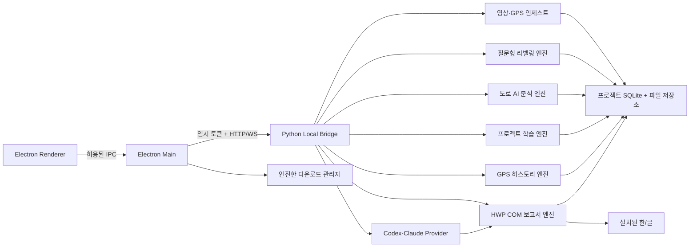

# TrafficSuperVision 통합 로컬 AI 도로점검 플랫폼 마스터 계획서

> 문서 상태: 목표 제품 기준·구현 로드맵  
> 문서 버전: 2.13
> 현재 구현 기준일: 2026-07-29  
> 상태 표기: 구현됨 / 부분 구현 / 미구현 / 목표  
> 완료 표시가 없는 현재형 설명은 최종 제품의 목표 동작을 의미한다.  
> 대상 플랫폼: Windows 설치형 Electron 애플리케이션  
> 핵심 원칙: 로컬 영상 처리, 사용자 확인형 라벨링, 프로젝트별 모델, 증거 중심 GPS 재생, 한/글 COM 보고서 작성

## North Star — 절대 제품 수용 기준

TrafficSuperVision은 기능 모듈을 모아 둔 웹 화면이 아니라 **Windows Electron 단일 프로그램**이다. 사용자는 프로젝트를 최초 한 번 설정한 뒤 주행 영상 하나만 넣는다. 프로그램은 다른 화면을 돌아다니며 단계별 실행 버튼을 누르게 하지 않고, 입력 검증부터 질문 큐 준비까지 하나의 영속 `PipelineJob`으로 자동 실행한다. 사용자가 질문 검토를 끝내면 같은 provenance 아래의 Incident, 지도·타임라인, raw·확정 CSV, 증거 패키지와 HWPX `DocumentEditPlan` 미리보기가 자동 갱신되어야 한다.

UI는 일반 작업에서 **하나의 기본 Windows 창**을 사용한다. 홈·영상 가져오기·질문 라벨링·분석·사건 검토·모델 관리·GPS 히스토리·보고서·내보내기는 그 창 안에서 전환되는 제품 화면이며, 별도 웹 SaaS나 브라우저 화면을 창 안에 다시 감싸지 않는다. 프로젝트 최초 설정만 영상 가져오기 화면 위의 명시적인 일회성 모달로 열리며, 설정 모달을 제품 본체처럼 보이게 만들어서는 안 된다.

여기서 “하나의 창”은 “페이지 하나”나 “설정 화면 하나”를 뜻하지 않는다. 1280×720에서도 현재 화면 이름, 이동 가능한 아홉 화면, 활성 화면이 제품 셸에서 즉시 읽혀야 하며, 사용자가 홈을 설정창으로 오해하거나 다른 기능이 별도 프로그램에 있다고 추측하게 만들면 단일 창 UX 수용 실패다.

다음 네 동작만 사용자 승인으로 남긴다.

1. 영상 권리 확인과 분석 시작
2. 빠른·정밀 질문 답변
3. 필요할 때 프로젝트 모델 학습 시작
4. 한/글 문서에 HWPX 편집 계획 실제 적용

분석 화면 이동, 2fps 인덱스 실행, 5~10fps 재탐색, DINO·OCR·SAM2 실행, 사건 병합, 유사 사례 검색, CSV 생성 또는 보고서 초안 생성을 단계별 버튼으로 요구하면 해당 기능의 존재 여부와 무관하게 제품 UX 수용 실패다.

### 최초 1회 프로젝트 설정

- 판정 프로필: `빠른 판정` 또는 `정밀 판정`
- 질문 정책: 학습 보조·전수 검토·빠른 검토
- 기본 3·4분기 기반 HWPX 양식
- 검지·한국어 OCR·SAM2 모델팩과 버전
- Codex 또는 Claude 보고서·구조화 판단 Provider
- 결과 저장 위치

### 영상 1회 입력 후 자동 파이프라인

`권리 확인·분석 시작`
→ magic/MIME/SHA-256/메타데이터 검사
→ 영상 내 시간대별 GPS 탐색과 GPX preflight
→ 기본 2fps 밀집 프레임 인덱스
→ 후보 구간 5~10fps 재분석
→ Grounding DINO·도로 전용 모델·한국어 OCR
→ SAM2 마스크·전후 프레임 추적
→ 시간·IoU·카메라 이동·GPS 기반 동일 사건 병합
→ 3·4분기 승인 사례 DB의 유사 사진·점검 문구 3~5건 검색
→ 비전 LLM의 유형·유지보수 필요·조치·심각도 추천 JSON
→ 대표 이미지·마스크·전후 프레임·클립·GPS·유사 사례를 갖춘 질문 큐
→ 사용자 검토 후 Annotation·Incident 투영
→ 지도·영상·타임라인, raw·확정 CSV와 증거 패키지 자동 갱신
→ sample 양식의 정확한 셀·네모·사진·점검 의견 위치를 대상으로 한 `DocumentEditPlan`과 HWPX 미리보기 자동 준비
→ 사용자 적용 승인 후 한/글 COM 부분 편집·재열기·48쪽 전체 렌더 검증·수락/거절/롤백

이 전 과정은 project-scoped `PipelineJob`/DAG 한 건이 연결한다. 각 stage의 상태, 진행률, 입력·출력 해시, 모델·설정 버전, 재시도 횟수, 취소, 오류, 재개 지점과 provenance를 영속 저장한다. 앱이나 PC가 재시작되면 정확한 단계에서 재개하고, 같은 원본 SHA-256과 같은 프로젝트 설정 버전은 멱등 처리한다. `모델 미설치`, `분석 실패`, `검지 0건`, `GPS/GPX 필요`, `부분 성공`, `완료`를 서로 다른 상태로 유지하며 부분 성공을 전체 성공으로 표시하지 않는다.

### 라벨링 절대 기준

- 빠른 판정은 `Y/N/U/E` 한 번으로 저장하고 다음 카드로 이동하며 심각도는 `미평가`로 보존한다.
- 정밀 판정은 `Y` 뒤 같은 카드의 `1/2/3`으로 낮음·보통·높음을 한 번 선택하면 저장하고 다음 카드로 이동한다.
- 심각도 선택에 목록이나 드롭다운을 사용하지 않는다.
- AI·YOLO 심각도는 추천값이고 사용자 최종값과 별도 필드·provenance로 저장한다.
- 낙하물과 긴급 제안은 모든 모드에서 강제 질문이다.
- 영역 수정은 임시 박스 이동이 아니라 `한 번 클릭 → SAM2 마스크 재생성·추적 → 사용자 재확인`이다.
- 사용자 승인 전 확정 Annotation·Incident·학습 데이터·보고서 사건은 모두 0건이어야 한다.

### 정직한 예외와 역할 경계

- 영상에 시간대별 GPS가 없으면 preflight에서 GPX 추가를 요청하되, GPS 없이도 검지·질문·CSV·보고서는 계속한다. 촬영 시작 좌표 하나로 이동 경로를 만들지 않는다.
- Grounding DINO는 객체 박스 후보, SAM2는 마스크·추적, 전용 모델은 포트홀·차선, LLM은 의미·문장 제안을 담당한다. 어느 하나도 단독으로 확정 정답을 생성하지 않는다.
- Codex·Claude CLI는 보고서와 구조화 판단 Provider이며 수천 프레임 대량 검지 엔진으로 사용하지 않는다.
- 3·4분기 sample HWPX/PDF는 단순 참고가 아니라 실제 보고서 양식이자 사용자 확인 전 `weak_unconfirmed` 사례 DB다. 사진·캡션·점검 의견·분기·노선·페이지·표/행/열·사진 슬롯·네모 위치와 문서·사진 해시를 보존하고, 사용자 승인 뒤에만 `approved_reference`로 승격한다.

현재 개발 PC 기준은 Codex CLI `0.145.0`, Claude Code `2.1.201`, `HWPFrame.HwpObject` COM 등록, NVIDIA RTX A2000 12GB·driver `572.16`, FFmpeg/FFprobe `4.4.1`이다. CLI 로그인 ready 상태는 사용자가 확인했으며 프로그램도 실행 시마다 공식 CLI의 비밀정보 비접근 상태 조회로 재검증한다. FFmpeg는 4.4.1 호환 경로를 유지한다.

### 최종 E2E 수용 시험

실제 NAS 영상 한 건을 새 프로젝트에 넣는 시점부터 자동 질문 큐 생성, 키보드 검토, 승인 Incident, 시간대별 GPS가 있을 때의 경로 재생, raw·확정 CSV와 증거 패키지, sample HWPX 편집 미리보기의 네모·사진·점검 의견 위치, 한/글 COM 적용과 48쪽 검증까지 **하나의 PipelineJob과 동일 provenance**로 통과해야 한다. 이 시험이 끝나기 전에는 “영상만 넣으면 알아서 된다”거나 제품 전체가 완료되었다고 주장하지 않는다.

## 0. 현재 구현 현황

이 표는 아래 목표 사양과 현재 실행 가능한 범위를 구분한다. 기능이 화면에 보인다는 이유만으로 구현 완료로 간주하지 않으며, 실제 브리지·저장소·산출물 검증을 통과한 범위만 `구현됨`으로 표시한다.

| 영역 | 상태 | 2026-07-29 현재 확인된 범위 |
|---|---|---|
| Electron 보안 셸·로컬 브리지 | 구현됨 | renderer 격리, main process 파일 선택, loopback 브리지, 실행별 토큰, 직접 파일·쉘·COM 접근 차단 |
| Electron 통합 UI·UX | 구현됨 | 기본 메뉴와 중첩 웹페이지형 외곽 프레임을 제거하고 Windows 네이티브 caption overlay가 있는 전체 창형 제품 셸로 통합했다. 다만 alpha.8의 1280×720 통과 판정은 기능 노출과 문서 overflow에 치우쳐 있었고, 컨셉 이미지와 다시 비교한 결과 네 개의 동등한 KPI 카드, 과도한 빈 패널, 8~10px 글자, 짧은 line-height와 말줄임이 MVP처럼 보이는 회귀를 놓쳤다. alpha.9에서는 앱에 번들한 `SUIT Variable 2.0.5`(OFL-1.1), 비대칭 핵심 카드, 절제된 유리 표면, 최소 가독 크기, 배지 높이, 라벨링 하단 조작 고정을 다시 적용했다. 후속 가혹 감사에서 발견한 1600×900 라벨링 필수 답변 누락, AI 명령 중첩, 1280×720 질문 제목 잘림과 분석 화면의 다중 세로 스크롤도 수정했다. 1280×720·1600×900에서 질문 제목, 네 답변, 건너뛰기와 AI 명령이 모두 보이고 분석 화면은 저장 작업 표만 하나의 내부 세로 스크롤을 소유한다. 실제 소스 Electron 9개 화면과 최종 패키지 상태는 별도 재감사 결과를 구분해 기록한다 |
| 로컬·UNC 영상 수집 | 구현됨 | MP4/MOV 선택, 안정성 확인, ffprobe, SHA-256, 불투명 파일 핸들, 프로젝트 등록 |
| URL 영상 수집 | 부분 구현 | URL 형식·기본 보안 정책 검사와 권리 확인 UI를 구현했다. 공급자 자동 분류, 원격 메타데이터 조회, 다운로드·재개·저장·프로젝트 등록은 미구현 |
| 프로젝트 저장소 | 부분 구현 | SQLite v4에 기존 `Project`, `ImportInspection`, `Import`, `MediaAsset`, `Trip`, 완료 `AnalysisJob`, 정규 라벨·DatasetVersion과 영구 `incidents` 테이블을 함께 유지한다. JSONL 답변 감사 기록을 원본 권위로 삼아 최신 `yes`·`edit` 답변을 `incident_id=question_id`인 active Incident로 결정적으로 upsert하고, `no`·`unsure` 최신 revision은 기존 사건을 감사 정보와 함께 superseded 상태로 전환한다. 프로젝트·분석 작업 격리 API와 Review·History 재조회까지 연결했으며, 기존 JSON·SHA-256·증거 파일과 51개 완료 작업은 재작성하지 않았다. 실제 사용자 승인 Incident는 현재 0건이다. 신규 queued/running 작업, 정규 `Detection`, 모델·보고서 카탈로그는 아직 영속화하지 않았다 |
| 실제 영상 장면 후보 추출 | 구현됨 | 공유 폴더 51개, 112,976,270,871 bytes, 56,020.015초(15.561시간)가 카탈로그와 파일명·크기 기준으로 정확히 일치한다. 장면·선명도 후보 349건과 JPEG/H.264 근거 698개를 저장했다. 영상당 최대 8프레임 제한 때문에 후보 간 평균은 160.52초이며, 이는 학습·검토용 희소 표본이지 도로 결함의 dense recall 결과가 아니다 |
| 도로 결함·삭초·낙하물·OCR 모델 | 부분 구현 | 모델팩 스키마, 격리 worker, CLIP·ONNX 비파괴 평가, resumable dense 실행기와 review-only sidecar에 더해 alpha.9에서 고정 해시의 오프라인 ONNX Grounding DINO Tiny Q4 실행기를 번들 대상으로 구현했다. 소스 앱 경로에서 실제 완료 작업의 후보 프레임 7개를 CPU로 약 23.844초에 평가해 사용자 검토용 제안 7건을 만들었지만, 표지판·식생 객체를 찾는 것과 “식생이 표지판을 가려 삭초가 필요하다”는 관계·유지보수 판정을 신뢰성 있게 확정하는 것은 다르다. 별도 Vinoth RDD YOLOv8s intake는 349개 대표 JPEG에서 10프레임·11박스를 제안했으나 사람 확인 결과 확정 양성 0프레임, 판단 어려움 1프레임, 오탐 9프레임·10박스였고 출처·권리도 확정되지 않아 활성화·설치본 번들·재배포를 거부했다. 기존 희소 JPEG 평가와 Grounding DINO·EasyOCR 제한평가도 확정 양성 성능을 입증하지 못했다. 모든 결과는 모델 점수의 review-only 후보이며 자동 라벨·확정 사건·모델 승격으로 사용하지 않는다 |
| 질문형 라벨링 | 부분 구현 | 실제 후보 이미지·클립과 빠른/정밀 판정, 키보드·클릭 자동 진행, 정밀 판정의 사용자 심각도 확정을 구현했다. 자연어 명령과 번들 Grounding DINO 결과는 review-only 제안이며 사용자 응답 없이 라벨·Incident·학습 데이터를 만들지 않는다. `PipelineJob` review gate는 질문 검토 완료 전 확정 투영을 차단한다. point-prompt SAM2 service·IPC·UI는 구현됐지만 현재 runtime 모델을 사용할 수 없고 실제 마스크·추적 종단은 미완료다 |
| 프로젝트별 데이터셋·모델 | 부분 구현 | SQLite v4의 승인·음성·보류·제외 라벨 통계와 불변 `DatasetVersion` 생성·목록·해시 재사용을 구현했다. 같은 `analysis_job_id`의 표본은 train/validation으로 갈라지지 않는다. ModelScreen은 실제 bridge 통계를 읽고 현재 답변이 1건 이상일 때만 `userConfirmed=true`로 스냅샷을 만들며, 실제 답변 0건 상태에서는 스냅샷과 학습 버튼이 모두 비활성이다. GPU 학습, 유형별 고정 검증 게이트, 성능 비교, 승격·롤백은 미구현 |
| 외부 모델·라벨 데이터 출처 | 부분 구현 | 읽기 전용 `/source-candidates`와 고정 `ProgramData\TrafficSuperVision` 증거 probe를 유지한다. 이 카탈로그 경로는 임의 탐색·다운로드·가중치 실행·라벨 생성을 하지 않는다. 별도로 alpha.9 번들 실행기는 Apache-2.0인 `onnx-community/grounding-dino-tiny-ONNX` revision `11778337bb87ff84af72a64928c86616d86c495e`의 `onnx/model_q4.onnx`만 사용하며, 모델 SHA-256·manifest·라이선스·고지 파일을 배포 무결성 체인에 포함한다. 이 번들은 검토 후보 생성만 허용하고 프로젝트 학습 데이터에 자동 혼합하지 않는다 |
| GPS 히스토리 | 부분 구현 | 완료 분석 작업을 Trip으로 사용해 `.gpx` 원본을 불투명 파일 선택으로 연결·교체하고, 시간대가 있는 최대 50,000개 지점을 원본 SHA-256·정규 레코드 해시·revision과 함께 프로젝트별로 저장한다. 영상 오프셋 ±24시간, 10초 초과 gap, 최대 8,000개 표시용 샘플을 검증하며 MapLibre에서 실제 경로·진행선·현재 위치·후보 위치와 영상·타임라인·사건 선택을 같은 재생 시각으로 동기화한다. gap과 GPX 시간 범위 밖에서는 좌표를 만들지 않는다. 현재 사용자 영상에는 시간대별 GPX가 없어 실제 운영 주행 재생 증거는 아직 없고, 방향 마커·도로명/주소 검증도 남아 있다 |
| CSV·구조화 내보내기 | 구현됨 | `trafficvisson-artifact-export-v3`로 7개 CSV, `report_payload.json`, `manifest.json`과 승인 사건의 실제 근거 미디어를 검증 ZIP으로 생성한다. 정확히 선택한 분석 작업의 active·approved Incident만 대상으로 `evidence/{incident_id}/representative.jpg`와 `evidence/{incident_id}/preview.mp4`를 포함하고, 전체 원본 영상은 제외한다. GPX가 연결된 작업은 renderer 샘플과 별개로 최대 50,000개 전체 지점을 `route_points.csv`에 보존하고 manifest에 track/source/record SHA-256, offset, revision, gap·영상 범위 통계를 기록한다. GPX 미연결은 `not_attached`로 명시한다. 선택 작업 밖·비활성·미승인 후보는 확정 출력과 증거 패키지에 포함하지 않는다 |
| 증거 미디어·비식별화 공유본 | 부분 구현 | 내부 검토용 승인 Incident JPEG·MP4의 ZIP 포함과 파일별 magic·크기·SHA-256 검증을 구현했다. 얼굴·번호판 자동 흐림과 공유용 비식별화 파생본 생성은 아직 연결되지 않았다 |
| Codex·Claude Provider | 부분 구현 | 공식 CLI 상태·로그인 흐름·제한 데이터 보고서 생성·JSON 스키마 검사와 로컬 모델 비활성 슬롯 구현. 연결 해제·독립 사용량 API는 미구현 |
| HWP/HWPX COM | 부분 구현 | COM 점검, 파일 선택, HWPML 요약, 텍스트·셀 편집 미리보기/적용, 별도 저장·재열기·해시·세션 롤백 코드 경로를 구현했다. 2026-07-29 읽기 전용 재점검에서 `HWPFrame.HwpObject`와 `.1` ProgID가 동일 CLSID로 등록된 것을 확인했다. 등록 여부와 실문서 편집 성공은 다르므로 sample 원본 보존, 작업본 적용, 재열기와 48쪽 전체 렌더 종단은 아직 미검증으로 유지한다 |
| Windows 설치본 | 부분 구현 | alpha.10 NSIS의 frozen bridge·FFmpeg·Q4 ONNX 모델팩과 서명 전 배포 경계는 역사 패키지 증거로 보존한다. 현재 source gate는 renderer 150/150, Electron 80/80, bridge 614 passed·2 skipped, typecheck/build passed이며 post-fix UI 감사도 P0·P1·P2 0건이다. `HistoryScreen` 초기 청크는 22.28kB(gzip 7.60kB)로 분리됐다. 다만 `NotSigned`, `development_only_not_distribution_ready`이며 별도 `HistoryMap` 947.96kB(gzip 249.38kB)의 첫 지도 진입 성능과 클린 PC 설치·업그레이드·제거 검증은 남아 있다 |

### 0.1 v2.13 실제 NAS PipelineJob 현재 증거

- 프로젝트: `11111111-1111-4111-8111-111111111111`
- `PipelineJob`: `98282642-e5bd-42a2-98b2-04c8c2c81a6d`
- 분석 작업: `7571e9f1-09ff-4236-aeb7-4946fca4ac0a`
- 원본: `20250905_095953.mp4`
- 원본 SHA-256: `020ac3d642e1b02ad1d3834a5fd98b6e24ad38de00b74262bce93e4280eb16a4`
- 현재 상태: `awaiting_review` / `question_queue`, 92%, 질문 1건
- GPS 경계: 시간대별 GPS와 연결된 GPX가 모두 없으므로 경로·사건 좌표를 만들지 않는다.
- 승인 경계: 사용자 답변 0건, 확정 `Annotation` 0건, 확정 `Incident` 0건이다.

`PipelineJob`은 모든 durable stage checkpoint를 검사해 질문 검토 완료 전에는 답변 감사 원장만 보존하고 `Annotation`·`Incident`를 투영하지 않는다. 검토 완료 뒤에도 완료된 원본·질문 후보 provenance를 다시 검증한 **정확히 같은 analysis**만 확정 투영하며, 그때 해당 analysis의 CSV와 증거 패키지를 자동 생성한다. 다른 작업·미승인 후보·불완전 stage를 부분 성공으로 승격하지 않는다.

SAM2 point refinement의 서비스·IPC·라벨링 UI 경로는 구현되어 있다. 그러나 현재 런타임 모델은 사용할 수 없고 실제 영상에서 `한 번 클릭 → 마스크 재생성·추적 → 재확인` 종단은 아직 통과하지 않았으므로 자동 분할 완료로 표시하지 않는다.

현재 확보된 영상에는 시간대별 GPS 트랙이 없다. 유효한 ISO 6709 좌표는 `촬영 시작 위치`로만 사용하며 후보 위치나 이동 경로로 보간하지 않는다. GPX 입력·오프셋·경로 재생 기능은 구현됐지만 실제 경로는 사용자가 시간대가 있는 GPX를 연결한 작업에서만 활성화한다.

### 0.2 2026-07-28 alpha.6 실제 데이터·Windows 패키징 역사 기록

- 실제 공유 폴더 영상과 카탈로그: 파일명·크기 기준 51개 중 51개 정확히 일치, 누락 0, 초과 0
- 총 입력 크기·재생시간: 112,976,270,871 bytes, 56,020.015초(15.561시간)
- 저장 결과: 장면·선명도 후보 349건, 대표 JPEG 349개, H.264 근거 클립 349개
- 희소 표본 한계: 기존 분석은 영상당 `max_sample_frames=8`, `max_candidate_groups=8`이며 전체 재생시간 대비 후보 간 평균은 160.52초다. 따라서 349건은 dense 결함 검지 결과나 미탐 없는 전수조사가 아니다
- 위치 메타데이터: 유효한 촬영 시작 좌표 25건, 영점 좌표 14건, 좌표 없음 12건
- SQLite v3 migration: v2의 `projects` 1, `media_assets` 51, `trips` 51, 완료 `analysis_jobs` 51, 후보 합계 349, 증거 합계 698을 보존하고 정규 라벨·DatasetVersion 테이블과 불변 trigger를 추가했다. 실제 사용자 답변·annotation·DatasetVersion은 0건이다
- GPS 카탈로그 상태: `capture_start_only` 25, `missing` 26. 영점 좌표는 위치로 사용하지 않음
- v1 카탈로그 백업: `%LOCALAPPDATA%\TrafficSuperVision\bridge-data\catalog.pre-v2-20260728.sqlite3`
- 선택 영상 내보내기 회귀: `20250916_153726.mp4`의 선택 작업에서 raw detection 7행, 그중 실험 sidecar 제안 5행, 질문 7행, 확정 incident·annotation 0행을 `trafficvisson-artifact-export-v2`로 생성했다
- 구조화 내보내기: 7개 CSV와 2개 JSON을 담은 ZIP 9개 엔트리, 산출물 크기·SHA-256 전수 일치. v2 검증 ZIP SHA-256은 `2a54288d0f57b836f52b721f20986504cfdad8a04eb1f618aecb843efbbf2cd4`
- CSV 승인 경계: 실험 제안은 `raw_detections.csv`와 `label_questions.csv`에만 합성한다. 확률이 아닌 CLIP·ONNX 점수에는 legacy `confidence`를 비워 두고 `score_semantics`, `score_calibration`, `proposal_origin`, `review_only`, `automatic_labeling_allowed`와 provenance 해시를 고정 열로 기록한다. 사용자 승인 없이 확정 출력에 포함하지 않되, 승인 뒤에는 원시 검지를 확정 사건의 추적 근거로 참조할 수 있다
- alpha.6 소스 회귀 게이트: domain 10, renderer state 66, Electron 40, Python bridge 340 통과·환경 의존 bridge 선택 테스트 2건 skip, Sites worker 4 통과
- alpha.6 실기동 QA: `qa/auto-label-alpha6-20260728`에 참고 이미지·홈 비교, 개발 Electron의 홈·자연어 명령 컴파일·실행 결과·모델 관리, 패키지 Electron의 자연어 명령 컴파일·모델 관리까지 1280×720 캡처 7장을 저장했다
- alpha.6 선라벨 실행: `표지판을 가린 수풀을 찾아줘`를 고정 `sign_vegetation_occlusion` 레시피로 컴파일했다. 현재 분석 범위에 설치 모델이 만든 해당 persisted proposal이 없어 `model_unavailable`, 일치 0건, 자동 수락 0건, 학습 반영 0건이었고 빈 실행 감사 기록만 저장됐다
- alpha.6 외부 출처 계약: source manifest·고정 allowlist digest·로컬 artifact inventory·라이선스를 모두 검증한 출처만 `verified_inactive`로 등록한다. 제품에 기본 allowlist와 자동 다운로드·자동 활성화 경로는 없다
- UI·성능 회귀: 실제 Electron 1280×720의 9개 화면에서 전체 페이지 스크롤 없이 핵심 조작을 확인했다. 초기 메인 JS는 377.18KiB에서 250.96KiB, CSS는 184.10KiB에서 131.81KiB로 줄었다
- 제품 의존성 감사: `npm audit --omit=dev` 0건. 전체 개발 도구 체인은 electron-builder 전이 의존성에서 high 16건이 남아 있어 별도 업데이트 검증이 필요
- alpha.6 검증 설치본: `desktop/release/TrafficSuperVision-Setup-0.1.0-alpha.6-x64.exe`
- 설치본 크기: 329,614,000 bytes
- 설치본 SHA-256: `4af550503b430755865451ccf974d73a091d3823b8fcb3d2f5d82a8e4af4f3c2`
- 배포 상태: `NotSigned`, `development_only_not_distribution_ready`
- 검증 경계: alpha.6 build·release manifest의 7개 배포 artifact(standalone renderer `app.asar` 포함)와 manifest 자체를 합친 SHA-256 8개·frozen bridge 스모크·unpacked Electron 실행을 통과. 독립 actual-data 패키지 QA는 alpha.4에서 수행
- 역사 증거 경계: 위 alpha.6 설치본의 파일명·크기·SHA-256과 당시 QA 캡처를 고정 기록으로 사용한다. 현재 `desktop/release/release-manifest.json`과 `SHA256SUMS.txt`는 최신 빌드로 교체되는 파일이므로 alpha.6 증거 포인터로 사용하지 않는다
- 검증 환경: Windows x64, OS build 26200
- 실행 스모크: alpha.6 clean frozen bridge에서 H.264 후보 클립 생성·재생과 `scene_fallback`을 확인했다. unpacked Electron의 창 제목·제품 아이콘·네이티브 caption·AUMID와 1280×720 자연어 recipe compile·실제 bridge ModelScreen을 확인했다. 별도 alpha.4 읽기 전용 actual-data QA에서는 동봉 bridge가 실제 완료 작업 51건·후보/질문 349건·질문 제안 43건(CLIP 24, ONNX 19)·사용자 답변 0건을 복구했고, bridge-data·라벨·sidecar·SQLite·UNC 지문은 전후 동일했다
- 한/글 사전 점검: alpha.6 당시 registry-only opt-in preflight 1건은 통과했으며 문서나 COM 객체를 실행하지 않았다. 당시 결과는 `available=false`, `HWPFrame.HwpObject`의 `prog_id_registered=false`, `security_module_registered=true`였다. 이는 역사 기록이며, 현재 PC에는 COM이 등록돼 있다. 다만 sample 적용·재열기·48쪽 전체 렌더 종단은 현재도 미검증이다
- 모델 상태: LAION CLIP과 peterhdd 포트홀 ONNX 개발 후보 팩은 별도 비파괴 평가와 질문 sidecar에만 사용했다. 별도 Vinoth RDD YOLOv8s intake도 349개 JPEG에서 10프레임·11박스를 제안했지만 확정 양성 0, 판단 어려움 1프레임, 오탐 9프레임·10박스였고 정확한 RDD 출처·라이선스와 YOLOv8 base-weight 권리가 불명확하다. 두 포트홀 계열 팩 모두 승격하지 않았으며 Vinoth 팩은 활성화·설치본 번들·재배포를 명시적으로 거부한다
- 배포 차단 조건: 설치본과 내부 실행 파일은 `NotSigned`; 클린 PC 설치·업그레이드·제거, 정식 아이콘·EULA·Third-Party Notices·SBOM, 지원 중인 Python 빌드 환경, 고정된 Python 의존성, FFmpeg GPL/libx264 재배포 의무, 한컴 보안 모듈, 실제 결함/OCR 모델을 검증해야 함

따라서 이 산출물은 기능 확인용 개발 알파 설치본이며 외부 납품·상용 배포본이 아니다.

### 0.3 2026-07-29 SQLite v4·증거 내보내기 검증 기록

- SQLite v4 migration은 v3 데이터와 불변 DatasetVersion을 보존하면서 영구 `incidents` 테이블, 프로젝트·질문·분석 작업·후보 경계, active/superseded revision 전이를 추가한다
- 최신 `yes`·`edit` 답변만 active Incident가 되며 `no`·`unsure`는 기존 Incident를 삭제하지 않고 superseded 감사 상태로 전환한다. JSONL 답변 기록이 계속 원본 권위다
- `GET /projects/{project_id}/incidents`와 Electron의 검증된 IPC를 통해 정확한 분석 작업의 active Incident를 Review·History에서 같은 `incident_id`, 유형, 심각도, 유지보수 조치, OCR로 다시 읽는다. 승인 전 장면은 Incident가 아니라 후보로 유지한다
- 현재 실제 로컬 카탈로그는 migration `[1, 2, 3, 4]`를 적용했으며 사용자 답변·annotation·DatasetVersion·active 또는 superseded Incident는 모두 0건이다. 기능 구현과 실제 승인 사건 수를 혼동하지 않는다
- `trafficvisson-artifact-export-v3`는 active·approved·exact-analysis-job Incident만 대상으로 JPEG·MP4 두 파일씩 ZIP에 포함한다. 전체 원본 영상, 비활성·타 작업·미승인 근거는 제외한다
- 증거 파일은 `evidence/{incident_id}/representative.jpg`와 `evidence/{incident_id}/preview.mp4`이며 manifest는 media type·크기·SHA-256, 답변 revision·원본 감사 해시, catalog v4 선택 조건을 보존한다
- 경로 경계·symlink·magic·크기·변조·취소·교차 프로젝트·superseded 제외 회귀를 통과했다. 비식별화 공유 파생본은 아직 구현하지 않았다
- 소스 회귀 게이트: domain 10, renderer state 74, Electron 46, Python bridge 353 passed·2 skipped, Sites worker 4 passed
- Electron 증거 화면: `qa/aaa-iteration-20260728/30-export-evidence-contract-final.png`, `qa/aaa-iteration-20260728/31-export-completed-final.jpg`
- 실제 승인 Incident 0건인 선택 작업을 Electron에서 내보내 `8개 데이터 파일 + manifest + ZIP` 10개를 생성했다. ZIP 내부는 9개 member, 증거 미디어 0개, 크기 4,491 bytes, SHA-256 `85e9baa297ca5de95355e7607c544bbe8473c81a33def892a0ea8f7dfc743581`이며 manifest·디스크·ZIP의 파일 크기와 해시, CSV 행 수가 모두 일치하고 절대경로 유출이 없었다
- alpha.7 설치본: `desktop/release/TrafficSuperVision-Setup-0.1.0-alpha.7-x64.exe`, 328,146,565 bytes, SHA-256 `b80ef818fc58541040965cad7d7ffe26fd46c6c641403b6ed1563ef851672453`
- alpha.7 release manifest 생성 시각: `2026-07-28T16:28:00.525Z` (`2026-07-29 01:28:00.525+09:00`). 7개 배포 artifact와 manifest를 포함한 `SHA256SUMS.txt` 8개 항목이 모두 일치한다
- alpha.7 실행 상태: `win-unpacked/TrafficSuperVision.exe`가 frozen `TrafficSuperVisionBridge.exe`를 직접 기동하고 실제 프로젝트 `20250916_073358.mp4`와 후보 7건을 복구했다. 실기동 화면은 `qa/aaa-iteration-20260728/32-alpha7-unpacked-home.jpg`에 보존했다. 설치본과 실행 파일은 `NotSigned`, release readiness는 `development_only_not_distribution_ready`다
- alpha.7 자연어 선라벨 실기동: unpacked 앱에서 `표지판을 가린 수풀을 찾아줘`를 `sign_vegetation_occlusion` 고정 레시피로 컴파일하고 현재 분석 영상 범위의 검토 전용 실행을 확인했다. 설치된 해당 모델 proposal이 없어 `AI 모델을 사용할 수 없음`, 일치 0건, 자동 수락 0건, 학습 반영 0건으로 끝났으며 빈 실행 감사 기록을 저장했다. 화면은 `qa/aaa-iteration-20260728/33-alpha7-auto-label-result.jpg`에 보존했다

### 0.3 실험 모델·dense 실행기·OCR 제한평가

기존 349개 대표 JPEG를 변경하지 않는 비파괴 평가와 실제 영상·프레임의 제한평가를 수행했다.

| 평가 | 범위 | 제안 | 현재 해석 |
|---|---:|---:|---|
| LAION CLIP B/32 road baseline 0.1.0 | 349 | 29 classified, 320 no detection | `zero_shot_relative_not_probability`; 정답·정밀도·재현율 없음 |
| peterhdd YOLOv8s pothole research 0.1.1 | 349 | 19 classified, 330 no detection | `model_score_not_probability`; 연락시트 육안 사전검토상 19건 모두 오탐으로 보이며 hard negative 확인 대상 |
| Vinoth RDD YOLOv8s `b001687.review-only` | 349 | 10프레임, 11박스 | 사람 확인 결과 확정 양성 0프레임, 판단 어려움 1프레임·1박스, 오탐 9프레임·10박스. 활성화 거부, 설치본 번들·재배포 차단 |
| Grounding DINO tiny deterministic30 | 30프레임 | 25프레임, 47박스 | `model_score_not_probability`; 육안 검토상 유지보수 사건으로 유효하지 않아 349건 확대 중단 |
| EasyOCR Korean+English CPU deterministic12 | 12프레임 | raw 9건, 한글/숫자 6건 | 이정표의 `도척` 1건만 참고 가능한 OCR 후보, 터널명 0건. 위치 검증·시설 확정 없음 |

- 두 평가의 원시 제안은 48건이다. 동일 후보 5건이 겹쳐 최신 유효 sidecar 우선 규칙을 적용하면 질문 API에서 보이는 합집합은 43건이다.
- 최신 합집합은 24개 분석 작업에 분포하며 CLIP 24건, ONNX 19건이다.
- sidecar는 원본 분석 JSON·SQLite·답변 저장소를 수정하지 않고 별도 저장된다. 실제 bridge의 `GET .../label-questions`에서 병합 결과를 확인했다.
- 모든 항목은 `review_only=true`, `automatic_labeling_allowed=false`이며 자동 라벨·사건·보고서 확정 입력·모델 승격을 만들지 않는다.
- 현재 사용자 답변, 확정 annotation, 확정 incident는 모두 0건이다.
- 라벨링 화면은 완료 작업 51개를 불러오고 6개씩 제한된 조회로 작업별 AI 제안 수를 표시한다. 영상 선택기와 `다음 AI 제안 영상` 버튼으로 24개 제안 보유 작업을 순회할 수 있다.
- Grounding DINO와 EasyOCR 제한평가는 후보·점수·연락시트·모델 해시를 별도 평가 디렉터리에 기록했지만 질문 sidecar를 쓰지 않았다. 자동 라벨·incident·maintenance action·모델 승격은 각각 0건이다.

실험 포트홀 모델은 Hugging Face `peterhdd/pothole-detection-yolov8`의 revision `da7747eea7abb4319a0f55961f31809a16c1b10a`에 고정했다. 원본 `best.onnx` SHA-256은 `91dd7de7a110c61314ea19a958fcc85c7b3461cc6d60d87fefc08b41ac6e32c5`다. 현재 ONNX Runtime 호환을 위해 opset 22에서 21로 변환한 파생 파일의 SHA-256은 `5680df5b80b8eabe6efa55237255426d6b533362ec27fdadcae78ed303ef98d9`다.

저장소 메타데이터는 가중치 Apache-2.0, ONNX Runtime은 MIT로 표시하지만 확인한 upstream snapshot에는 독립 라이선스 파일이 없었다. 따라서 법률 검토 전 `redistribution_allowed=false`로 고정하고 로컬 연구 평가에만 사용한다. 이 팩은 활성 모델도, 설치본 번들도 아니다.

Vinoth RDD 팩도 평가 전용 `evaluation_only_review_only`로 격리했다. 모델 카드는 가중치를 Apache-2.0으로 표시하지만 정확한 RDD release와 원 데이터셋의 CC-BY-4.0/CC-BY-SA-4.0 조건, YOLOv8 base-weight 재배포 권리가 확정되지 않았다. 한국 도로 고정 검증 세트도 아니므로 정밀도·재현율을 계산하지 않았고, 활성 모델 승격·자동 라벨·Incident·설치본 번들·재배포를 모두 거부한다.

resumable dense 실행기는 실제 최단 영상 `20250905_095953.mp4` 2.8095초를 5fps로 읽는 제한 스모크를 통과했다. 총 14프레임에서 예측·사건 그룹은 0건이었고, 결과 파일 6개 해시와 재개 동작을 확인했다. 이는 영상 디코딩·저장·재개 경로 검증일 뿐 검지 재현율 검증이 아니다. Grounding DINO는 deterministic30 육안 게이트에서 유효한 유지보수 사건이 없어 349개 전체 평가 전에 중단했고, EasyOCR도 deterministic12 후보 평가에 한정했다. 따라서 349개 희소 후보와 세 제한평가를 전체 영상 전수검지 성능으로 해석하지 않는다.

### 0.4 2026-07-29 alpha.8 UI·명령 평가·출처 카탈로그 검증 기록

- 질문형 라벨링 1280×720 회귀: 수정 전에는 영상 선택기, AI 명령 패널, 질문 작업대가 동시에 세로 스크롤을 소유했다. 수정 후 document overflow, AI 본문·recipe·실행 결과·질문 카드 overflow는 모두 0이며 가변 콘텐츠인 `candidate-media-stack` 한 곳만 경계가 보이는 내부 세로 스크롤을 소유한다. 자연어 해석·실행 결과, 현재 질문, `예`·`아니오`·`판단 어려움`·`영역 수정`과 건너뛰기 조작이 첫 화면에 함께 보인다
- UI 증거: 개발 Electron 전후 비교는 `qa/aaa-iteration-20260729/10-labeling-after-dev.png`, `11-reference-vs-labeling-before-after.png`에, alpha.8 패키지 실기동은 `13-alpha8-packaged-home-1280x720.jpg`, `14-alpha8-packaged-labeling-command-1280x720.jpg`, `15-alpha8-packaged-model-sources-1280x720.jpg`, `16-alpha8-packaged-model-rejected-dataset-1280x720.jpg`에 보존했다
- 명령형 GPU 평가: 사용자 명령 `표지판을 가린 수풀을 찾아줘`를 `sign_vegetation_occlusion`과 고정 positive prompt `road sign obscured by vegetation`으로 컴파일했다. 원문은 모델에 전달하거나 평가 산출물에 저장하지 않고 명령·프롬프트·query 해시와 recipe ID만 기록했다
- 정확한 평가 범위: 프로젝트 `11111111-1111-4111-8111-111111111111`, 완료 작업 `1ca29d0d-7dd7-4024-9f98-6d0ffa1d6984`, 영상 `20250916_073358.mp4`의 후보 7건 전체를 시간순으로 평가했다. 프로젝트·작업 UUID, 단일 분석 레코드 경로·SHA-256과 `.sha256` sidecar를 실행 전에 검증했다
- 실제 실행 결과: Grounding DINO Tiny가 `cuda:0`, NVIDIA RTX A2000 12GB에서 17.859초 동안 실행됐고 peak allocated GPU memory는 약 2.097GB였다. 7개 후보 중 3프레임에서 3박스를 제안했으며 점수 의미는 `model_score_not_probability`다
- 육안 판정: 3개 제안 모두 `표지판이 식생에 가려진 상태`를 뒷받침하지 않는 오탐이다. 두 건은 같은 주차장 장면의 작은 무관 영역이고 한 건은 식생 가림이 없는 이정표다. 이 결과는 어려운 음성 예제 또는 검토 표본일 뿐 유형 정밀도·재현율이나 자동 라벨 성능의 증거가 아니다
- 비파괴 경계: 위 실행은 자동 라벨 0건, Incident 0건, 질문 sidecar 0건, 모델 승격 0건을 유지했고 보호된 원본 분석·SQLite·답변·프로젝트 파일을 변경하지 않았다. 결과와 연락시트는 별도 `ModelEvaluations` 디렉터리와 `qa/aaa-iteration-20260729/12-grounding-command-sign-vegetation-contact-sheet.jpg`에만 저장했다
- 앱 연결 경계: 설치형 앱의 `명령 실행`은 여전히 기존 persisted proposal을 필터링하는 기능이다. 위 Grounding DINO 실행기는 외부 운영자용 평가 경로이며 앱 bridge 작업 큐·질문 카드 sidecar에 연결되지 않았다. alpha.8 설치본도 ML 런타임과 가중치를 포함하지 않는다
- 읽기 전용 출처 probe: `/source-candidates`는 `%PROGRAMDATA%\TrafficSuperVision` 아래 코드에 고정된 증거 상대경로만 검사하고 파일당 최대 2MiB를 읽어 pinned SHA-256과 비교한다. 임의 디렉터리 검색, 사용자 경로 입력, 네트워크 접근, 다운로드, 압축 해제, 가중치 실행, 외부 라벨 import는 하지 않는다. 일부 파일만 있거나 해시가 다르면 `unverified_local`로 격리한다
- 출처 5종: 정확한 snapshot 증거가 모두 일치한 Grounding DINO Tiny와 LAION CLIP ViT-B/32 Road Baseline만 `installed_validation_only`로 표시한다. 이는 가중치 실행 허가나 활성 모델을 뜻하지 않는다. SAM2.1 Hiera Small과 CC0-1.0 Road Issues Detection Dataset 9,660장은 `not_installed` 검토 후보이며, Pothole Detection YOLOv8은 19/19 육안 오탐과 모델 카드 Apache-2.0·원 데이터셋 OpenRAIL 조건 차이 때문에 `rejected`·로컬 캐시 격리 상태다
- alpha.8 소스 회귀 게이트: domain 10 passed, renderer 76 passed, Electron 48 passed, Python bridge 362 passed·환경 의존 2 skipped, Sites worker 4 passed
- alpha.8 설치본: `desktop/release/TrafficSuperVision-Setup-0.1.0-alpha.8-x64.exe`, 328,170,964 bytes, SHA-256 `ce1d5c09202959bb1da63826b5b9bd3d94dbbea11d802972c794866956e8e16d`
- alpha.8 release manifest 생성 시각: `2026-07-28T17:25:47.361Z` (`2026-07-29 02:25:47.361+09:00`). 7개 배포 artifact와 manifest를 포함한 `SHA256SUMS.txt` 8개 항목이 모두 일치한다. 설치본과 동봉 실행 파일은 `NotSigned`, release readiness는 `development_only_not_distribution_ready`다
- 미완료 경계: 실제 사용자 답변·승인 라벨·annotation·active/superseded Incident·DatasetVersion은 계속 0건이다. 검증된 dense 도로 결함 모델, 앱 관리형 명령 추론, 실제 GPS 경로 재생, 얼굴·번호판 비식별화, 프로젝트 GPU 학습·승격·롤백, 실제 HWP/HWPX COM 종단, 코드 서명과 클린 PC 배포 검증은 P0/P1 미완료다. 따라서 alpha.8은 기능 확인용 개발 알파이며 통합 제품 완성이나 현장 수용 완료를 의미하지 않는다

### 0.5 2026-07-29 alpha.9 자연어 로컬 AI 실행기·UI 재감사

- 앱 연결: Electron main이 개발 시 `desktop/build/command-proposal-runner`, 패키지 시 `resources/command-proposal-runner`의 고정 경로만 bridge 환경에 전달한다. renderer는 실행 파일·모델·경로·인수·임계값을 선택하지 못한다
- 실행기: PyInstaller one-file `trafficsupervision-command-proposal-runner.exe`와 ONNX Runtime, tokenizer, NumPy, Pillow를 함께 고정했다. runner manifest SHA-256 `65f6cc1f6941b25936c10b8387a7867d6249e25b5453a1d2cb8567e28ba547f3`를 bridge 소스와 release 검증기에 신뢰 루트로 고정했다
- 모델: `onnx-community/grounding-dino-tiny-ONNX` revision `11778337bb87ff84af72a64928c86616d86c495e`의 `onnx/model_q4.onnx`만 사용한다. 모델 파일은 227,229,745 bytes, SHA-256 `2ed98a91b75f00d325c7581bee83b92b5b98460981772edf5ed844370ac25c11`, 라이선스는 Apache-2.0이다. model manifest·tokenizer·설정·라이선스·Third-Party Notices의 크기와 해시도 실행 전 검증한다
- 오프라인·격리: 실행기는 bounded stdin JSON 하나를 받고 bounded stdout JSON 하나만 내보낸다. 네트워크 다운로드, 임의 명령행 경로, TrafficSuperVision DB·Incident·라벨·보고서 쓰기를 하지 않는다. bridge는 실행 전 runner→model manifest→모든 모델 artifact 해시를 검증하고 응답의 프로젝트·작업·recipe·후보 ID·박스 범위를 다시 검증한다
- 실행 장치: ONNX Runtime의 `DmlExecutionProvider`가 있으면 우선하고 `CPUExecutionProvider`를 fallback으로 사용한다. 현재 개발 PC의 번들 실행기는 CPU fallback으로 실제 후보 프레임 7개를 약 23.844초에 처리했다
- 실제 소스 실행: 완료 작업의 7프레임을 평가해 7개 사용자 검토용 제안을 만들었고 결과 출처는 `proposal_origin=local_model_generated`, 생성 상태는 `proposal_generation_status=generated`로 구분했다. 자동 라벨 0건, Incident 0건, 학습 반영 0건, 모델 승격 0건을 유지했다. 같은 명령을 다시 실행할 때는 정확한 recipe·후보·해시의 검증된 캐시만 사용할 수 있다
- 성능 경계: 이 실행은 로컬 앱이 프레임을 실제 추론해 질문 후보를 만든다는 종단 연결 증거다. 객체 박스가 7건 있다는 사실은 삭초 필요·표지판 가림·파손을 올바르게 판정했다는 뜻이 아니다. 현재 Grounding DINO는 표지판·식생 같은 개체를 찾는 검토 보조에는 쓸 수 있으나 개체 간 가림 관계와 유지보수 조치의 신뢰도는 별도 사용자 라벨·한국 도로 검증 세트·전용 모델로 검증해야 한다
- UI 정정: alpha.8 재감사는 “전체 문서 스크롤 없음”을 중심으로 통과시켰지만, 컨셉 대비 네 개의 동등한 KPI 카드, 큰 빈 패널, 8~10px 글자, 짧은 line-height, 한국어와 mono 혼용, 배지·하단 진행 영역 잘림을 충분히 잡지 못했다. alpha.9는 앱 번들 `SUIT Variable 2.0.5`(OFL-1.1), 비대칭 핵심 카드, 최소 글자·line-height, 카드 밀도, 한 화면 작업대와 내부 스크롤 소유권을 다시 조정했다. 실제 소스 Electron 1280×720 9개 화면과 컨셉 결합 비교는 `qa/ui-iteration-20260729`에 보존했고, 최종 패키지의 로컬 AI 결과는 `qa/aaa-iteration-20260729/17-alpha9-suit-packaged-local-ai-result-1280x720.png`에 보존했다
- 배포 무결성: release manifest schema v2는 기존 앱·bridge·FFmpeg 산출물에 runner EXE, runner manifest, model manifest와 Q4 ONNX를 더해 11개 배포 artifact를 검증하고 manifest 자체를 포함한 checksum 12개를 생성했다. manifest 생성 시각은 `2026-07-28T19:03:29.146Z`(`2026-07-29 04:03:29.146+09:00`)다. 설치본은 491,356,877 bytes, SHA-256 `c4d00ec0d122df534621ae40e18fe8b6d39ef85517284d7684ebb46e0c99ec2b`, Authenticode `NotSigned`다
- 패키지 종단: `win-unpacked/TrafficSuperVision.exe`가 실제 프로젝트와 51개 완료 분석 작업을 복구했다. AI 제안이 0건이던 `20250820_133356.mp4` 작업에서 새 자연어 명령을 실행해 CPU fallback으로 프레임 7개를 약 14.856초에 처리하고 `local_model_generated/generated` review-only 제안 7건을 만들었다. 자동 라벨·Incident·학습·승격은 0건이다
- 변경하지 않은 승인 경계: 실제 사용자 답변·승인 라벨·annotation·active/superseded Incident·DatasetVersion은 여전히 0건이다. 자연어 AI는 사용자의 라벨링을 대신 완료하지 않고 검토할 프레임과 영역을 줄여 주는 보조 기능이다

## 1. 문서 목적

이 문서는 차량에 고정한 휴대폰으로 촬영한 주행 영상과 GPS 기록을 이용해 도로 파손, 시설물 이상, 낙하물, 식생 가림, 차선 도색 상태 등을 검지하고, 사용자의 간단한 질문 응답을 학습용 라벨로 전환하며, 결과를 지도·영상·CSV·HWP/HWPX 보고서로 연결하는 TrafficSuperVision 목표 제품 사양과 구현 로드맵을 정의하는 단일 마스터 계획서다.

TrafficSuperVision은 브라우저에서만 동작하는 웹 SaaS가 아니다. Electron으로 배포되는 Windows 설치형 서비스이며, 완성 제품은 다음 기능을 한 제품 안에서 연결한다.

1. 로컬 파일과 영상 링크 수집
2. AI 후보 추출과 사용자 질문형 라벨링
3. 프로젝트별 데이터셋·모델 학습·검증·롤백
4. 도로 문제와 유지보수 필요 사항 검지
5. 이정표·터널명 OCR과 GPS 기반 위치 검증
6. GPS 지도·영상·사건 타임라인 재생
7. 원시·최종 CSV와 증거 패키지 내보내기
8. 설치된 한/글을 직접 제어하는 HWP/HWPX 보고서 작성
9. Codex·Claude 연결을 이용한 보고서 초안과 구조화 편집 계획 생성
10. 향후 로컬 언어모델을 추가할 수 있는 비활성 Provider 슬롯

최종 결과는 해당 영상을 촬영하지 않은 사람도 다음 내용을 증거와 함께 이해할 수 있어야 한다.

- 차량이 언제, 어디서, 어느 방향으로 이동했는가
- 이동 중 어떤 결함이나 유지보수 필요 지점이 발견되었는가
- AI가 무엇을 근거로 판단했고 사용자가 무엇을 승인·수정했는가
- 이정표나 터널명에 무엇이라고 쓰여 있었으며 실제 위치와 일치하는가
- 동일 지점이 여러 프레임에서 반복 검지된 경우 실제 사건은 몇 건인가
- 결과가 어떤 영상, 프레임, GPS, 라벨, 데이터셋, 모델 버전에서 만들어졌는가
- CSV와 HWP/HWPX 보고서에 어떤 근거가 반영되었는가

---

## 2. 제품 원칙과 범위

### 2.1 제품 원칙

- 원본 영상과 비전 모델 학습·추론은 사용자 PC에서 처리한다.
- AI가 확정 판정을 대신하지 않고 질문과 근거를 제시한다.
- 사용자 답변은 즉시 구조화 라벨이 되지만 모델 재학습은 자동 시작하지 않는다.
- 프로젝트 간 영상·라벨·모델을 자동으로 섞지 않는다.
- 지도, 영상, 타임라인, 사건 목록은 하나의 재생 시각으로 동기화한다.
- 원시 AI 결과와 사용자 최종 결과를 덮어쓰지 않고 함께 보존한다.
- 언어모델은 한/글 문서를 직접 수정하지 않고 검증 가능한 편집 계획만 생성한다.
- renderer에는 파일시스템, 쉘, COM, 비밀정보에 대한 직접 접근 권한을 주지 않는다.
- 실패 시 추정값을 만들어내지 않고 `미확인`, `보류`, `누락` 상태를 명시한다.

### 2.2 1차 사용자

- 프로젝트 관리자: 영상·GPS를 가져오고 분석과 학습을 실행
- 라벨 검토자: 질문 카드에 답하고 영역·유형·심각도를 수정
- 결과 검토자: 지도 히스토리와 증거를 확인
- 보고서 작성자: 기본 또는 사용자 양식으로 HWP/HWPX 보고서를 생성

1차 버전은 단일 Windows 사용자와 로컬 프로젝트를 기준으로 한다. 조직 계정, 웹 협업, 클라우드 모델 학습은 포함하지 않는다.

### 2.3 서비스 경계

제품 내부 기능은 다음 네 영역으로 분리한다.

- 수집·라벨링 서비스: 영상 링크, 로컬 파일, GPS, 질문 카드, 라벨
- 도로 분석 서비스: 검지, 분할, OCR, 위치 검증, 사건 병합, 모델 관리
- GPS 증거 히스토리 서비스: 지도, 영상, 타임라인, 사건 설명
- 보고서 서비스: CSV, 증거 패키지, HWP/HWPX, Codex·Claude Provider

초기에는 하나의 설치형 모듈형 모놀리스로 배포하되, 영역 간에는 버전이 있는 계약을 사용한다.

---

## 3. 전체 아키텍처



### 3.1 Electron 계층

- Electron + React + TypeScript + Vite로 제품 UI를 구성한다.
- renderer는 context isolation이 켜진 상태로 실행한다.
- node integration은 끈다.
- preload에서 프로젝트, 가져오기, 분석, 라벨링, 지도, 내보내기용 최소 IPC만 노출한다.
- renderer가 임의 경로, 임의 명령, 임의 URL 스킴을 전달하지 못하게 main process에서 다시 검증한다.
- 외부 링크는 허용 목록과 사용자 확인을 거쳐 기본 브라우저에서 연다.

### 3.2 Electron main process

- Python 로컬 브릿지의 시작·상태·종료를 감독한다.
- 매 실행마다 충분히 긴 임시 브릿지 토큰을 생성한다.
- 브릿지는 `127.0.0.1`에만 바인딩한다.
- 포트 충돌, 비정상 종료, 재시작, 로그 수집을 담당한다.
- 파일 선택, 저장 경로, 다운로드 경로를 main process가 소유한다.
- Codex·Claude CLI와 HWP COM 작업 요청은 검증된 인수 배열로만 실행하고 쉘 문자열 결합을 금지한다.

### 3.3 Python 로컬 브릿지

- FastAPI 기반 로컬 API와 WebSocket 작업 이벤트를 제공한다.
- 영상 분석, 모델 학습, GPS, CSV, HWP COM 작업을 background job으로 실행한다.
- 분석, 학습, 문서 편집을 서로 다른 작업 큐로 분리한다.
- 작업별 취소·일시정지·재개·실패 복구 상태를 저장한다.
- 임베디드 Python 런타임과 검증된 의존성을 Electron 설치본에 동봉한다.

### 3.4 데이터 저장

- 프로젝트 메타데이터와 상태는 SQLite에 저장한다.
- 영상, GPX, 프레임, 클립, 모델, 데이터셋, 보고서는 프로젝트별 디렉터리에 저장한다.
- SQLite는 원본 데이터 계약의 기준이며 CSV는 내보내기 산출물이다.
- 모든 주요 파일에 SHA-256과 생성 주체를 기록한다.

### 3.5 지도

- Electron renderer 안에서 MapLibre GL JS를 사용한다.
- 온라인 지도 타일은 공급자 설정을 통해 사용한다.
- 네트워크가 없으면 캐시된 타일 또는 단순 경로 배경에서 GPS 선과 사건을 계속 표시한다.
- 지도 타일 공급자와 역지오코딩 공급자는 별도 어댑터로 분리한다.

---

## 4. 실행 환경과 배포

### 4.1 기본 실행 환경

- Windows 10/11 x64
- Electron 설치형 애플리케이션
- NVIDIA GPU 권장, 현재 기준 RTX A2000 12GB
- FFmpeg 동봉
- Python 3.12 임베디드 런타임
- SQLite
- HWP/HWPX 보고서 기능 사용 시 한컴오피스와 `HWPFrame.HwpObject` COM 등록
- Codex·Claude 보고서 AI 사용 시 공식 CLI 설치·로그인·인터넷 연결

### 4.2 설치본

> alpha.8은 `no-model-pack` 개발 알파였고 alpha.9에서 Electron renderer, PyInstaller frozen bridge, FFmpeg·FFprobe, 별도 PyInstaller one-file ONNX 명령형 실행기와 고정 Grounding DINO Tiny Q4 모델팩을 `extraResources`에 도입했다. 이 번들은 질문 후보 생성만 담당하고 Torch·EasyOCR·프로젝트 학습 런타임은 포함하지 않는다. alpha.9 installer와 unpacked 신규 review-only 제안 7건 검증은 역사 기록이다. 현재 alpha.10 installer는 같은 안전 경계를 유지하며 491,689,854 bytes, SHA-256 `b0b0a79f952fd614f8c23a449073bfeea108af82e164c5a59f9c1d84d408f945`다. 현재 bridge는 Python 3.9.13 빌드여서 목표인 지원 중 Python 런타임으로 교체해야 한다. 한컴오피스와 Codex·Claude 공식 CLI는 외부 요구사항이며 Authenticode는 아직 연결되지 않았다. 아래 항목은 최종 배포 목표다.

- electron-builder 기반 NSIS 설치본을 만든다.
- Electron, renderer assets, Python, FFmpeg, 기본 모델, DB migration을 포함한다.
- 사용자 데이터는 앱 설치 경로가 아닌 전용 데이터 디렉터리에 둔다.
- 앱 업데이트가 프로젝트 데이터나 모델을 덮어쓰지 않게 한다.
- 배포 전 Authenticode 서명을 연결한다.

### 4.3 첫 실행 점검

- GPU와 VRAM
- FFmpeg
- Python bridge
- 디스크 여유 공간
- 한컴오피스 COM
- Codex CLI
- Claude Code
- 인터넷·지도·역지오코딩

점검 실패 시 전체 앱을 막지 않고 관련 기능만 비활성화하고 해결 방법을 표시한다.

---

## 5. 촬영 및 입력 기준

### 5.1 권장 촬영 기준

- 휴대폰 후면 카메라
- 가로 화면
- 차량 전방을 바라보는 고정 거치
- 주간, 맑음 또는 흐림
- 1080p 이상
- MP4 또는 MOV
- 같은 시간대에 기록된 GPX
- 촬영 전 휴대폰과 GPS 기록 시각 동기화

야간, 비, 눈, 안개, 심한 역광, 손촬영 영상도 입력할 수 있지만 1차 성능 보장 대상에는 포함하지 않는다.

### 5.2 입력 종류와 지원 등급

> 현재 상태: 로컬 MP4/MOV와 UNC 네트워크 폴더 수집은 구현되었다. URL 계열은 안전성·지원 등급 검사까지만 구현되어 있으며 아래 다운로드 지원 정책은 목표 사양이다.

| 등급 | 입력 | 지원 정책 |
|---|---|---|
| 공식 | 로컬 MP4/MOV | 항상 지원 |
| 공식 | 직접 MP4/MOV 다운로드 URL | HEAD/범위 요청과 MIME 검사 후 지원 |
| 공식 | 다운로드 가능한 Drive·Dropbox·OneDrive 공유 링크 | 공급자 어댑터로 지원 |
| 조건부 | 사용자가 권리를 가진 YouTube 링크 | 다운로드 가능 여부와 권리 확인 후 지원 |
| 최선형 | 일반 웹페이지 URL | 미디어 후보를 찾을 수 있을 때만 지원 |
| 제외 | DRM·암호화 스트림·권한 없는 비공개 영상 | 거부하고 대체 입력 방법 안내 |

### 5.3 영상 링크 처리

다음은 URL 다운로드 모듈의 목표 절차다.

1. 사용자가 URL을 붙여넣는다.
2. 앱이 공급자와 링크 유형을 판별한다.
3. 파일명, 예상 용량, 길이, 해상도, 저장 위치를 미리 표시한다.
4. 사용자가 다운로드·분석 권한이 있음을 확인한다.
5. 안전한 임시 경로로 이어받기 가능한 다운로드를 수행한다.
6. 확장자가 아니라 파일 시그니처와 실제 MIME을 검사한다.
7. 실행 파일, 스크립트, HTML을 영상으로 취급하지 않는다.
8. SHA-256, 원본 URL, 공급자, 다운로드 시각, 검사 결과를 등록한다.
9. 검증된 파일만 프로젝트 입력 경로로 이동한다.

웹페이지 스크립트나 내려받은 파일을 자동 실행하지 않는다. 인증 쿠키와 브라우저 세션을 무단으로 읽지 않는다.

### 5.4 GPX 입력

> 현재 `.gpx` 선택·등록·교체, 영상 시간 오프셋, 경로 조회와 Trip Package 연결을 구현했다. Electron main이 `.gpx` 전용 불투명 선택 핸들을 발급하고 renderer에는 실제 경로를 주지 않는다. 브리지는 외부 엔터티가 있는 XML, 심볼릭 링크·비정규 파일, 25MB 초과, 시간대가 없는 지점, 50,000점 초과 입력을 거부한다. 원본 SHA-256과 정규 레코드 해시를 저장하고 내보내기 전에 둘을 다시 검증한다. 영상 컨테이너의 ISO 6709 좌표는 계속 촬영 시작 위치로만 보존하며 이동 경로나 후보 좌표로 사용하지 않는다.

- 영상과 함께 GPX를 선택하거나 링크로 가져온다.
- GPS가 없어도 분석은 가능하지만 위치·도로명·이정표 검증은 제한된다.
- GPS 원본은 수정하지 않고 해시와 시간대를 보존한다.
- 현재 제품 UI에서는 완료된 분석 작업의 히스토리 화면에서 GPX를 연결한다. 영상 가져오기 단계의 동시 선택과 링크형 GPX 수집은 후속 범위다.

---

## 6. 검지 및 판정 범위

### 6.1 표준 사건 유형

| 코드 | 검지 대상 | AI가 찾아야 하는 것 | 기본 조치 |
|---|---|---|---|
| `POTHOLE` | 포트홀 | 노면의 구멍과 손상 영역 | 노면 보수 |
| `ROAD_SURFACE_DAMAGE` | 노면 균열·파손 | 균열, 망상 균열, 박리, 깨짐, 변형 | 노면 점검·보수 |
| `ROAD_DEBRIS` | 낙하물·장애물 | 타이어, 목재, 금속, 화물, 돌, 미상 물체 | 긴급 제거·안전 확인 |
| `MEDIAN_BARRIER_DAMAGE` | 중앙분리대·방호시설 파손 | 파손, 이탈, 기울어짐, 누락 | 시설 점검·복구 |
| `SIGN_DAMAGE` | 표지판 파손·전도 | 찌그러짐, 파손, 기울어짐, 전도 | 표지판 복구·교체 |
| `SIGN_VEGETATION_OCCLUSION` | 표지판 식생 가림 | 가지, 잎, 풀, 덩굴에 가려진 표지판 | 가지치기·삭초 |
| `ROADSIDE_MOWING_REQUIRED` | 도로변 과성장 | 갓길, 보도, 중앙부, 시설물 주변 침범 | 삭초·전정 |
| `GUIDE_SIGN_IDENTITY` | 이정표 식별 | 목적지, 방면, 화살표, 도로번호 | 위치 증거·검증 |
| `TUNNEL_IDENTITY` | 터널명 식별 | 터널 입구 명판의 한글·영문 명칭 | 위치 증거·검증 |
| `TUNNEL_NAME_OCCLUSION` | 터널명 식생 가림 | 터널명·명판을 가리는 수목 | 가지치기·삭초 |
| `LANE_MARKING_FADED` | 일반 차선 마모·소실 | 흰색·노란색 차선의 끊김·저대비·소실 | 차선 재도색 |
| `COLORED_GUIDANCE_FADED` | 색깔유도선 마모·소실 | 녹색·분홍색·파란색 유도선의 색 손실·끊김 | 유도선 재도색 |

한 프레임과 사건에는 여러 유형이 동시에 연결될 수 있다.

### 6.2 낙하물

- 먼저 도로 주행 가능 영역을 분할한다.
- 알려진 낙하물 유형을 객체 검지한다.
- 주행 영역 안의 미상 물체는 `UNKNOWN_DEBRIS` 후보로 만든다.
- 단일 프레임 반사·그림자·오염을 줄이기 위해 지속 프레임, 광학 흐름, 차량 이동에 따른 상대 위치를 사용한다.
- 차선 중앙 또는 진행 경로와 직접 겹치면 `긴급`을 제안한다.
- 낙하물과 긴급 후보는 질문 정책과 관계없이 사용자에게 반드시 확인한다.

### 6.3 차선·색깔유도선

- 도로와 차선 영역을 분할한다.
- 원근 보정 영역에서 연속성, 대비, 폭 변화, 색 채도, 소실 비율을 계산한다.
- 그림자, 젖은 노면, 차량 가림이 짧게 나타나는 구간은 제외한다.
- 여러 연속 프레임에서 같은 구간의 마모가 확인되어야 사건으로 승격한다.
- 일반 차선과 색깔유도선은 별도 유형으로 저장한다.
- 실제 재도색 필요 여부와 심각도는 질문 카드에서 사용자가 확정한다.

### 6.4 심각도

모든 사건에 AI 제안값과 사용자 최종값을 분리해 저장한다.

- 심각도: `경`, `중`, `심`, `긴급`
- 유지보수 조치
- 신뢰도
- 화면·도로 영역 대비 결함 면적
- 차로 또는 시설물 침범 비율
- 가림 비율
- 지속 프레임 수

단안 영상만으로 실제 폭·깊이를 cm 단위로 확정하지 않는다.

---

## 7. 비전·OCR·GPS 분석 파이프라인

### 7.1 모델 구성

> 현재 상태: 장면 변화·선명도 후보 추출, 선택형 모델팩 계약, CLIP·ONNX 비파괴 평가, resumable dense 실행기와 review-only sidecar를 구현했다. alpha.9에는 앱의 자연어 명령에서 실제 프레임 추론을 시작하는 고정 해시 오프라인 ONNX Grounding DINO Tiny Q4 실행기와 bridge 검토 큐 가져오기를 연결했다. 실행기는 DML을 우선하고 현재 개발 PC에서는 CPU fallback으로 7개 프레임을 약 23.844초에 평가해 review-only 제안 7건을 만들었다. 모든 출력은 확률이 아닌 `model_score_not_probability`이며 자동 라벨·Incident·학습·모델 승격은 0건이다. 기존 alpha.8 이전 평가에서는 349개 희소 대표 JPEG의 CLIP 29건·peterhdd 포트홀 ONNX 19건, Grounding DINO deterministic30의 25프레임·47박스, 작업 한정 GPU 평가의 3프레임·3박스가 모두 확정 양성 성능을 입증하지 못했다. 이후 별도 Vinoth RDD 평가도 같은 349개 JPEG에서 10프레임·11박스를 제안했지만 확정 양성 0, 판단 어려움 1프레임, 오탐 9프레임·10박스였고 출처·재배포 권리까지 불명확해 활성화·번들·재배포를 거부했다. EasyOCR deterministic12도 `도척` 1건만 참고 가능한 후보였다. 따라서 현재 연결은 질문 후보 생성 기능의 구현이지 실제 도로 결함의 dense 정밀도·재현율, 객체 관계 판정, 추적기, 자동 분할, 한국어 도로 OCR 위치 검증의 완료가 아니다.

외부 모델팩·공개 라벨 데이터셋용 `source_registry`의 순수 검증 계약은 I/O를 하지 않는다. 그 앞단의 `SourceCandidateProbe`만 `%PROGRAMDATA%\TrafficSuperVision` 아래 코드에 고정된 증거 상대경로를 읽으며, 각 파일을 최대 2MiB로 제한하고 pinned SHA-256과 정확히 비교한다. 모든 고정 증거가 일치하면 `verified_snapshot`, 일부만 있거나 해시가 다르면 `unverified_local`, 없으면 `absent`다. renderer에는 읽기 전용 `/source-candidates`로 변환된 카탈로그 상태만 전달한다. 이 경로는 임의 파일 탐색·사용자 지정 경로·네트워크 읽기·다운로드·압축 해제·모델 실행·라벨 import를 하지 않는다. `installed_validation_only`도 과거 검증 증거를 읽었다는 뜻이며 가중치 실행, 자동 활성화, 프로젝트 학습 연결을 허가하지 않는다.

2026-07-29 외부 출처 조사와 실제 제한평가를 함께 적용한 후보 판정은 다음과 같다.

| 후보 | 공개 조건·용도 | TrafficSuperVision 판정 |
|---|---|---|
| [onnx-community/grounding-dino-tiny-ONNX](https://huggingface.co/onnx-community/grounding-dino-tiny-ONNX) | Apache-2.0, revision `11778337bb87ff84af72a64928c86616d86c495e`, Q4 ONNX zero-shot object detection | alpha.9의 번들 검토 전용 실행기다. 선택 파일 `onnx/model_q4.onnx`의 크기·SHA-256과 모델 manifest·라이선스·고지를 고정한다. review-only 질문 제안 생성만 허용하며 자동 라벨·Incident·프로젝트 학습·모델 승격을 금지한다 |
| [IDEA-Research/grounding-dino-tiny](https://huggingface.co/IDEA-Research/grounding-dino-tiny) | Apache-2.0, Transformers 기반 zero-shot object detection | alpha.8까지의 별도 운영자 평가 역사다. deterministic30의 25프레임·47박스와 작업 한정 GPU 평가의 3프레임·3박스 모두 유지보수 사건을 입증하지 못했다. alpha.9에서 도입되어 현재 alpha.10에도 유지되는 번들 ONNX 팩과 이 역사적 성능 결과를 섞어 해석하지 않는다 |
| [laion/CLIP-ViT-B-32-laion2B-s34B-b79K](https://huggingface.co/laion/CLIP-ViT-B-32-laion2B-s34B-b79K) | MIT 표기, 로컬 도로 후보 상대점수 baseline | 고정 pack·평가 파일 해시가 모두 일치할 때만 `installed_validation_only`로 표시한다. 349프레임의 29개 제안은 `zero_shot_relative_not_probability`이며 결함 확률이나 승인 라벨이 아니다 |
| [facebook/sam2.1-hiera-small](https://huggingface.co/facebook/sam2.1-hiera-small) | Apache-2.0, 46.1M parameter promptable segmentation | `not_installed` 검토 후보다. 사용자의 클릭 또는 승인 박스를 마스크로 다듬는 용도이며 자동 라벨 생성기로 사용하지 않는다 |
| 로컬 캐시 `peterhdd/pothole-detection-yolov8` | 모델 카드 Apache-2.0, 원 데이터셋은 OpenRAIL, ONNX 44,746,345 bytes | 349개 희소 프레임의 19개 제안이 육안상 19/19 오탐이고 권리 조건도 일치하지 않아 `rejected`로 고정한다. 검증 파일이 있더라도 `local_cache_quarantined`이며 가중치 실행·설치본 포함·자동 선라벨을 금지한다 |
| 평가 격리 `vinothvikas1987-rdd-yolov8s-eval` | 가중치 Apache-2.0 표기, 정확한 RDD release·원 데이터셋 조건·YOLOv8 base-weight 권리 불명확 | 349개 JPEG의 10프레임·11박스 중 확정 양성 0, 판단 어려움 1프레임, 오탐 9프레임·10박스다. `evaluation_only_review_only`, `rejected_for_activation`으로 고정하고 설치본 번들·재배포·자동 라벨을 금지한다 |
| [Programmer-RD-AI/road-issues-detection-dataset](https://huggingface.co/datasets/Programmer-RD-AI/road-issues-detection-dataset) | CC0-1.0 표기, 9,660장, image classification·object detection | `not_installed` retrieval reference 후보다. 자동 다운로드·프로젝트 혼합·자동학습을 금지하고 annotation 구조, 클래스, 중복, 개인정보, 한국 도로 적합성, 영상 단위 split과 권리 범위를 검증한 뒤에만 유사사례 참고를 검토한다 |

따라서 “LLM이 프레임을 보고 바로 정답 라벨을 쓰는 방식”은 채택하지 않는다. LLM은 사용자 명령을 허용 유형·고정 prompt recipe로 해석하고, Grounding DINO·전용 detector·OCR이 검토 전용 후보를 만들며, SAM2가 사용자의 클릭·박스를 마스크로 다듬는 조정 계층으로 사용된다. 외부 데이터는 별도 출처·라이선스·중복·품질 검증을 통과한 뒤에도 프로젝트 사용자 라벨과 구분한다.

- 목표 결함 모델 후보는 분할 성능·라이선스·배포 가능성을 검증한 뒤 확정한다. 개인 연구용 후보로 `YOLO26s-seg`, 입력 크기 1280px를 평가한다.
- 목표 추적기는 짧은 구간의 객체 연결을 위한 ByteTrack 계열이다.
- 도로·차선·식생 관계는 분할 마스크로 계산한다.
- point-prompt 기반 `InteractiveSegmenter` 서비스·IPC·라벨링 UI는 구현했다. 현재 SAM2 런타임 모델을 사용할 수 없고 실제 프레임 마스크·추적 종단을 통과하지 않았으므로 임시 박스 fallback과 완성된 SAM2 보정을 구분한다.
- 한국어 이정표·터널명 OCR의 목표 후보는 PaddleOCR 한국어 인식 모델이다.
- 얼굴·번호판 비식별화는 도로 결함 모델과 분리된 전용 검지 모델로 처리한다.
- 학습은 PyTorch 환경, 배포 추론은 검증된 ONNX 모델을 우선 사용한다.
- 모델 가중치 해시, 라벨 목록, 입력 크기, 전처리, 임계값을 manifest에 고정한다.

Ultralytics 계열은 개인 연구 단계의 초기 선택이다. 비공개 납품·상용 배포 전 AGPL 공개 조건을 수용하거나 Enterprise 라이선스를 취득하거나 허용 라이선스 모델로 교체한다.

### 7.2 처리 단계

> 아래는 목표 종단 처리 순서다. 현재 기본 앱 경로는 로컬 영상 검증, 장면·선명도 희소 후보 추출, 자연어 명령→고정 recipe→해시 검증된 번들 ONNX Grounding DINO 추론, 검증 응답의 review-only 질문 sidecar 가져오기, 질문·답변 저장, SQLite v4 Incident 투영, 구조화 CSV·JSON과 승인 사건 근거 JPEG·MP4 내보내기까지 연결됐다. GPX도 불투명 파일 선택·가져오기·오프셋·영상 시각 보간·MapLibre 경로/진행선/현재점/후보점·전체 경로 export provenance까지 제품 경로에 연결됐지만 시간대가 있는 실제 운영 GPX 수용 증거는 아직 없다. 실행기 사용 불가 또는 무결성 실패는 저장 제안으로 가장하지 않고 `proposal_origin=none`, `proposal_generation_status=unavailable`로 구분하며, 정확히 일치하는 기존 결과만 `cached_existing`으로 재사용한다. 실제 영상 dense 실행기는 2.8095초·14프레임 제한 스모크로 디코딩·저장·재개만 확인했으며 결함 recall을 측정하지 않았다. 실제 영상의 검증된 촘촘한 결함 분류, 객체 관계·유지보수 판정, 자동 분할, OCR 위치 검증, 사건 재평가와 최종 HWP 페이지 검증은 아직 모두 연결되지 않았다.

1. 영상·GPX 검증과 프로젝트 등록
2. 시간 동기화
3. 장면 변화·흔들림·선명도 기반 후보 프레임 추출
4. 기본 5fps 분석
5. 의심 구간 전후 2초를 10fps로 재분석
6. 도로·차선·시설물·식생 분할
7. 결함·낙하물 검지
8. 이정표·터널명 OCR
9. GPS·도로·방향 기반 OCR 검증
10. 프레임 검지를 사건으로 병합
11. 질문 후보 생성·중복 제거
12. 사용자 질문 응답과 라벨 변환
13. 사건 재평가와 대표 증거 생성
14. 사용자 최종 검토
15. CSV·Trip Package·HWP/HWPX 생성

### 7.3 GPS 시간 동기화

- 영상 촬영 시작 시각과 GPX 시작 시각을 읽는다.
- UTC와 로컬 시간대를 명시적으로 처리한다.
- 사용자가 영상 첫 프레임과 지도 위치를 보며 오프셋을 조정할 수 있게 한다.
- 프레임 타임코드 사이의 GPS를 선형 보간한다.
- GPX 표본 간격이 10초를 넘거나 영상 시간 범위를 벗어나면 `GPS_MISSING`으로 기록한다.
- 위도, 경도, 고도, 속도, 진행 방향, 원본 시각을 보존한다.

### 7.4 이정표·터널명 OCR

1. 이정표 또는 터널 입구를 검지한다.
2. 문자 영역의 원근, 흔들림, 대비, 회전을 보정한다.
3. 여러 프레임을 비교해 가장 선명한 이미지 또는 합성 이미지를 고른다.
4. 한글, 영문, 숫자, 도로번호를 행 단위로 읽는다.
5. 목적지, 도로번호, 화살표, 한글·영문명을 구조화한다.
6. GPS, 현재 도로, 이동 방향, 주변 기준 시설물과 비교한다.

검증 상태는 다음 중 하나다.

- `VERIFIED`: 문자·GPS·도로·방향이 일치
- `PROBABLE`: 일부 글자가 불명확하지만 후보가 하나
- `UNVERIFIED`: 기준 자료 또는 신뢰도 부족
- `CONFLICT`: 문자와 GPS 후보 충돌
- `MANUAL_CONFIRMED`: 사용자가 최종 확정

명판이 식생에 가려졌으면 보이지 않는 글자를 억지로 복원하지 않고 OCR 사건과 가림 사건을 동시에 생성한다.

### 7.5 사건 병합

- 같은 유형, 3초 이내, GPS 20m 이내인 검지를 하나의 사건 후보로 묶는다.
- 짧은 구간에서는 추적 ID를 우선 사용한다.
- GPS가 없으면 추적이 이어진 프레임만 자동 병합한다.
- 서로 다른 원본 영상은 같은 위치라도 자동 병합하지 않는다.
- 사용자의 병합·분리 이력을 저장한다.
- 대표 프레임은 신뢰도, 선명도, 마스크 크기, 가림 정도를 함께 평가해 선택한다.

### 7.6 도로명·주소

- WGS84 좌표를 원본으로 보존한다.
- 사건 병합 후 대표 좌표만 역지오코딩한다.
- 공급자별 속도 제한과 캐시 정책을 지킨다.
- 네트워크가 없거나 공급자가 실패하면 좌표는 유지하고 도로명만 비운다.

---

## 8. 질문형 데이터 라벨링 프로그램

> 현재 상태: 완료 분석의 후보별 `ai_inference`와 별도 실험 sidecar를 엄격 검증해 질문 UI까지 보존한다. 로컬 모델의 유형·점수·박스와 OCR-only 결과는 모두 `실험적 AI 제안`으로 표시하며 자동 승인하지 않는다. 실제 51개 완료 작업을 영상 선택기에서 전환할 수 있고, 6개씩 제한해 읽은 제안 수를 각 영상에 표시하며 `다음 AI 제안 영상`으로 이동한다. alpha.9에서 도입해 alpha.10에 유지한 자연어 명령 UI·API는 고정 recipe를 만들고, 사용자의 실행 동의 뒤 고정 해시의 번들 ONNX Grounding DINO로 완료 작업 프레임을 실제 평가한다. bridge가 검증한 결과만 review-only sidecar로 가져오며 `local_model_generated`·`cached_existing`·`none` 출처와 `first_match`를 반환한다. 소스 종단에서 7프레임·제안 7건·약 23.844초 CPU fallback을 확인했다. 1280×720 질문 작업대는 document overflow 없이 자연어 해석·실행 결과, 질문, 네 응답과 건너뛰기를 첫 화면에 보이고, 가변 미디어 스택만 내부 스크롤한다. 기존 최신 유효 sidecar 합집합은 24개 작업의 43개 후보(CLIP 24, ONNX 19)이고 사용자 답변은 0건이다. 모델팩이 없거나 무결성 실패·시간 초과·미검지이면 이를 명시하고 기존 장면·선명도 미분류 질문을 보존한다. 실제 51건과 새 7개 제안은 승격 모델의 검증 결과가 아니므로 사용자 확인 전에는 결함이나 유지보수 사건이 아니다.

### 8.1 라벨링 책임

| 주체 | 역할 |
|---|---|
| 후보 추출 엔진 | 대표 프레임·클립 추출, AI 박스·마스크·OCR 선행 제안 |
| TrafficSuperVision 질문 UI | 어려운 기술 용어를 쉬운 질문과 선택지로 변환 |
| 사용자 | 예·아니오·판단 어려움, 유형·심각도·조치, 영역 수정 승인 |
| 데이터 운영 보조 | 링크 영상 목록화, 대량 후보 검수, 오탐·미탐 표본 감사 |
| 모델 평가 엔진 | 라벨 품질, 분포, 검증 세트, 성능 회귀 확인 |

사용자는 모든 프레임에 박스를 직접 그리지 않는다. AI가 먼저 영역을 제안하고 사용자는 질문에 답한다. 개발·초기 데이터 구축 과정에서는 접근 가능한 영상 링크를 분석해 후보 프레임, 선행 라벨, CVAT/YOLO 호환 데이터, QA 보고서를 만들 수 있다. 삭초·재도색·심각도처럼 정책 판단이 필요한 기준은 사용자의 대표 사례 승인으로 고정한다.

### 8.2 질문 카드

각 질문 카드는 동일 사건의 연속 프레임을 하나로 묶고 다음을 포함한다.

- 대표 이미지
- AI 박스·분할 마스크
- 앞뒤 프레임
- 2~5초 미리보기 클립
- GPS 지도 위치
- AI 예상 유형·심각도·신뢰도
- 답변이 학습에 어떻게 반영되는지에 대한 설명

현재 알파는 분석 작업별 장면 후보를 질문 단위로 제공한다. 완료 영상 51개를 선택할 수 있고 작업별 실험 제안 수를 표시하지만, 같은 실제 결함을 dense 프레임에서 추적·병합하는 사건 단위 중복 제거는 목표 기능이다. sidecar가 겹치는 5개 후보에는 최신 유효 제안 하나만 표시하며 원본 평가 provenance는 보존한다.

1280×720에서는 영상 선택, AI 명령, recipe와 실행 결과, 현재 질문과 응답 조작을 같은 첫 화면에 배치한다. 화면 전체와 여러 자식 패널에 세로 스크롤을 중첩하지 않으며, 앞뒤 프레임·클립처럼 길이가 달라지는 미디어 스택 한 곳만 명확한 경계 안에서 스크롤을 소유한다.

예시 질문:

- `이 구간은 삭초가 필요한가요?`
- `표지판이 식생에 의해 가려졌나요?`
- `차선 재도색이 필요한 상태인가요?`
- `색깔유도선이 지워졌나요?`
- `도로 위 물체가 낙하물인가요?`
- `이 글자는 ○○터널이 맞나요?`
- `AI가 표시한 영역이 정확한가요?`

### 8.3 공통 응답

| 응답 | 라벨 변환 |
|---|---|
| `예` | AI 영역·유형을 승인 라벨로 저장 |
| `아니오` | 제안을 폐기하고 어려운 음성 예제로 저장 |
| `판단 어려움` | 학습에서 제외하고 보류 큐로 이동 |
| `영역 수정` | 사용자가 대상을 클릭하고 자동 재분할 후 재확인 |
| `유형 변경` | 제안 영역을 유지하고 올바른 유형 선택 |

삭초·재도색·시설물 파손을 승인하면 심각도와 권장 조치를 추가 질문한다. OCR 질문은 AI 원문, 위치 후보, 기준 명칭을 나란히 보여주고 사용자가 정답 또는 `모름`을 선택한다.

### 8.4 질문 정책

프로젝트별로 다음 모드를 선택할 수 있다.

- `학습 보조`: 기본값. 유형별 초기 30건 전수 질문
- `전수 검토`: 모든 사건 후보 질문
- `빠른 검토`: 불확실 후보만 질문

학습 보조 모드는 최근 30건의 사용자-AI 일치율이 90% 이상이면 다음 후보만 질문한다.

- 신뢰도 경계 구간
- 모델 간 판정 불일치
- 새로운 촬영 환경
- 낙하물과 긴급 사건
- 고신뢰 후보의 10% 무작위 품질표본

낙하물과 `긴급` 제안은 모든 모드에서 반드시 질문한다.

### 8.5 질문 상태

- `QUEUED`
- `ANSWERED_ACCEPT`
- `ANSWERED_REJECT`
- `ANSWERED_UNSURE`
- `EDITING_GEOMETRY`
- `CONFIRMED`
- `SUPERSEDED`

질문, 답변, 수정 전·후 영역, 사용자, 시각, 원본 모델을 모두 추적한다.

### 8.6 고급 라벨 편집

쉬운 질문만으로 해결되지 않는 경우에만 고급 편집기를 연다.

- 박스 이동·크기 조절
- 점 클릭 기반 마스크 재생성
- 브러시 추가·삭제
- 객체 분리·병합
- OCR 문자 수정
- 유형·세부 유형 변경
- 프레임 범위 조절

고급 편집 결과도 원본 AI 제안을 삭제하지 않는다.

### 8.7 외부 호환

- CVAT 프로젝트 내보내기
- COCO detection/segmentation
- YOLO detection/segmentation
- OCR 정답 JSON
- 라벨 QA CSV

외부 도구에서 수정한 라벨은 import 전 스키마와 프로젝트 소유권을 검증한다.

### 8.8 자연어 AI 선라벨 명령

현재 다음 검토 보조 경로를 구현했다.

1. 사용자가 `포트홀을 찾아줘`, `표지판을 가린 수풀을 찾아줘`처럼 명령한다.
2. 명령을 NFKC 정규화하고 고정 규칙으로 지원 사건 유형 하나에만 매핑한다. 매핑되지 않거나 여러 유형에 걸리면 명시적 유형 선택 없이는 거부한다.
3. 원문 명령을 모델 프롬프트에 넣지 않고 버전 고정 positive/negative prompt 집합, 기능 요구사항, 명령·프롬프트 SHA-256을 가진 recipe를 만든다.
4. 실행 시 recipe를 다시 컴파일해 ID가 달라지지 않았는지 확인한다.
5. bridge는 alpha.9 앱 빌드에 고정된 runner manifest SHA-256과 실행 파일·model manifest·모든 모델 artifact의 크기·해시를 확인한다. 실패하면 모델 사용 불가로 종료하며 다른 실행 파일이나 사용자 Python을 찾지 않는다.
6. 정확한 프로젝트·완료 작업의 후보 JPEG 경로·크기·SHA-256과 구조화 recipe만 bounded stdin JSON으로 실행기에 보낸다. renderer는 실행 파일·모델 경로·인수·timeout·임계값을 지정할 수 없다.
7. 고정 실행기는 오프라인 ONNX Runtime으로 후보를 평가한다. `DmlExecutionProvider`가 있으면 우선하고 그렇지 않으면 CPU로 실행한다.
8. bridge는 bounded stdout JSON의 프로젝트·작업·recipe·runner/model manifest·후보 집합·유형·박스·점수를 다시 검증한다. 정확히 검증된 `classified` 결과만 review-only 질문 sidecar로 가져온다.
9. 실행 결과를 `trafficvisson.auto-label-run.v1` 프로젝트별 JSON으로 원자적 저장한다. 새 추론은 `local_model_generated/generated`, 정확한 캐시 재사용은 `cached_existing/cached`, 실행 불가나 유효 제안 없음은 `none/unavailable`로 구분한다.
10. 저장 레코드와 각 match는 `review_only=true`, `include_in_training=false`다. 일치 항목이 있으면 정렬된 첫 match의 작업·후보·유형·검토 상태·결정 해시를 `first_match`로 반환해 UI 이동에 사용한다.

`assisted_auto`를 요청해도 검증 세트 기반 클래스별 임계값이 비어 있는 현재 구현에서는 `proposal_only`로 적용된다. API의 `training_labels_created`, 자동 Incident, 자동 모델 승격은 항상 0이며 사용자 질문 답변을 대신하지 않는다. alpha.9 소스 종단에서는 완료 작업의 후보 프레임 7개를 CPU로 약 23.844초에 평가해 사용자 검토용 제안 7건을 생성했다.

alpha.8의 별도 운영자용 `evaluate_grounding_dino_candidates.py` GPU 평가도 역사 증거로 보존한다. 당시 실제 작업 `1ca29d0d-7dd7-4024-9f98-6d0ffa1d6984`의 7개 후보에서 3프레임·3박스를 얻었지만 육안상 3건 모두 오탐이었고 앱·sidecar에 연결되지 않았다. alpha.9 번들 실행기 연결은 이 경계를 바꾸어 앱에서 새 추론과 검토 큐 가져오기를 구현했지만, 두 평가 모두 해당 유형의 정밀도·재현율이나 유지보수 판정 성능을 통과했다는 뜻은 아니다.

---

## 9. 프로젝트별 데이터셋·모델

> 현재 상태: JSONL 답변 감사 원본을 SQLite v4의 질문·답변 revision·annotation·Incident로 멱등 투영하고, 현재 답변 통계와 불변 DatasetVersion 생성·목록 API를 구현했다. 최신 승인 답변의 영구 Incident와 비승인 revision의 supersession 감사 경계도 같은 프로젝트·분석 작업 계약으로 보존한다. ModelScreen은 localStorage 집계가 아니라 실제 bridge의 승인·음성·보류·제외 수치와 최신 DatasetVersion을 표시한다. 현재 사용자 답변이 0건이므로 실기동 화면의 Incident·스냅샷·DatasetVersion은 0건이고 학습 버튼은 비활성이다. GPU 학습 실행, 유형별 고정 검증 게이트, 성능 비교, 모델 승격·롤백 API는 미구현이다.

### 9.1 프로젝트 격리

- 새 프로젝트는 공통 초기 모델을 복제해 시작한다.
- 한 프로젝트의 영상·라벨·데이터셋·모델은 다른 프로젝트에 자동으로 섞지 않는다.
- 공통 모델로 데이터를 보내는 기능은 1차에 제공하지 않는다.
- 모델과 데이터셋 파일 경로에 항상 `project_id`를 포함한다.
- API와 DB 쿼리는 프로젝트 소유권을 검사한다.

### 9.2 라벨 분류

- 승인 양성 라벨
- 승인 음성 라벨
- 판단 보류
- OCR 정답
- 고정 검증 세트
- 고정 테스트 세트

검토자가 수정한 결과를 자동 학습에 넣지 않고 `CONFIRMED` 상태만 사용한다.

### 9.3 데이터셋 버전

현재 구현된 v1 DatasetVersion은 각 질문의 최신 답변 revision을 스냅샷으로 고정한다. 승인·음성만 학습에 포함하고 보류·제외는 `excluded` split으로 보존한다. train/validation 분할은 `analysis_job_hash_v1`을 사용해 같은 분석 작업의 후보가 서로 다른 분할로 새지 않게 한다. 구성원·분할·프로젝트·검증 비율을 정규화한 SHA-256이 같으면 기존 버전을 재사용하고, 최신 답변 revision이 바뀌면 새 버전을 만든다. DB trigger는 DatasetVersion과 membership의 UPDATE·DELETE를 거부한다.

각 버전에는 다음을 저장한다.

- 포함 annotation ID
- 프로젝트 ID
- 클래스 분포
- 촬영일·노선·영상 분리 기준
- train/validation/test 목록
- 생성 설정
- 데이터셋 해시
- 이전 버전과의 차이

현재 구현은 같은 분석 작업의 프레임을 서로 다른 train/validation 분할에 넣지 않는다. 목표 제품에서는 촬영일·노선·영상 단위 고정 테스트 세트까지 확장한다.

### 9.4 재학습 시작

- 사용자가 `새 모델 학습`을 눌러야 시작한다.
- 새 확정 라벨 100건 이상일 때 버튼을 활성화한다.
- 학습 대상 유형별 검증 표본 30건 이상을 요구한다.
- 시작 전에 예상 시간, VRAM, 디스크, 클래스 불균형을 보여준다.
- 조건이 부족하면 모델 학습 대신 추가 질문 수집을 제안한다.

### 9.5 학습과 평가

- 활성 모델과 같은 검증 세트를 사용한다.
- 사건 단위 정밀도·재현율, 중복 사건, 오탐, 클래스별 혼동을 비교한다.
- 클래스별 재현율이 2%p 이상 하락하면 자동 승격하지 않는다.
- 중복 생성률 또는 오탐률이 증가하면 자동 승격하지 않는다.
- 후보 모델은 활성화 전 사용자가 비교 결과를 승인한다.

### 9.6 모델 상태

- `BASE`
- `TRAINING`
- `CANDIDATE`
- `ACTIVE`
- `REJECTED`
- `ARCHIVED`

이전 활성 모델은 보존하며 한 번의 사용자 조작으로 롤백할 수 있다.

### 9.7 희귀 사건 데이터

낙하물과 시설물 파손을 촬영하기 위해 실제 도로에 위험물을 놓지 않는다.

- 보유 영상 우선
- 이용 조건이 명확한 공개 데이터
- 폐쇄된 안전 구간의 제한적 재현
- 이미지 합성과 데이터 증강은 보조 수단
- 합성 데이터만으로 테스트 성능을 주장하지 않음

---

## 10. GPS 주행 히스토리 및 증거 재생

> 현재 상태: 실제 후보 클립, 원본 타임코드, 타임라인, 후보 목록, 검토·라벨링 화면의 동일 후보 이동을 구현했다. 시간대가 있는 GPX를 연결하면 영상 오프셋을 적용해 지점 사이를 보간하고 MapLibre 지도에 전체 경로, 재생 완료 경로, 현재 위치와 후보 위치를 표시한다. 지도·영상·타임라인·후보 목록은 같은 후보와 시각으로 이동한다. 10초 초과 gap, GPX 시작 전·종료 후 시각에서는 좌표를 만들거나 선을 잇지 않는다. 원본 컨테이너의 유효한 ISO 6709 좌표는 GPX가 없을 때에도 `촬영 시작 위치`로만 표시한다. 현재 사용자 영상에는 시간대별 GPX가 없으므로 실제 운영 데이터의 연속 경로 재생 증거는 아직 없으며, 방향 마커·지도 타일·도로명 검증은 후속이다.

### 10.1 화면 구조

히스토리 화면은 하나의 `playback_time_ms`로 동기화된 다음 영역을 제공한다.

1. 영상 플레이어
2. GPS 지도와 주행 경로
3. 사건 타임라인
4. 사건 목록·필터
5. 증거 상세 카드

### 10.2 경로 재생

- 재생 전 전체 경로는 흐린 선으로 표시한다.
- 재생이 시작되면 출발점부터 현재 위치까지 진행 방향에 따라 색이 채워진다.
- 현재 차량 위치는 방향이 있는 마커로 표시한다.
- 지도 카메라는 차량 추적 또는 자유 이동을 지원한다.
- 일시정지, 탐색, 0.5배·1배·2배·4배 재생을 지원한다.
- GPS 누락 구간은 임의 직선으로 사실처럼 표시하지 않고 점선·경고 상태로 구분한다.

### 10.3 사건 상호 이동

- 지도 마커를 누르면 영상과 타임라인이 해당 시각으로 이동한다.
- 타임라인 사건을 누르면 지도와 영상이 이동한다.
- 영상의 검지 영역을 누르면 사건 상세가 열린다.
- 사건 목록을 누르면 지도 중심과 재생 위치가 이동한다.
- CSV의 사건 ID를 앱에 전달하면 같은 사건을 연다.
- 필터를 변경하면 지도, 타임라인, 목록이 함께 갱신된다.

### 10.4 증거 카드

- 발견 시각과 영상 타임코드
- 위·경도, 도로명, 진행 방향
- 원본 프레임
- AI 표시 프레임
- 사용자 최종 영역
- 얼굴·번호판이 흐림 처리된 공유용 이미지
- 전후 영상 클립
- AI 유형·신뢰도·심각도·조치
- 사용자 답변과 최종 판정
- OCR 원문과 검증된 이정표·터널명
- 모델·데이터셋·질문 ID

촬영하지 않은 사람도 이 카드만으로 사건 위치, 전후 상황, 판단 근거를 이해할 수 있어야 한다.

---

## 11. 사용자 검토 워크플로

사용자는 사건별로 다음 작업을 수행할 수 있다.

- 승인·반려
- 유형·세부 유형 변경
- 심각도·조치 변경
- 사건 병합·분리
- 대표 캡처 변경
- OCR 문자와 기준 시설물 수정
- 도로명·위치 메모 수정
- 얼굴·번호판 추가 흐림
- 학습 라벨 포함·제외

AI 원본, 질문 답변, 최종 검토값은 별도 필드와 이력으로 보존한다.

---

## 12. 데이터 계약

### 12.1 핵심 엔터티

| 엔터티 | 역할 |
|---|---|
| `Project` | 영상·데이터셋·모델·보고서를 격리하는 단위 |
| `Trip` | 한 번의 주행 영상·GPS·시간 범위 |
| `MediaAsset` | 영상, 프레임, 클립, 이미지 |
| `GpsTrackPoint` | 시각별 위치·속도·방향 |
| `ModelRun` | 한 번의 추론 실행 |
| `Detection` | 프레임 단위 AI 원시 검지 |
| `Incident` | 여러 Detection을 병합한 사건 |
| `OcrObservation` | OCR 원문·영역·신뢰도 |
| `PlaceVerification` | OCR과 위치 기준 자료의 비교 |
| `ReferenceAsset` | 이정표, 터널, 도로 기준 자료 |
| `LabelQuestion` | 질문 문구, 후보 사건, 제안 영역, 표시 자료, 정책 |
| `LabelAnswer` | 사용자 응답과 수정값 |
| `Annotation` | 학습에 사용하는 최종 라벨 |
| `DatasetVersion` | 포함 라벨, 분할, 통계, 해시 |
| `ModelVersion` | 기반 모델, 데이터셋, 성능, 승격 상태 |
| `MaintenanceAction` | AI 제안·사용자 확정 조치 |
| `EvidenceAsset` | 원본·표시·비식별화 이미지와 클립 |
| `ReviewAction` | 승인·반려·수정·병합 감사 이력 |
| `ReportDraft` | 보고서 문장과 구조화 내용 |
| `DocumentEditPlan` | 한/글에 적용할 허용 편집 목록 |
| `ProviderConnection` | Codex·Claude·미래 로컬 모델 상태 |

### 12.2 LabelQuestion

- `question_id`
- `project_id`
- `trip_id`
- `incident_id`
- `question_type`
- `prompt`
- `policy_mode`
- `proposed_class`
- `proposed_geometry`
- `confidence`
- `media_refs`
- `gps_ref`
- `mandatory_reason`
- `status`
- `created_at`

### 12.3 LabelAnswer

- `answer_id`
- `question_id`
- `answer`
- `selected_class`
- `selected_severity`
- `selected_action`
- `final_geometry`
- `ocr_text`
- `include_in_training`
- `answered_at`

### 12.4 Incident

- `schema_version`
- `project_id`
- `trip_id`
- `incident_id`
- `model_run_id`
- `incident_type`
- `incident_subtype`
- `start_time_ms`
- `representative_time_ms`
- `end_time_ms`
- `latitude`
- `longitude`
- `gps_status`
- `road_name`
- `travel_heading`
- `ai_confidence`
- `ai_severity`
- `final_severity`
- `ai_maintenance_action`
- `final_maintenance_action`
- `measurement_json`
- `ocr_text`
- `verified_place_name`
- `place_verification_status`
- `review_status`
- `representative_evidence_id`

### 12.5 DocumentEditPlan

허용 작업만 표현하는 버전형 JSON 계약으로 만든다.

- 문서 스냅샷 ID
- 대상 문단·표·셀·사진 슬롯 주소
- 작업 유형: 텍스트 채우기, 표 행 추가, 셀 채우기, 이미지 삽입, 지도 삽입
- 적용 전 기대값
- 적용할 값과 출처
- 스타일 보존 정책
- 미리보기 설명

임의 매크로, 임의 COM 메서드, 임의 파일 경로는 포함할 수 없다.

---

## 13. 프로젝트 파일과 내보내기

> 현재 전역 `catalog.sqlite3` v4는 프로젝트·가져오기 메타데이터, 기존 완료 분석의 `MediaAsset`·`Trip`·`AnalysisJob`, 정규 라벨·DatasetVersion과 영구 Incident를 보존한다. JSONL 답변 감사 기록은 계속 원본 권위이며 SQLite는 최신 revision을 멱등 투영한다. 상세 후보·원본 JSON·SHA-256·증거 파일은 기존 프로젝트 디렉터리에 그대로 두고 카탈로그는 검증된 상대 경로와 해시를 색인한다. 실험 모델 제안은 원본 분석·답변과 분리된 `experimental-proposals` sidecar에 저장하고 질문 조회와 선택 작업 내보내기 때 최신 유효 제안 하나만 병합한다. 아래 `project/project.sqlite3` 전체 구조는 최종 목표다. 검증된 `trafficvisson-artifact-export-v3` ZIP은 구조화 CSV·JSON과 정확히 선택한 작업의 active·approved Incident별 대표 JPEG·미리보기 MP4를 포함하지만 전체 원본 영상은 제외한다. 얼굴·번호판을 흐린 공유 파생본·지도·보고서 문서는 아직 목표 Trip Package 범위다.

```text
project/
  project.sqlite3
  manifest.json
  input/
    videos/
    gps/
    sources.json
  analysis/
    frames/
    clips/
    detections/
  labels/
    questions/
    annotations/
    datasets/
  models/
    base/
    candidates/
    active/
    archived/
  evidence/
    internal/
    share/
  reports/
    drafts/
    hwpx/
    hwp/
    renders/
  exports/
    raw_detections.csv
    reviewed_incidents.csv
    label_questions.csv
    annotations.csv
    ocr_observations.csv
    route_points.csv
    maintenance_actions.csv
    report_payload.json
  logs/
```

### 13.1 CSV 원칙

- Excel 한글 호환을 위해 UTF-8 BOM 사용
- ISO 8601 시각과 영상 타임코드 함께 저장
- 위·경도는 WGS84
- AI 원본값과 사용자 최종값 분리
- 사건 행은 근거 이미지 또는 클립과 연결
- 스키마 버전을 manifest에 기록
- 데이터셋·모델·입력 영상 provenance 포함
- 실험 제안은 `raw_detections.csv`와 `label_questions.csv`에만 합성하고, 사용자 승인 전 `reviewed_incidents.csv`, `annotations.csv`, `maintenance_actions.csv`, 보고서 확정 입력에는 포함하지 않음
- 확률이 아닌 점수는 `confidence`를 비우고 `score_value`, `score_semantics`, `score_calibration`으로 의미를 분리
- `proposal_origin`, `review_only`, `automatic_labeling_allowed`, 모델·데이터셋·평가·후보·이미지 해시를 고정 열과 manifest provenance에 기록
- 사용자가 승인한 뒤에는 확정 사건이 원시 실험 제안을 증거로 참조할 수 있으나, 이 추적 연결을 자동 승인으로 해석하지 않음

### 13.2 Trip Package

다른 PC나 검토자에게 전달할 때는 다음을 묶는다.

- 검토 완료 사건
- 경로와 지도 데이터
- 비식별화 증거
- 전후 클립
- CSV
- report payload
- manifest

원본 영상 포함 여부는 사용자가 선택한다.

---

## 14. HWP/HWPX inline AI 보고서

| 세부 기능 | 현재 상태 |
|---|---|
| 한컴오피스 COM 사전 점검·사용자 파일 선택 | 코드 경로 구현, 현 PC registry-only 점검 |
| HWP/HWPX 열기, HWPML 구조 요약, 텍스트·셀 편집 미리보기 | 코드 경로 구현, 현 PC 실문서 미검증 |
| 사용자 수락 후 별도 파일 저장·재열기·SHA-256·세션 롤백 | 코드 경로 구현, 현 PC 실문서 미검증 |
| 현재 열린 문서 자동 감지·기본 양식 | 미구현 |
| 이미지·지도·표 삽입의 제품 UI 연결 | 미구현 |
| 한/글 변경 내용 추적·항목별 수락/거절 | 미구현 |
| 재시작 가능한 영구 복구 저널 | 미구현 |
| 전 페이지 렌더·누락·겹침·넘침 자동 검사 | 미구현 |

아래 절차는 완성 제품의 목표 흐름이며, 현재 실제 쓰기 경로는 검증된 `fill_text`와 `fill_cell` 작업으로 제한한다.

2026-07-29 읽기 전용 재점검에서 현재 개발 PC의 `HWPFrame.HwpObject`와 `HWPFrame.HwpObject.1` ProgID가 CLSID `{2291CF00-64A1-4877-A9B4-68CFE89612D6}`로 등록된 것을 확인했다. 과거 alpha.6의 미등록 기록은 당시 역사 증거로만 유지한다. COM 등록은 실행 가능성의 필요조건일 뿐이며, sample 원본을 건드리지 않는 작업본 편집, 정확한 표·네모·사진·점검 의견 위치, 저장·재열기·48쪽 전체 렌더 검증을 통과하기 전에는 HWP/HWPX 종단 완료로 간주하지 않는다.

### 14.1 지원 방식

- TrafficSuperVision 기본 점검보고서 제공
- 사용자가 보유한 HWP/HWPX 양식 지원
- 설치된 한/글에서 양식을 열거나 현재 열린 문서를 감지
- HWPML 구조, 표, 문단, 사진 영역, 기존 서식 분석
- 명시적 필드가 있으면 우선 사용
- 필드가 없으면 표 머리글, 인접 라벨, 빈 칸, 문단 의미를 기반으로 후보 슬롯 생성
- 후보가 여러 개면 자동 쓰지 않고 사용자에게 선택 요청

### 14.2 보고서 데이터

- 조사 개요
- 주행 일시·구간·거리
- GPS 경로 지도
- 유형별 집계
- 사건별 위치·심각도·조치
- 이정표·터널명 OCR과 검증 상태
- 대표 근거 이미지
- 비식별화 이미지
- 검토자 메모
- 모델·데이터셋·분석 버전

### 14.3 편집 절차

1. 사용자가 기본 또는 사용자 양식을 선택한다.
2. 보고서 엔진이 작업용 복사본과 원본 해시를 만든다.
3. 한/글 COM으로 문서 구조와 미리보기 스냅샷을 읽는다.
4. 규칙 엔진이 확정 가능한 표·사진·필드를 매핑한다.
5. 연결된 Codex·Claude가 필요한 설명문과 구조화 편집 계획을 제안한다.
6. 스키마·대상 주소·기대값을 검증한다.
7. 사용자에게 변경 위치와 내용을 미리 보여준다.
8. 사용자가 수락한 작업만 한/글 COM으로 적용한다.
9. 변경 내용 추적에서 수락·거절할 수 있게 한다.
10. 저장 후 다시 읽고 전 페이지 렌더링한다.
11. 누락, 겹침, 표 잘림, 페이지 넘침, 남은 빈 칸을 검사한다.
12. 검증 성공본만 최종 보고서로 이동한다.

### 14.4 COM 안전 원칙

- HWP COM은 별도 STA worker에서 실행한다.
- TrafficSuperVision이 연 문서·프로세스만 자동 제어한다.
- 작업 전 임시 복사본과 복구 저널을 만든다.
- 한 작업에서 서로 다른 편집 엔진을 섞지 않는다.
- 기대한 문서 스냅샷과 다르면 쓰기를 거부한다.
- 표, 스타일, 문단 번호, 필드, 그림, 페이지 제어를 보존한다.
- 실패 시 원본을 덮어쓰지 않고 작업본을 폐기한다.
- 강제 종료 후에도 저널을 읽어 미완료 작업을 복구·폐기할 수 있게 한다.

### 14.5 변경 검토

- 추가 내용과 삭제 내용을 구분 표시
- 변경 위치로 이동
- 항목별 수락·거절
- 전체 수락·거절
- 원본으로 롤백
- 저장 전·후 페이지 비교

언어모델은 COM을 직접 호출하지 않는다. 결정적 편집기가 검증된 `DocumentEditPlan`만 실행한다.

---

## 15. Codex·Claude Provider

> 현재 상태: Codex·Claude 공식 CLI 상태 확인·로그인 실행, 구조화된 최소 데이터 전송 동의, 보고서 초안·편집 계획 생성과 JSON 스키마 검사를 구현했다. 현재는 사건 JSON, 문서 구조 요약, 불투명 증거·지도 참조만 전송하며 원본 영상·이미지는 전송하지 않는다. 자동 비식별화 이미지 생성은 미구현이다. Local Model은 비활성 UI 슬롯이며 연결 해제와 독립 사용량 조회는 목표 계약이다.

### 15.1 1차 Provider

- `CodexCliProvider`
- `ClaudeCodeProvider`
- `LocalModelProvider` - 비활성, 준비 중

### 15.2 인증

- Codex는 공식 Codex CLI의 ChatGPT 로그인 흐름을 사용한다.
- Claude는 Claude Code의 공식 Console 또는 Pro/Max 로그인 흐름을 사용한다.
- TrafficSuperVision은 인증 파일, refresh token, 세션 쿠키를 직접 읽지 않는다.
- 로그인·로그아웃과 자격증명 저장은 각 공식 CLI가 소유한다.
- 앱은 CLI 설치·버전·연결 상태와 출력 전용 실행 결과만 확인한다.

### 15.3 실행 경계

- 보고서 초안용 임시 작업 디렉터리를 별도로 만든다.
- 승인 사건 JSON, OCR 결과, 비식별화 이미지, 문서 구조 요약만 제공한다.
- 전체 원본 영상과 불필요한 개인정보는 보내지 않는다.
- 전송 전 데이터 범위와 공급자를 사용자에게 보여주고 동의를 받는다.
- CLI는 프로젝트 소스나 임의 사용자 폴더가 아닌 제한된 임시 경로에서 실행한다.
- 출력은 `ReportDraft` 또는 `DocumentEditPlan` JSON 스키마로 검증한다.
- 비정형·불완전·대상 불명확 출력은 보고서 쓰기에 사용하지 않는다.

### 15.4 Provider 계약

다음은 목표 공통 인터페이스다.

- `get_status()`
- `start_login()`
- `disconnect()`
- `get_capabilities()`
- `generate_report_draft(context, schema)`
- `generate_document_edit_plan(context, schema)`
- `get_usage_summary()`

### 15.5 미래 로컬 모델

`LocalModelProvider`는 비활성 구현과 UI 슬롯만 제공한다.

- 현재 미지원 사유
- 요구되는 한국어 문서 품질
- 구조화 JSON 준수율
- HWP 양식 이해 능력
- 활성화 성능 게이트

위 내용을 코드 주석, Provider 문서, 계약 테스트에 남긴다. 충분한 모델이 나오면 UI·보고서 파이프라인 변경 없이 Provider만 추가한다.

---

## 16. 화면과 사용자 흐름

### 16.1 프로젝트 홈

- 프로젝트 생성·열기·전환 — 현재 SQLite 프로젝트 API와 renderer 선택 상태까지 구현
- 최근 주행
- 승인 대기 질문
- 분석 진행률
- 심각·긴급 사건
- 활성 모델
- 보고서 상태

### 16.2 영상 가져오기

- 로컬 파일
- URL 붙여넣기
- 링크 지원 등급과 권리 확인
- 다운로드 진행률·재개
- 메타데이터와 SHA-256
- GPX 선택·동기화

### 16.3 질문 라벨링

- 질문 모드 선택
- 대표 이미지·클립·지도
- 예·아니오·판단 어려움·영역 수정
- 남은 질문 수
- 유형별 진행률
- 고급 라벨 편집기

현재 alpha.10은 완료 영상 51개를 한 화면에서 선택하고 작업별 AI 제안 수를 확인하며, 제안이 있는 다음 영상으로 이동하는 흐름까지 구현했다. 제안 수 조회는 6개 작업씩 제한해 renderer가 51개 API 요청을 동시에 만들지 않는다. alpha.9에서 도입한 자연어 명령 작업대는 고정 recipe, 실행 동의, 번들 ONNX 추론 진행, 새 로컬 제안·검증 캐시·실행 불가 출처, review-only 결과와 `first_match` 이동을 alpha.10에서도 구분해 보여준다. 사용자 답변 0건인 현재 상태에서 어떤 제안도 승인 라벨·Incident·학습 데이터로 표시하지 않는다.

### 16.4 분석

- 단계별 진행 상태
- 프레임·사건 수
- GPU 상태
- 예상 남은 시간
- 취소·재개
- 오류 로그

### 16.5 사건 검토

- 영상 오버레이
- 지도
- AI 원본·사용자 답변·최종값 비교
- 병합·분리
- OCR·위치 검증
- 비식별화

### 16.6 모델 관리

- 데이터셋 준비 상태
- 유형별 라벨 분포
- 학습 가능 조건
- 학습 시작
- 활성·후보 모델 성능 비교
- 승격·거부·롤백

현재 화면은 실제 bridge의 프로젝트 라벨 통계와 DatasetVersion 목록을 읽는다. 승인·음성·보류·제외·검증 표본과 최신 스냅샷을 표시하며 원시 UUID 대신 선택 프로젝트의 격리 상태를 설명한다. `current_answer_count > 0`일 때만 사용자의 클릭으로 `userConfirmed=true` DatasetVersion 생성 요청을 보낼 수 있다. 학습 실행은 아직 연결하지 않아 버튼을 항상 비활성으로 유지한다.

### 16.7 GPS 히스토리

- 경로 진행 애니메이션
- 지도·영상·타임라인 동기화
- 사건 필터
- 증거 카드
- 공유용 보기

### 16.8 보고서

- 기본·사용자 양식 선택
- 한/글 연결 상태
- Codex·Claude 연결 상태
- 전송 데이터 확인
- 보고서 초안
- 편집 계획 미리보기
- 수락·거절·롤백
- HWP/HWPX 저장·렌더 검증

### 16.9 내보내기

- 원시 CSV
- 최종 CSV
- 라벨·데이터셋
- 비식별화 이미지
- 전후 클립
- Trip Package
- HWP/HWPX 보고서

---

## 17. 로컬 API와 IPC

### 17.1 현재 구현 API

- `GET /health`
- `GET /projects`
- `POST /projects`
- `GET /projects/{project_id}`
- `POST /projects/{project_id}/imports/inspect`
- `POST /projects/{project_id}/imports`
- `POST /projects/{project_id}/media/local-file`
- `POST /projects/{project_id}/media/snapshots`
- `POST /projects/{project_id}/media/stability`
- `POST /projects/{project_id}/media/probe`
- `POST /projects/{project_id}/media/hash-jobs`
- `GET /projects/{project_id}/media/hash-jobs/{job_id}`
- `POST /projects/{project_id}/media/hash-jobs/{job_id}/cancel`
- `POST /projects/{project_id}/analysis/jobs`
- `GET /projects/{project_id}/analysis/jobs`
- `GET /projects/{project_id}/analysis/jobs/{job_id}`
- `POST /projects/{project_id}/analysis/jobs/{job_id}/cancel`
- `GET /projects/{project_id}/analysis/jobs/{job_id}/candidates/{candidate_id}/{kind}`
- `GET /projects/{project_id}/analysis/jobs/{job_id}/label-questions`
- `POST /projects/{project_id}/analysis/jobs/{job_id}/candidates/{candidate_id}/answer`
- `POST /projects/{project_id}/auto-labeling/compile`
- `POST /projects/{project_id}/auto-labeling/runs`
- `GET /projects/{project_id}/labels/stats`
- `GET /projects/{project_id}/datasets`
- `POST /projects/{project_id}/datasets`
- `POST /projects/{project_id}/trips/{trip_id}/gpx`
- `GET /projects/{project_id}/trips/{trip_id}/gpx`
- `POST /projects/{project_id}/trips/{trip_id}/gpx/offset`
- `GET /projects/{project_id}/history` — fixture/demo 호환 계약. 운영 renderer의 실제 프로젝트 히스토리 데이터 소스로 사용하지 않음
- `POST /projects/{project_id}/exports`
- `GET /providers`
- `POST /providers/{provider}/login`
- `POST /projects/{project_id}/reports/generate`
- `GET /hwp/preflight`
- `POST /projects/{project_id}/hwp/preview`
- `POST /projects/{project_id}/hwp/apply`
- `POST /projects/{project_id}/hwp/rollback`

`label-questions` 응답은 원본 분석 레코드를 변경하지 않고 최신 유효 실험 sidecar를 후보별로 병합한다. 실제 데이터 루트에서 43개 review-only 제안이 24개 작업의 GET 응답에 노출되는 것을 확인했다. sidecar를 기록하는 evaluator 경로는 개발·평가 도구이며 renderer 공개 IPC로 노출하지 않는다. `auto-labeling/runs`도 이 persisted proposal을 읽기만 하며 새 추론이나 자동 승인 라벨을 만들지 않는다. `datasets` POST는 답변이 1건 이상이고 명시적 사용자 확인이 있을 때만 불변 DatasetVersion을 생성하거나 같은 해시 버전을 재사용한다. GPX API는 완료된 같은 프로젝트의 분석 작업만 Trip으로 허용하며, renderer 표시 응답은 최대 8,000점을 샘플링하고 Trip Package는 무결성을 다시 확인한 전체 지점을 사용한다.

### 17.2 계획 API

- `POST /projects/{project_id}/questions/{question_id}/segment`
- `POST /projects/{project_id}/models/train`
- `POST /projects/{project_id}/models/{model_id}/promote`
- `POST /projects/{project_id}/models/{model_id}/rollback`
- `POST /providers/{provider}/disconnect`
- `GET /providers/{provider}/usage`
- 보고서 초안·편집 계획의 항목별 수락·거절·영구 저널 API

운영 HistoryScreen은 위 fixture/demo `history` 계약을 호출하지 않는다. 선택한 실제 프로젝트·완료 `AnalysisJob`의 후보, 원본 타임코드, JPEG·H.264 근거와 해당 Trip에 연결된 GPX API만 사용한다. 시간대별 GPS가 없으면 경로·후보 위치·사건 마커를 만들지 않고 `GPS 자료 없음` 또는 `촬영 시작 좌표만`으로 표시한다. 따라서 fixture의 합성 경로·사건은 실제 프로젝트 결과나 구현 완료 증거로 간주하지 않는다.

fixture 전용 `reports/draft|plan|apply|accept|reject` 계약은 테스트 호환을 위해 남아 있지만 production 보고서 쓰기 경로로 간주하지 않는다.

### 17.3 IPC 원칙

- renderer는 URL·파일·프로세스를 직접 다루지 않는다.
- preload가 typed request만 노출한다.
- main은 project ID, 경로, URL, 저장 대상, 작업 권한을 재검증한다.
- Python bridge 호출에는 임시 토큰을 넣는다.
- WebSocket은 작업 진행 이벤트만 보낸다.

---

## 18. 권장 저장소 구조

```text
TrafficSuperVision/
  apps/
    desktop/
      src/main/
      src/preload/
      src/renderer/
      src/map/
  bridge/
    api/
    jobs/
    ingest/
    analysis/
    labeling/
    training/
    geolocation/
    history/
    evidence/
    exports/
    reports/
    providers/
  packages/
    contracts/
    ipc/
    ui/
  ml/
    datasets/
    training/
    evaluation/
    models/
  templates/
    reports/
  tests/
    unit/
    integration/
    e2e/
    model/
    hwp/
  docs/
  TRAFFIC_SUPER_VISION_MASTER_PLAN.md
```

`superkorea` 저장소를 런타임 의존성이나 import 경로로 사용하지 않는다.

---

## 19. 개인정보·보안·감사

### 19.1 개인정보

- 원본은 로컬 프로젝트 내부에 유지한다.
- 공유용 이미지·클립·보고서에는 얼굴·번호판을 흐림 처리한다.
- 사용자가 누락 영역을 추가로 흐릴 수 있다.
- 언어모델에는 비식별화 자료와 최소 구조화 데이터만 전달한다.

### 19.2 다운로드 보안

- MIME·파일 시그니처·최대 용량 검사
- 임시 디렉터리와 경로 정규화
- path traversal 거부
- 실행 가능 파일 거부
- 웹페이지 스크립트 실행 금지
- DRM·권한 없는 비공개 콘텐츠 거부

### 19.3 로컬 서비스

- loopback 전용
- 실행별 임시 토큰
- CORS 허용 목록
- 요청 크기 제한
- 작업별 프로젝트 소유권 확인

### 19.4 감사 이력

- 입력 출처·해시
- 분석 설정·모델
- 질문·답변·영역 수정
- 데이터셋 버전
- 모델 학습·승격·롤백
- 보고서 편집 계획
- HWP 수락·거절·저장

---

## 20. 성능 목표와 품질 게이트

### 20.1 검지

표본 기준을 충족한 유형별로 다음을 목표로 한다.

- 사건 단위 재현율 90% 이상
- 검토 전 사건 단위 정밀도 80% 이상
- 동일 실제 사건 중복 생성률 5% 이하
- 테스트 세트와 학습 영상·노선 분리

유형별 독립 사건 250건 이상, 테스트 사건 50건 이상이 없으면 `표본 부족`으로 표시한다.

### 20.2 OCR·위치

- 육안 판독 가능 이정표·터널명 정규화 이름 정확도 90% 이상
- 기준 시설물 후보가 존재할 때 올바른 후보 선택 정확도 95% 목표
- 불확실 결과는 `UNVERIFIED`로 유지
- OCR 원문, 보정 이미지, 위치 검증 근거 보존

### 20.3 라벨링 UX

- 비전문 사용자가 별도 교육 없이 질문 카드 50건을 완료
- 동일 사건이 중복 질문되지 않음
- 모든 응답이 유효한 라벨 상태로 변환
- `판단 어려움`이 학습에 포함되지 않음
- 영역 수정의 이전·이후가 추적됨
- 1280×720에서 현재 질문과 기본 응답 조작이 화면 전체 스크롤 없이 보임
- 여러 중첩 세로 스크롤을 만들지 않고, 가변 미디어 한 곳만 명확한 내부 스크롤을 소유

### 20.4 GPS 히스토리

- 수동 오프셋 조정 후 영상·지도 시각 차이 2초 이하
- 지도, 영상, 타임라인, 목록의 상호 이동
- 진행선과 현재 위치가 탐색·재생 상태에 맞춰 갱신
- GPS 누락을 명시적으로 표시

### 20.5 처리 성능

- RTX A2000에서 1080p 1시간 영상을 2시간 이내 분석
- VRAM 부족 시 입력 크기·batch를 안전하게 낮추고 작업을 재개
- 중단 후 마지막 완료 단계에서 재개

### 20.6 HWP/HWPX

- 기본·사용자 양식 모두 열림
- 원본 서식, 표, 문단 번호, 그림 구조 보존
- 수락·거절·롤백 가능
- 강제 종료 후 복구 가능
- 최종 보고서 전 페이지 렌더 검증 통과
- 근거 이미지·사건 표·지도 누락 없음

---

## 21. 테스트 계획

### 21.1 단위 테스트

- URL 공급자 판별과 MIME 검사
- 영상 메타데이터와 시간대
- GPX 보간·누락
- 사건 병합·분리
- 질문 정책과 강제 질문
- 응답→라벨 변환
- OCR 정규화와 위치 후보 점수
- 데이터셋 프로젝트 격리
- 자연어 명령의 지원 유형·고정 prompt recipe 매핑과 모호한 명령 거부
- 새 로컬 추론·persisted proposal 캐시·실행 불가 출처 구분과 선라벨 실행 감사 해시·불변성
- 명령형 evaluator의 canonical project/job 격리, job record·sidecar 해시 검증, 원문 명령 비전달·비저장
- 고정 runner manifest 신뢰 해시, 실행 파일→model manifest→Q4 ONNX artifact 해시 체인, review-only 모델 정책
- bounded stdin/stdout, 중복 JSON key·NaN·후보 누락·범위 밖 박스·scope 교차 응답 거부
- JSONL 답변의 SQLite v4 멱등 projection, revision chain, active/superseded Incident 전이
- DatasetVersion 해시 재사용·작업 단위 split·불변 trigger
- 외부 source manifest·고정 allowlist·artifact inventory·라이선스 검증
- `/source-candidates` probe의 고정 ProgramData 상대경로, 파일당 2MiB 제한, pinned SHA-256, absent·unverified_local·verified_snapshot 전이
- 모델 승격 규칙
- CSV 인코딩·스키마
- DocumentEditPlan 검증

### 21.2 통합 테스트

- 로컬 파일
- 직접 URL
- Drive·Dropbox·OneDrive
- YouTube 조건부 입력
- 일반 웹 최선형 입력
- DRM·권한 없음 거부
- MP4+GPX 정상 입력
- GPS 없음·시각 불일치·중간 단절
- 질문 카드와 고급 영역 수정
- 학습 승인·후보 모델·롤백
- 인터넷 없는 지도·역지오코딩
- 앱 종료 후 작업 재개

### 21.3 UI E2E

- 프로젝트 생성→링크 입력→다운로드→질문→분석
- 완료 영상 51개 선택→작업별 AI 제안 수 확인→다음 제안 영상 이동
- 자연어 명령→고정 recipe 확인→번들 ONNX 실행 동의→새 review-only 제안 또는 검증된 캐시의 `first_match` 이동
- 실행기 누락·manifest/model 변조·timeout 때 `model_unavailable`로 종료하고 기존 제안·답변·Incident를 보존
- 1280×720 질문 화면에서 document overflow 0, 기본 질문 조작 노출, 경계가 있는 미디어 스크롤 한 곳 확인
- 모델 화면에서 설치 검증 전용, 미설치, 거부·격리, 데이터셋 후보 상태를 서로 다른 의미로 표시
- 질문 세 모드 전환
- 지도·영상·타임라인·목록 상호 이동
- 사건 승인·수정·반려
- 데이터셋 생성과 모델 학습 승인
- 비식별화 확인
- CSV·Trip Package 내보내기

### 21.4 모델 테스트

- 유형별 사건 정밀도·재현율
- 비파괴 evaluator가 원본 분석·SQLite·답변을 변경하지 않는지 검증
- CLIP 상대점수와 ONNX 모델 점수를 확률로 표시하지 않는지 검증
- 동일 후보의 여러 sidecar 중 최신 유효 제안만 병합하는지 검증
- malformed sidecar가 이전 유효 제안을 숨기지 않는지 검증
- 사용자 답변 없이 자동 라벨·사건·승격이 생성되지 않는지 검증
- 검증 임계값이 없는 `assisted_auto`가 proposal-only로 하향되고 학습 라벨 0건을 유지하는지 검증
- 정확한 한 완료 작업을 명령형 Grounding DINO evaluator로 실행해도 원본 분석·SQLite·답변·sidecar·모델 승격이 변경되지 않는지 검증
- alpha.9 번들 ONNX 실행기가 정확한 후보 해시만 읽고 검증된 review-only sidecar만 bridge를 통해 저장하는지 검증
- DML 사용 가능 시 우선 선택하고 없는 환경에서 CPU fallback으로 동일 계약을 지키는지 검증
- 동일 recipe 재실행의 캐시 재사용과 다른 recipe의 유효 제안 비가림 검증
- 연락시트 육안 판정이 오탐이면 자동 라벨로 승격하지 않고 hard negative·검토 표본으로만 남기는지 확인
- 작은 물체와 먼 거리
- 그림자·젖은 노면·차량 가림 오탐
- OCR 문자와 정규화 이름
- 위치 충돌 후보
- 미상 낙하물과 노면 무늬
- 차선 마모와 일시 가림

### 21.5 Provider 테스트

- Codex·Claude CLI 미설치
- 미로그인·로그인 만료
- 네트워크 실패
- 비정형 출력
- 스키마 불일치
- 데이터 전송 동의 취소
- 임시 디렉터리 밖 접근 차단
- LocalModelProvider 비활성 계약

### 21.6 HWP/HWPX 테스트

- 기본·사용자 HWP/HWPX
- 열린 문서 감지
- 구조·표·필드 후보
- 편집 계획 수락·거절
- stale snapshot 쓰기 거부
- 잘못된 AI 계획 쓰기 거부
- 강제 종료·재시작 복구
- 저장 후 재읽기·전 페이지 렌더
- 표 잘림·사진 누락·페이지 넘침

### 21.7 보안 테스트

- renderer의 직접 파일·쉘·COM 접근 차단
- loopback 외부 접속 차단
- bridge 토큰 누락·오류
- path traversal
- 악성 확장자와 MIME 위장
- CLI 인수 주입
- 프로젝트 간 데이터 접근
- renderer가 runner·model 경로, 인수, timeout, threshold를 주입하지 못하는지 검증
- runner/model manifest·실행 파일·ONNX·tokenizer 한 바이트 변조, symlink·junction·reparse point 거부
- runner timeout·crash 뒤 자식 프로세스와 부분 라벨·Incident·학습 데이터가 남지 않는지 검증

### 21.8 최종 종단 테스트

실제 영상 한 건으로 다음 전체 흐름을 검증한다.

영상 링크 입력 → 다운로드·해시 → GPX 동기화 → 후보 질문 → 사용자 라벨 → 프로젝트 데이터셋 → 사용자 승인 학습 → 도로 분석 → 지도 히스토리 → 사건 검토 → CSV → Codex·Claude 보고서 초안 → 한/글 편집 미리보기 → 수락 → HWP/HWPX 저장·렌더 검증.

### 21.9 2026-07-29 현재 소스·패키지 회귀 게이트

alpha.8의 마지막 완결 패키지 게이트는 역사 기록으로 다음과 같다.

- domain 10, renderer 76, Electron 48, Python bridge 362 passed·환경 의존 2 skipped, Sites worker 4 passed
- 실기동 1280×720: `qa/aaa-iteration-20260729/13-alpha8-packaged-home-1280x720.jpg`, `14-alpha8-packaged-labeling-command-1280x720.jpg`, `15-alpha8-packaged-model-sources-1280x720.jpg`, `16-alpha8-packaged-model-rejected-dataset-1280x720.jpg`
- 설치본: `desktop/release/TrafficSuperVision-Setup-0.1.0-alpha.8-x64.exe`, 328,170,964 bytes, SHA-256 `ce1d5c09202959bb1da63826b5b9bd3d94dbbea11d802972c794866956e8e16d`, release checksum 8/8, `NotSigned`

alpha.9의 마지막 완결 패키지 확인도 역사 기록으로 다음과 같다.

- 고정 command runner manifest SHA-256 검증: passed
- runner→model manifest→모델 artifact 무결성 검증: passed
- 실제 소스 앱 경로 CPU 실행: 7프레임 평가, review-only 제안 7건, 약 23.844초, 자동 라벨·Incident·학습·승격 0건
- renderer targeted 회귀: 81 passed
- release manifest schema v2 테스트: 3 passed
- TypeScript와 Vite production build: passed
- alpha.9 `npm run test:all`: 517 passed, 2 skipped, 실패 0. Domain 10, renderer 81, Electron 51, Python bridge 368 passed·2 skipped, release manifest 3, Sites 4, TypeScript 통과
- alpha.9 NSIS·unpacked 실기동: 실제 프로젝트·51개 완료 작업 복구, SUIT 로드, 1280×720 document/screen overflow 0
- 패키지 로컬 AI 종단: 기존 AI 제안 0건 작업의 7프레임을 CPU fallback 약 14.856초에 평가, `local_model_generated/generated` 제안 7건, 자동 라벨·Incident·학습·승격 0건
- alpha.9 installer: 491,356,877 bytes, SHA-256 `c4d00ec0d122df534621ae40e18fe8b6d39ef85517284d7684ebb46e0c99ec2b`, manifest `2026-07-28T19:03:29.146Z`, artifact 11개·checksum 12개

현재 alpha.10 소스·패키지 회귀 게이트는 다음과 같다.

- `npm run test:all`: **546 passed, 2 skipped, 실패 0**. Domain 10, renderer 91, Electron 56, Python bridge 382 passed·2 skipped, release manifest 3, Sites 4
- TypeScript, Vite production build, Windows NSIS 패키징, frozen bridge 스모크: passed
- SUIT Variable 2.0.5 전체 face를 앱에 번들하고 Vite가 `SUIT-Variable-gqD86R3M.woff2` 624,536 bytes를 생성
- alpha.10 installer: `desktop/release/TrafficSuperVision-Setup-0.1.0-alpha.10-x64.exe`, 491,689,854 bytes, SHA-256 `b0b0a79f952fd614f8c23a449073bfeea108af82e164c5a59f9c1d84d408f945`, `NotSigned`, `development_only_not_distribution_ready`
- GPX 가져오기·오프셋·영상 시각 보간·MapLibre 경로/진행선/현재점/후보점·전체 경로 export provenance는 구현됨. 시간대가 있는 실제 운영 GPX 수용은 아직 미실시
- Vinoth RDD intake는 349개 JPEG에서 10프레임·11박스를 제안했으나 확정 양성 0, 판단 어려움 1프레임, 오탐 9프레임·10박스였고 활성화·설치본 번들·재배포를 거부함
- **PASSED — final-suit-p2 UI 시각 감사:** [`qa/aaa-continuation-20260729/final-suit-p2-audit.md`](qa/aaa-continuation-20260729/final-suit-p2-audit.md)에서 P0 0건·P1 0건·P2 0건으로 판정했다. 실제 Electron의 1280×720 DPR 1.0, Windows 최소 창 반올림이 적용된 1282×722 DPR 1.25, 1600×900 DPR 1.0에서 라벨링 안전 문구·정책값 고아행·11.5px 증거 메타데이터/검지 오버레이·History 하단 독립 스크롤의 마지막 사건과 provenance 도달성을 확인했다
- **v2.13 post-fix UI 재감사:** `qa/visual-reaudit-20260729/`의 Home·Labeling·Report 실화면과 참조 결합본 6개에서 P0 0건·P1 0건·P2 0건이다. 다만 1280×720 live pixel 재캡처, 정밀 판정의 심각도 선택 상태, OCR 관측이 실제로 존재하는 카드 상태는 P3 증거 공백으로 남는다
- **v2.13 현재 소스 회귀:** renderer 150/150, Electron 80/80, Python bridge 614 passed·2 skipped, TypeScript typecheck와 Vite production build passed
- **P3 성능 경계:** `HistoryScreen` 초기 청크는 22.28kB(gzip 7.60kB)로 분리됐고, 지도를 열 때 lazy-load되는 `HistoryMap` 청크 947.96kB(gzip 249.38kB)가 Vite 500kB 경고를 남긴다. 초기 화면 성능 회귀는 해소했지만 저사양 현장 PC의 첫 지도 진입 시간은 별도 측정해야 한다

이 수치는 앱 버튼이 실제 로컬 ONNX 추론을 시작하고 검토 전용 제안을 가져오는 연결 및 현재 소스·패키지 회귀를 검증한다. GPU 학습·승격, 실제 운영 GPX 수용, 한/글 COM 실문서 종단이나 도로 결함 정밀도·재현율을 통과했다는 뜻은 아니다. 실제 사용자 승인 라벨·Incident는 0건이다.

---

## 22. 구현 마일스톤

### M0 - 저장소·계약·Electron 보안 기반

- Electron main/preload/renderer
- Python bridge supervision
- 임시 토큰
- 프로젝트 DB와 migration
- 핵심 계약

완료 조건: 최소 실제 입력에서 생성된 Project·Trip·Incident·Question 객체를 UI에서 다시 읽을 수 있다.

현재 진척: Electron 보안 셸, 인증 bridge, SQLite v4 ordered migration, 실제 완료 영상의 `MediaAsset`·`Trip`·`AnalysisJob` 무손실 backfill, 프로젝트 생성·전환, JSONL 최신 승인 답변의 영구 Incident 투영과 Review·History 재조회는 구현했다. 현재 실제 사용자 승인 Incident가 0건이어서 실제 입력에서 생성된 Incident 재조회 수용 증거는 아직 없고, 신규 실행 중 작업과 정규 `Detection` 저장도 남아 있어 M0 전체 완료로 표시하지 않는다.

### M1 - 안전한 영상 링크·로컬 파일 수집

- 입력 지원 등급
- 권리 확인
- 다운로드 재개
- MIME·해시
- GPX 등록

완료 조건: 공식·조건부·거부 링크 테스트가 구분되어야 한다.

### M2 - 영상·GPS·지도 수직 구현

- 영상 재생
- GPX 시간 보정
- 경로선·현재 위치
- 지도·영상 탐색 동기화

완료 조건: 실제 영상 재생에 따라 지도 마커와 진행 경로가 움직인다.

현재 진척: 완료 분석 작업에 프로젝트 범위 GPX를 연결·교체하고 영상 오프셋을 조정하는 API·IPC·History UI를 구현했다. MapLibre는 검증된 GPX가 있을 때만 실제 경로·진행선·현재 위치·후보 위치를 그리며 지도·영상·타임라인·후보 선택을 같은 시각으로 동기화한다. 10초 초과 gap과 GPX 범위 밖에서는 보간하지 않는다. 전체 GPX 지점은 `route_points.csv`와 manifest provenance까지 이어진다. 다만 현재 운영 영상에는 GPX 원본이 없어 실제 사용자 주행 재생 종단, 방향 마커·지도 타일·도로명 검증이 남아 있으므로 M2 전체 완료로 표시하지 않는다.

### M3 - 질문형 라벨링

- 후보 프레임·사건
- 질문 카드
- 세 질문 모드
- 응답→라벨
- 영역 수정
- CVAT/YOLO 내보내기

완료 조건: 비전문 사용자가 50건을 처리하고 유효 annotation을 생성한다.

현재 진척: 실제 bridge 질문 GET과 빠른/정밀 판정 UI, 키보드·클릭 자동 진행, 정밀 판정의 사용자 심각도 확정, review-only Grounding DINO 제안을 연결했다. point-prompt SAM2 service·IPC·UI 경로도 구현했지만 runtime 모델을 사용할 수 없어 실제 마스크·추적 종단은 미완료다. 실제 NAS PipelineJob은 질문 1건 대기, 사용자 답변·Annotation·Incident 0건이며 50건 사용성 시험과 한국 도로 성능 검증이 남아 있어 M3 완료가 아니다.

### M4 - 핵심 도로 검지

- 포트홀
- 노면 파손
- 낙하물
- 사건 병합
- 대표 증거

완료 조건: 영상 입력부터 질문·사건·CSV까지 처리된다.

현재 진척: 기존 희소 대표 JPEG 349개에 CLIP·peterhdd 포트홀 ONNX 평가를 실행했지만 이는 영상당 최대 8프레임, 평균 160.52초 간격의 검토 표본이다. peterhdd 포트홀 제안 19건은 육안 사전검토상 모두 오탐으로 보이며 확정 양성 사건은 0건이다. 별도 Vinoth RDD 평가도 349개 JPEG에서 10프레임·11박스를 제안했지만 사람 확인 결과 확정 양성 0프레임, 판단 어려움 1프레임, 오탐 9프레임·10박스였고 출처·권리 불명확까지 있어 활성화·설치본 번들·재배포를 거부했다. resumable dense 실행기는 최단 영상 2.8095초·14프레임·예측 0건 제한 스모크로 동작과 재개만 확인했다. Grounding DINO deterministic30의 47박스와 alpha.8 GPU 명령 평가 3박스도 유지보수 사건을 입증하지 못했다. alpha.9 번들 ONNX 실행기의 7개 review-only 제안은 앱 추론 연결 증거일 뿐 포트홀·노면 파손·낙하물 검지 성능 증거가 아니다. 고정 한국 도로 검증 세트, 실제 dense 전수평가, 객체 관계 판정, 사건 병합과 성능 게이트가 남아 있어 M4 완료를 주장하지 않는다.

### M5 - 전체 유지보수 유형

- 방호시설
- 표지판
- 식생·삭초
- 차선·색깔유도선
- 심각도·조치

완료 조건: 모든 표준 유형이 같은 Incident 계약을 사용한다.

### M6 - OCR·위치 검증

- 이정표·터널 입구
- 한국어 OCR
- 기준 시설물 인덱스
- GPS·도로·방향 검증
- 명판 가림 동시 판정

완료 조건: OCR 원문과 검증 이름을 분리해 표시한다.

현재 진척: EasyOCR Korean+English를 CPU·로컬 가중치·다운로드 비활성 조건으로 실제 후보 12프레임에 제한평가했다. raw 관측 9건, 한글/숫자 관측 6건 중 이정표의 `도척` 1건만 참고 가능한 후보였고 터널명은 검출되지 않았다. 결과는 별도 평가 산출물에만 저장했으며 질문 sidecar·확정 시설명·위치 검증·annotation은 만들지 않았다. 다중 프레임 OCR, GPS·도로·방향 검증과 이정표/터널 고정 검증 세트가 남아 있어 M6 완료가 아니다.

### M7 - 프로젝트 모델 관리

- 데이터셋 버전
- 사용자 승인 학습
- 성능 비교
- 승격·거부·롤백
- 프로젝트 격리

완료 조건: 프로젝트 A 모델이 B 데이터 없이 독립 학습·복구된다.

현재 진척: SQLite v4의 정규 라벨·Incident projection, 프로젝트별 최신 답변 통계, 분석 작업 단위 train/validation split, 해시 기반 불변 DatasetVersion 생성·재사용·목록, 프로젝트 경계와 외래키·불변 trigger를 구현했다. ModelScreen도 실제 bridge 통계와 스냅샷 API로 전환했다. 현재 사용자 답변·DatasetVersion·Incident는 0건이어서 스냅샷은 비활성이고, GPU 학습·후보 모델 평가·승격·롤백은 아직 연결하지 않았다. 따라서 M7 완료가 아니다.

### M8 - GPS 증거 히스토리

- 경로 진행 애니메이션
- 지도·영상·타임라인·목록 동기화
- 증거 카드
- 촬영자 외 검토자 보기

완료 조건: 어느 화면에서 사건을 선택해도 동일 증거로 이동한다.

현재 진척: 영상·후보·타임라인·목록의 동일 후보 이동에 실제 GPX 경로, 재생 진행선, 현재 좌표, 후보 좌표, ±1초 오프셋과 gap 표시를 연결했다. renderer는 표시용 샘플만 받고 내보내기는 전체 지점을 보존한다. 실제 운영 데이터에는 승인 Incident와 시간대별 GPX가 모두 없어 촬영자가 아닌 검토자의 실제 사건 선택 종단은 아직 입증하지 못했고, 주소·도로명·진행 방향과 공유용 비식별화 근거도 남아 있어 M8 완료가 아니다.

### M9 - CSV·비식별화·Trip Package

- 원시·최종 CSV
- 얼굴·번호판 흐림
- 클립·증거
- 공유 패키지

완료 조건: AI 원본과 사용자 확정 결과를 모두 재현한다.

현재 진척: `trafficvisson-artifact-export-v3`가 선택 작업의 최신 실험 제안과 점수 의미·승인 경계·모델/데이터셋/평가/이미지 provenance를 원시 CSV와 manifest에 보존한다. active·approved·exact-analysis-job Incident만 `evidence/{incident_id}/representative.jpg`와 `preview.mp4` 두 파일로 포함하고 전체 원본 영상, 비활성·타 작업·미승인 근거는 제외한다. GPX 연결 시 renderer의 8,000점 표시 샘플과 분리해 최대 50,000개 전체 지점을 `route_points.csv`에 내보내며 원본·정규 레코드 해시, offset, revision, gap·영상 범위 통계를 manifest에 기록한다. 파일별 magic·크기·SHA-256과 사건·답변 revision·감사 해시 연결을 검증했다. 실제 운영 데이터의 승인 Incident와 GPX는 0건이며 얼굴·번호판 비식별화 공유 파생본은 아직 미구현이다.

### M10 - Codex·Claude와 HWP/HWPX

- Provider 슬롯과 공식 CLI 연결
- 보고서 데이터 전송 동의
- ReportDraft·DocumentEditPlan
- 한/글 COM 구조 분석
- 미리보기·수락·거절·롤백
- 저장·전 페이지 검증

완료 조건: 기본·사용자 양식에 실제 사건·지도·사진을 넣고 검증된 HWP/HWPX를 생성한다.

### M11 - 설치본·현장 수용

- NSIS 설치본
- 임베디드 Python·FFmpeg·모델
- self-check
- 실제 영상 종단 수용
- 성능 리포트
- Authenticode

완료 조건: 개발 도구가 없는 Windows PC에서 설치·분석·보고서 생성이 가능하다.

현재 진척: 현재 소스에서 자연어 선라벨 recipe·실행 감사, 고정 해시의 번들 ONNX Grounding DINO 실행기와 review-only bridge import, SQLite v4 라벨·DatasetVersion·Incident, 실제 bridge ModelScreen, 읽기 전용 `/source-candidates`, 승인 사건 근거 JPEG·MP4 export v3를 구현했다. alpha.10 package 정의는 실행기와 Q4 모델팩을 `extraResources`로 포함하고 release manifest schema v2가 runner→model manifest→ONNX 무결성을 검증한다. 546 passed·2 skipped 전체 회귀, TypeScript, Vite production build, Windows NSIS 패키징과 frozen bridge 스모크를 통과했다. `SUIT Variable 2.0.5` 전체 face를 번들했고 Vite 산출물에 `SUIT-Variable` WOFF2가 포함된다. GPX import·offset·interpolation·MapLibre 재생·전체 경로 export는 구현됐지만 실제 운영 GPX 수용은 남아 있다. Vinoth RDD 팩은 활성화·번들·재배포 거부 상태다.

alpha.6·alpha.7·alpha.8·alpha.9 설치본과 alpha.10 installer의 크기·해시는 역사 기록이다. 현재 source gate는 renderer 150/150, Electron 80/80, bridge 614 passed·2 skipped, typecheck/build passed이며 post-fix UI 감사는 P0·P1·P2 0건이다. 실제 사용자 답변·DatasetVersion·자동 승인 라벨은 0건이며 GPU 학습·승격, 실제 운영 GPX 수용, 한/글 sample 적용·48쪽 검증, 별도 `HistoryMap` 947.96kB(gzip 249.38kB)의 저사양 PC 첫 지도 진입 성능 측정, 서명, 클린 PC 설치·업그레이드·제거가 남아 있다.

---

## 23. 주요 위험과 대응

| 위험 | 영향 | 대응 |
|---|---|---|
| 낙하물·시설 파손 데이터 부족 | 높은 미탐 | 공개·보유·안전 통제 데이터, 표본 부족 표시 |
| 영상당 최대 8프레임 희소 추출 | 결함 구간 미탐·과도한 성능 해석 | 별도 resumable dense scan, 시간·거리 기반 표본화, 희소 후보와 dense 결과 명확히 분리 |
| 공개 포트홀 모델의 한국 도로 domain shift | 그림자·갓길·식생 오탐 | review-only hard negative 수집, 고정 검증 세트, 유형별 승격 금지 게이트 |
| 사용자가 너무 많은 질문을 받음 | 라벨링 중단 | 사건 병합, 학습 보조·전수·빠른 모드 |
| 잘못된 사용자 라벨 | 모델 성능 하락 | 보류, 품질표본, 검증 세트, 수동 승격 |
| 프로젝트 데이터 혼합 | 잘못된 모델 | 경로·DB·API 프로젝트 격리 테스트 |
| OCR 흔들림 | 잘못된 지명 | 다중 프레임, 원근 보정, 위치 검증 |
| GPS 시각 불일치 | 잘못된 위치 | 오프셋 미리보기와 수동 보정 |
| 차선과 그림자 혼동 | 도색 오탐 | 지속성, 도로 마스크, 대비·색 결합 |
| 식생은 있으나 조치 불필요 | 과도한 삭초 사건 | 시설물·도로 침범 관계와 사용자 질문 |
| 일반 웹 링크 변화 | 다운로드 실패 | 지원 등급, 공급자 어댑터, 로컬 파일 대체 |
| 악성 링크·파일 | 로컬 침해 | MIME·magic·경로·실행 차단 |
| Codex·Claude 출력 오류 | 잘못된 보고서 | 구조화 스키마, 미리보기, 결정적 편집기 |
| CLI 로그인 만료 | 보고서 중단 | 명확한 연결 상태와 재로그인 |
| HWP COM 실패 | 문서 손상 | 작업본, 저널, stale 검사, 원본 보존 |
| 지도·지오코딩 제한 | 도로명 누락 | 좌표 우선, 캐시, 공급자 교체 |
| 비전 모델 라이선스 | 상용 배포 제한 | 배포 전 라이선스 게이트 또는 모델 교체 |
| 실험 가중치에 독립 라이선스 파일 없음 | 재배포 권한 불명확 | pinned revision·해시 보존, `redistribution_allowed=false`, 법률 검토 전 설치본 제외 |
| 얼굴·번호판 노출 | 공유 위험 | 자동 흐림과 사용자 최종 검사 |

---

## 24. 1차 범위에서 제외

- 웹 브라우저형 멀티테넌트 SaaS
- 클라우드 GPU 비전 학습
- 프로젝트 간 자동 데이터 공유
- 조직 계정·동시 협업
- 모바일 전용 촬영 앱
- 실시간 주행 중 안전 경고
- 자동 유지보수 발주
- 법적·행정적 확정 판정
- 단안 영상 기반 실제 cm 단위 포트홀 깊이
- 로컬 언어모델 실제 구현
- 한컴오피스 없는 HWP/HWPX 직접 편집 fallback
- 야간·악천후 성능 보장
- 반복 주행 간 자동 변화 비교

Provider 슬롯, 데이터 계약, 비교용 필드는 후속 확장을 위해 미리 둔다.

---

## 25. 최종 완료 정의

다음 조건을 모두 만족해야 1차 통합 제품이 완성된 것으로 본다.

1. 로컬 영상과 지원 등급의 링크 영상을 안전하게 가져올 수 있다.
2. GPX를 영상과 동기화하고 누락 상태를 구분할 수 있다.
3. AI가 대표 이미지·영역·클립·GPS가 포함된 질문을 만든다.
4. 사용자가 예·아니오·판단 어려움·영역 수정으로 라벨을 확정한다.
5. 질문·답변·라벨·영상·프레임·사건·모델이 추적된다.
6. 프로젝트별 데이터셋과 모델이 다른 프로젝트와 격리된다.
7. 사용자 승인 없이 재학습이나 모델 승격이 일어나지 않는다.
8. 정의된 도로·시설물·식생·차선·낙하물 유형을 처리한다.
9. 이정표와 터널명을 OCR하고 GPS 기반 검증 상태를 표시한다.
10. 지도 경로가 재생 방향으로 채워지고 모든 화면이 같은 사건으로 이동한다.
11. 촬영하지 않은 사용자가 증거 카드만으로 사건을 이해할 수 있다.
12. 원시·최종 CSV, 라벨, 증거, Trip Package를 내보낼 수 있다.
13. 공유 자료의 얼굴·번호판이 비식별화된다.
14. Codex·Claude 공식 CLI 연결 상태를 확인하고 최소 데이터로 보고서 초안을 만든다.
15. AI 편집 계획이 스키마와 문서 대상 검사를 통과해야만 한/글에 적용된다.
16. 기본·사용자 HWP/HWPX 양식에서 미리보기·수락·거절·롤백이 동작한다.
17. 최종 HWP/HWPX가 재읽기와 전 페이지 렌더 검증을 통과한다.
18. 로컬 모델은 비활성 슬롯으로 존재하며 향후 Provider 추가가 가능하다.
19. 실제 영상 종단 테스트와 Windows 설치본 검증을 통과한다.

---

## 26. 기술 참고

- Electron: https://www.electronjs.org/docs/latest/
- FastAPI: https://fastapi.tiangolo.com/
- MapLibre GL JS: https://maplibre.org/maplibre-gl-js/docs/
- MapLibre 경로 애니메이션: https://maplibre.org/maplibre-gl-js/docs/examples/animate-a-line/
- PaddleOCR 한국어 인식: https://www.paddleocr.ai/main/en/version3.x/module_usage/text_recognition.html
- Ultralytics 분할 모델: https://docs.ultralytics.com/tasks/segment
- Ultralytics 라이선스: https://www.ultralytics.com/license
- ONNX Runtime CUDA: https://onnxruntime.ai/docs/execution-providers/CUDA-ExecutionProvider.html
- alpha.9 번들 ONNX Grounding DINO Tiny: https://huggingface.co/onnx-community/grounding-dino-tiny-ONNX
- 실험 포트홀 모델 원본: https://huggingface.co/peterhdd/pothole-detection-yolov8
- Grounding DINO tiny 모델 카드: https://huggingface.co/IDEA-Research/grounding-dino-tiny
- Grounding DINO 공식 Transformers 문서: https://huggingface.co/docs/transformers/model_doc/grounding-dino
- CVAT 데이터 관리: https://docs.cvat.ai/docs/dataset_management/
- Nominatim 이용 정책: https://operations.osmfoundation.org/policies/nominatim/
- Codex CLI 로그인: https://help.openai.com/en/articles/11381614-api-codex-cli-and-sign-in-with-chatgpt
- Claude Code 인증: https://docs.anthropic.com/en/docs/claude-code/getting-started
