# TrafficVisson Electron 가혹한 시각·성능·UI/UX 감사

감사 일시: 2026-07-29  
대상: `desktop` 소스 빌드 `0.1.0-alpha.9`  
실행 방식: Vite production renderer를 새로 빌드한 뒤 실제 Electron main process로 실행  
기준 화면: 1280×720, 1600×900, 최초 실행 1600×1000  
시각 기준: `Pretendard와 리퀴드 글래스 디자인/uploads/pasted-1785143633633-0.png`

## 최종 판정

**FAIL — 지금 상태로는 UI/UX 완료 판정을 내릴 수 없다.**

1280×720의 9개 기본 화면은 문서 전체 스크롤 없이 대부분 한 화면에 들어오며, 기존의 “Electron 창 안에 다시 둥근 웹페이지를 넣은” 이중 프레임도 사라졌다. 실제 Windows 프로그램처럼 보이기 시작했고, SUIT 글꼴·차분한 청회색 패널·파란 강조·검은 pill CTA도 시각 기준과 같은 방향이다.

그러나 핵심 라벨링 화면은 1600×900에서 오히려 무너진다. `판단 어려움`, `영역 수정`, `건너뛰기`와 진행 상태가 화면 아래로 밀려나는데 문서 스크롤은 막혀 있어 사용할 수 없다. AI 명령 패널을 열면 질문과 근거 위를 덮는다. 분석 화면은 1600×900에서 동시에 세 개의 세로 스크롤 영역을 만든다. 사용자가 명시한 “한 화면, 불필요한 스크롤 금지” 기준을 직접 위반한다.

엄격 점수:

| 항목 | 점수 | 판정 |
|---|---:|---|
| 실제 데스크톱 프로그램 인상 | 8.0/10 | 통과 |
| 시각 기준과의 톤 일치 | 7.0/10 | 조건부 통과 |
| 1280×720 한 화면 적합성 | 7.0/10 | 일부 화면 보완 |
| 1600×900 반응형 적합성 | 3.0/10 | 실패 |
| 라벨링 작업 완결성 | 3.5/10 | 차단 결함 |
| 정보 구조·증거 이해성 | 6.5/10 | 축약 과다 |
| 키보드·접근성 기본기 | 7.0/10 | 크기·대비 추가 검증 필요 |
| 체감 반응성 | 8.5/10 | 빠름 |
| 유휴 메모리 효율 | 4.5/10 | Electron·GPU process 부담 큼 |
| 종합 | **5.8/10** | **출시/완료 불가** |

## 가장 심각한 발견

### [Blocker] V-01 — 1600×900 라벨링에서 필수 답변이 화면 밖에 있다

기본 닫힘 상태에서도 다음 요소가 900px viewport 아래에 배치됐다.

- `판단 어려움`: y=906~984
- `영역 수정`: y=906~984
- `이번 질문 건너뛰기`: y=1073~1113
- `label-progress`: clientHeight 34px, scrollHeight 385px

문서 전체는 `canScrollY=false`이고 작업 화면은 overflow를 숨긴다. 따라서 단순히 “아래에 있으니 스크롤하면 된다”가 아니라 **실제 사용자가 핵심 답변을 볼 방법이 없는 상태**다.

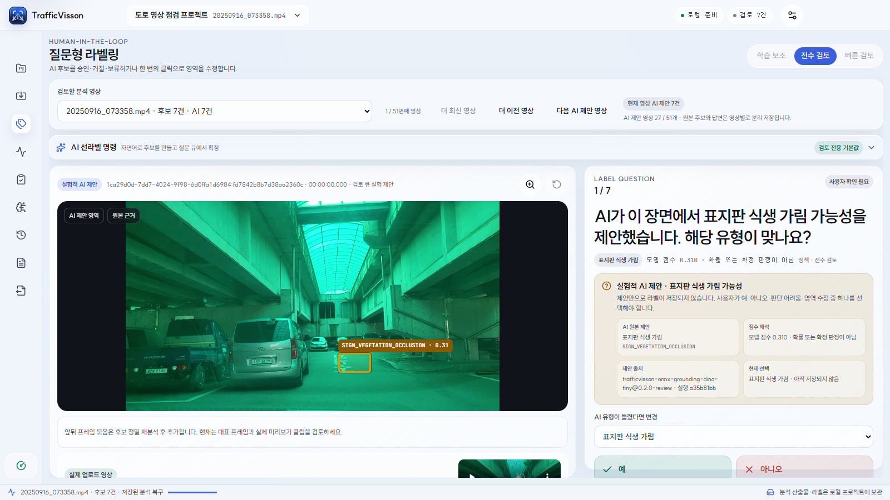

AI 명령 패널을 열면 패널이 질문·영상 위를 덮고, 뒤의 질문과 답변을 반쯤 보이게 만든다. 팝오버처럼 보이지만 배경 차단·포커스 격리·명확한 레이어 전환이 없어 겹친 화면으로 인식된다.

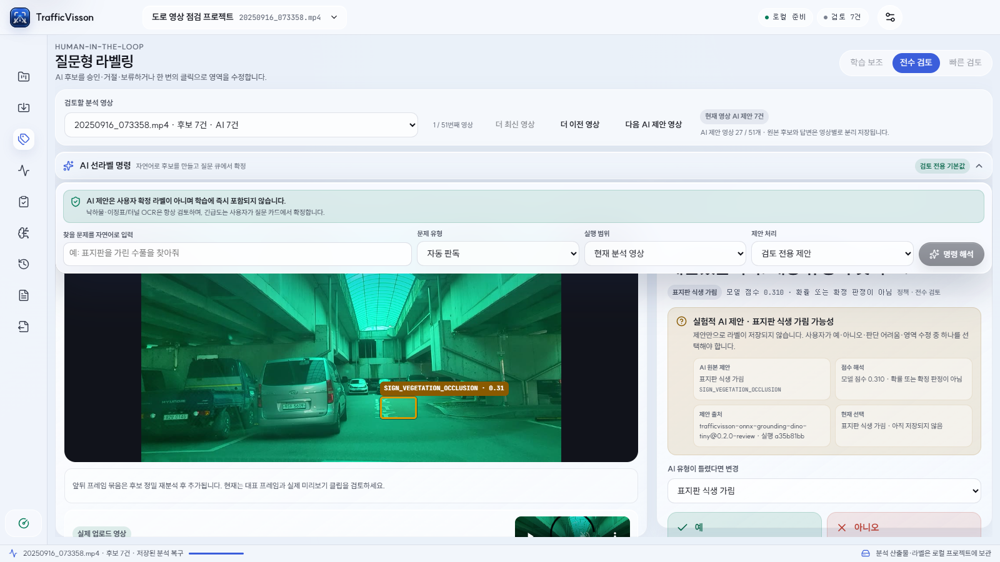

권장 수정:

1. 높이 820px 이하에서만 쓰는 compact 규칙을 고정 breakpoint가 아니라 실제 가용 작업 높이 기준으로 바꾼다.
2. 질문과 4개 답변, 건너뛰기를 항상 보이는 필수 영역으로 먼저 예약한다.
3. 큰 영상의 `42vh` 중심 크기 결정을 버리고, 남은 공간 안에서 줄어드는 `minmax(0, 1fr)` 구조로 바꾼다.
4. AI 명령은 질문 위를 덮는 절대 위치 패널이 아니라 레이아웃에 참여하는 compact row 또는 별도 modal로 만든다.
5. 한 화면 원칙을 유지하려면 답변 설명·제안 provenance는 접거나 압축하되 질문 문장과 답변 버튼은 절대 자르지 않는다.

### [Blocker] V-02 — 1280×720에서 AI 명령을 열면 질문 문장이 잘린다

1280×720에서는 전체 구조가 compact 모드로 바뀌어 답변 버튼은 보인다. 하지만 AI 명령 패널을 열면 질문 제목의 실제 높이는 43px인데 보이는 높이는 19px뿐이다. 질문이 `해당 유형이…`에서 끊긴다. 안전 안내 문장도 한 줄 ellipsis로 잘린다.

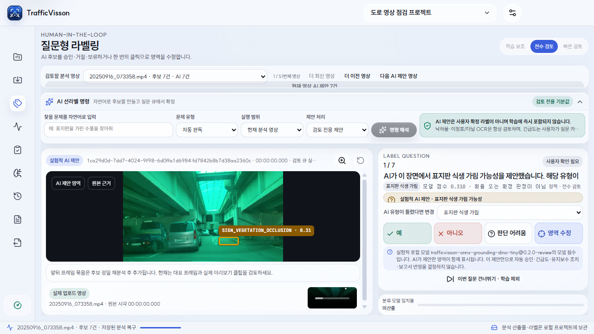

질문형 라벨링 제품에서 질문 원문을 자르는 것은 장식 문제가 아니다. 오답과 잘못된 학습 데이터로 직접 이어지는 작업 오류다.

### [High] V-03 — 분석 화면이 viewport별로 서로 다른 방식으로 실패한다

1280×720:

- 저장된 분석 표의 보이는 높이 76px
- 실제 scrollHeight 2219px
- 한 행 정도만 보여 “51개 작업”을 탐색하기 어렵다

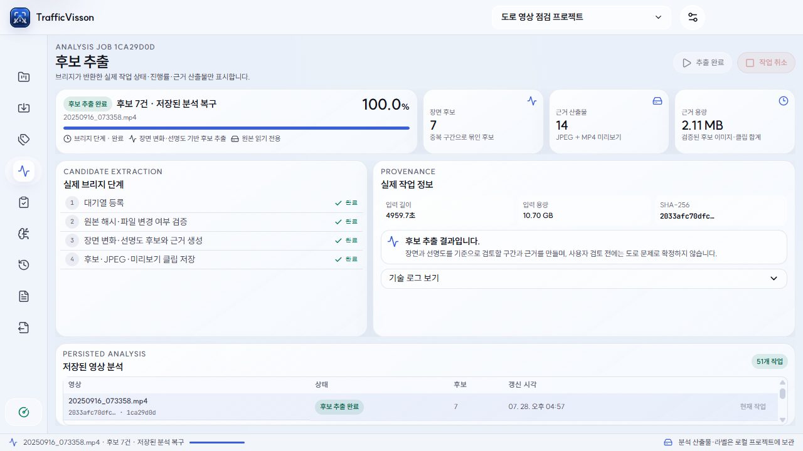

1600×900:

- 실제 브리지 단계: clientHeight 133px / scrollHeight 231px
- 실제 작업 정보: clientHeight 133px / scrollHeight 303px
- 저장된 분석 표: clientHeight 308px / scrollHeight 3249px
- 한 화면에 세 개의 독립 세로 스크롤바가 생김

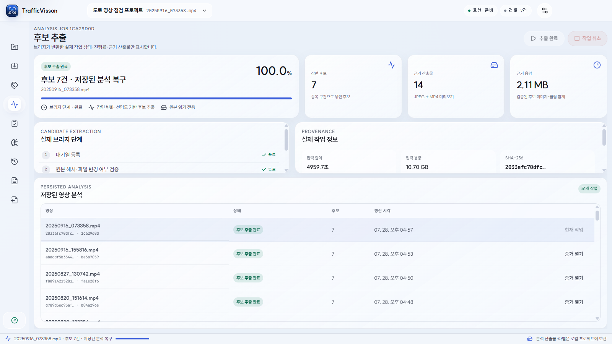

짧은 화면용 CSS가 1280×720을 어느 정도 구제하지만 821px 이상의 높이에서는 기본 규칙으로 되돌아가면서 오히려 세 패널이 동시에 스크롤된다. breakpoint 자체가 작업 구조와 반대로 작동하고 있다.

권장 수정:

- 브리지 단계와 provenance는 모두 보이는 고정 summary로 압축한다.
- 긴 데이터의 유일한 세로 scroll owner를 저장된 분석 표 하나로 제한한다.
- 1280에서는 표를 최소 3행, 1600에서는 최소 5행 이상 보이게 한다.
- 기술 로그는 펼침 후에만 공간을 차지하게 한다.

### [High] V-04 — 1600×900 공간 배분이 화면마다 일관되지 않다

홈은 핵심 카드가 화면 상단 약 610px 안에 끝나고 아래에 큰 빈 공간이 남는다. 반대로 라벨링은 같은 viewport에서 영상이 과도하게 커져 답변이 화면 밖으로 밀린다. 즉, 단순히 “공간이 부족하다”가 아니라 **화면별 세로 공간 배분 규칙이 통일되지 않았다.**

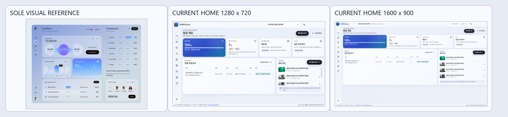

기준 이미지가 잘하는 것은 카드 개수가 아니라 전체 세로 리듬이다. 위·중간·아래 작업이 화면을 균형 있게 채운다. TrafficVisson 홈은 1600×900에서 위쪽만 쓰고, 라벨링은 그 반대로 과밀하다.

### [High] V-05 — 1280 모델 소스 표는 읽기보다 “들어가기”에 맞춰져 있다

1280×720 모델 화면은 239px 안에 420px 표를 넣어 스크롤하게 한다. `자연어 의미 후보 점수`, `자동확정 금지` 같은 한국어가 단어 중간에서 줄바꿈된다. 1600×900에서는 5개 행이 모두 보이고 훨씬 안정적이다.

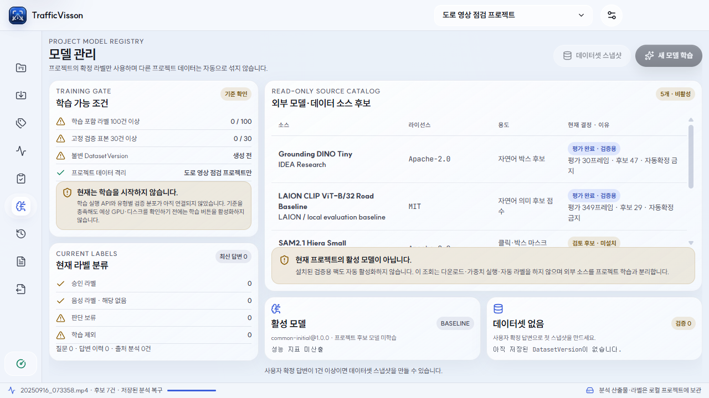

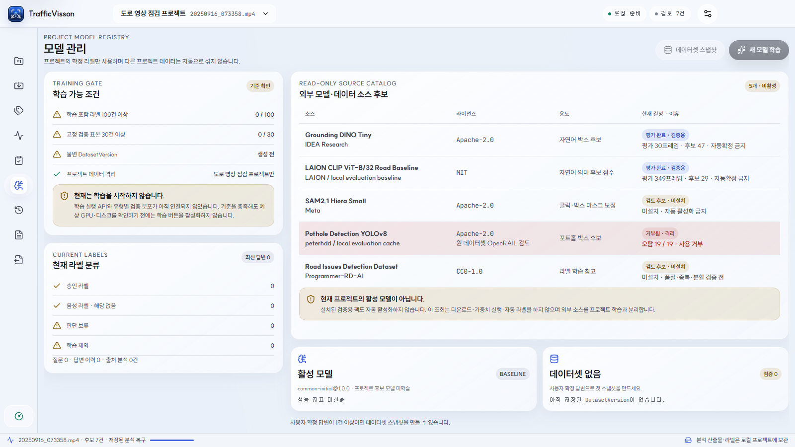

권장 수정:

- 1280에서는 소스 후보를 4열 표가 아니라 `소스 + 판정` 중심의 compact row로 바꾼다.
- `word-break: keep-all`과 최소 열 너비를 적용한다.
- 라이선스·용도는 2차 정보로 묶고, 설치/검증/거부 상태를 1차 정보로 둔다.

### [Medium] V-06 — 추적성은 강하지만 축약이 과해 “다녀오지 않은 사람”에게 불친절하다

히스토리와 사건 검토는 영상·시각·후보·GPS·판정 이력을 한 화면에 묶는 방향이 좋다. 다만 실제 보이는 화면에서 candidate id, source, GPS 좌표, provenance가 여러 곳에서 ellipsis로 끊긴다. 화면에 SHA와 id가 많지만 사람이 이해할 이름과 도로 구간 설명은 상대적으로 약하다.

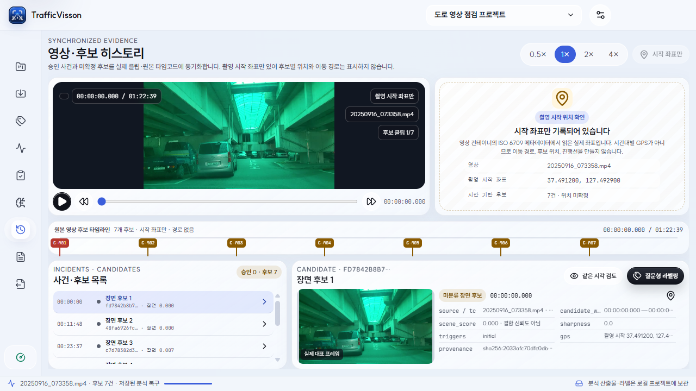

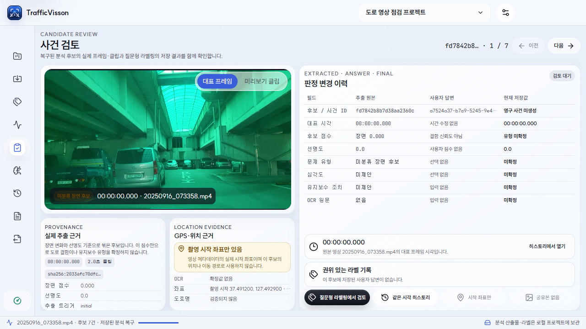

권장 수정:

- 원시 id 대신 `영상명 · 시각 · 후보 번호`를 기본 제목으로 사용한다.
- 전체 SHA/id는 hover, 복사 버튼, 펼침 상세에서 제공한다.
- 위치 정보는 검증 상태와 사람이 읽을 도로/구간명을 같은 줄에 둔다.

### [Medium] V-07 — 하단 고정 정보가 표와 경쟁한다

내보내기 1280 화면은 왼쪽 9개 산출물을 모두 보여주는 점이 좋다. 하지만 오른쪽 표의 마지막 보이는 행은 하단 provenance badge bar와 시각적으로 겹쳐 보이고, 표 자체도 438px/589px 내부 스크롤이다. 표 하단이 “더 있음”인지 “잘림”인지 한눈에 명확하지 않다.

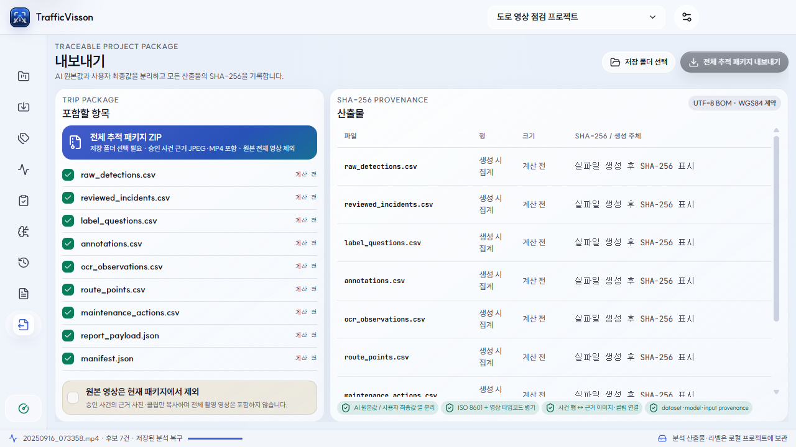

## 시각 디자인 평가

### 잘된 점

- 일반 Electron `File / Edit / View` 메뉴와 창 안의 가짜 둥근 웹 shell이 없어졌다. **현재 화면은 하나의 실제 프로그램처럼 보인다.**
- 기준 이미지의 청회색 배경, 밝은 matte panel, 강한 파란 hero, 검은 pill CTA, 큰 radius를 일관되게 가져왔다.
- 아이콘은 한 라이브러리의 선형 스타일로 통일돼 있다.
- Review, History, Report는 서로 다른 업무인데도 패널, 상태 badge, 정보 밀도 언어가 같다.
- 1280에서 홈·가져오기·검토·히스토리·보고서·내보내기 핵심 시작점이 첫 화면에 보인다.

### 아쉬운 점

- 카드가 거의 모두 같은 밝기·같은 흰색·같은 radius여서 기준 이미지보다 깊이 계층이 약하다.
- `HUMAN-IN-THE-LOOP`, `READ-ONLY SOURCE CATALOG`, `TRACEABLE PROJECT PACKAGE`, raw job id 같은 개발자형 상단 문구가 현장 점검 사용자의 시선을 분산시킨다.
- 1600 홈은 세로로 비고, 1600 라벨링은 반대로 넘친다.
- 작은 mono text와 9~11px 보조 문구가 많아 125% Windows 배율에서 추가 검증이 필요하다.
- 왼쪽 nav는 아이콘만 보인다. 기준 이미지와는 맞지만, 9개 도로 업무를 처음 쓰는 사용자는 tooltip을 보기 전까지 아이콘 의미를 추측해야 한다. 1440px 이상에서는 짧은 라벨을 표시하는 편이 낫다.

## SUIT 글꼴 확인

실행 renderer에서 다음을 확인했다.

- `document.fonts.status = loaded`
- `document.fonts.check("16px SUIT") = true`
- body computed font: `"SUIT Variable", SUIT, system-ui, sans-serif`
- 빌드 산출물: `SUIT-Variable-*.woff2` 624,536 bytes

한글 본문은 선명하고 숫자·영문과의 높이도 안정적이다. 다만 표의 좁은 열에서 한국어 단어가 중간 분리되는 문제는 글꼴이 아니라 layout/word-break 문제다.

## 키보드·접근성

### 확인된 장점

- 모든 보이는 icon-only button에 aria-label 또는 title이 있었다.
- screen마다 H1 하나와 논리적인 H2/H3 구조가 있었다.
- focus-visible outline은 `3px rgba(59, 94, 219, 0.42)`로 실제 화면에서 명확했다.
- 앱은 화면 전환 후 MAIN workspace에 초점을 옮겨 사용자가 바로 본문 조작을 시작하게 한다.

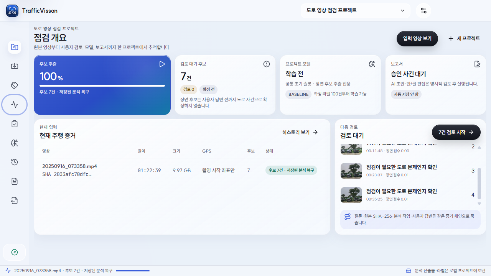

### 위험

- 홈의 `분석 결과 보기`는 30×30px, 라벨링 확대는 32×32px이다.
- 히스토리 재생/앞뒤 이동은 34×34px, timeline marker는 32×34px, 배속 버튼 높이는 32px이다.
- WCAG 2.5.8의 24px 최소에는 대체로 들어오지만 Windows desktop에서 편안한 40~44px 조작 기준에는 못 미친다.
- 1280 AI 명령 열림 상태처럼 질문이 시각적으로 잘리면 screen reader가 전문을 읽더라도 시각 사용자에게는 동등한 정보가 아니다.
- 색 대비는 screenshot과 computed style의 일부만 확인했다. WCAG 대비비, Windows 고대비 모드, 125/150% 배율, 실제 screen reader는 이번 감사에서 완료하지 않았다.

## 성능 측정

### Renderer 체감 성능

| 측정 | 결과 |
|---|---:|
| navigation loadEventEnd | 136.1ms |
| first paint / FCP | 392ms |
| 9개 화면 × 3회 전환, 2 animation frame까지 | 27회 |
| 화면 전환 중앙값 | 66.2ms |
| 화면 전환 평균 | 66.8ms |
| 화면 전환 p95 | 75.0ms |
| 최소 / 최대 | 59.2 / 76.2ms |
| 관찰된 long task | 0건 |
| renderer JS heap used | 13.36MB |

화면 전환은 빠르고, lazy screen을 미리 불러오는 방식도 체감상 잘 작동했다.

### 빌드 크기

| 항목 | 결과 |
|---|---:|
| JS | 18 files / 432.7KB raw |
| CSS | 1 file / 108.4KB raw |
| font | 6 files / 692.1KB raw |
| SUIT variable font | 624.5KB |

프론트엔드 번들 자체는 가볍다. custom `trafficvisson://` protocol에서는 Resource Timing entry가 0건으로 표시되어 renderer 내부 transfer size 비교는 할 수 없었다.

### 프로세스 메모리 스냅샷

실제 Electron + local Python bridge 유휴 상태의 working set 합계는 약 **667.9MB**였다.

| 프로세스 | Working set |
|---|---:|
| Electron browser | 116.0MB |
| Electron GPU | 258.0MB |
| Electron utility | 49.2MB |
| Electron renderer | 165.9MB |
| Python bridge | 71.3MB |
| conhost | 7.5MB |

현장 노트북에서 영상 decode, ONNX/CUDA 모델, 지도, HWP COM까지 동시에 올리면 메모리 압박이 커질 수 있다. 이번 값은 inference와 실제 장시간 영상 재생 전의 유휴 기준이다. GPU/AI 추론, 장시간 playback, HWP COM, export peak memory는 별도 성능 예산과 장시간 측정이 필요하다.

## 화면별 단계와 건강도

1. **최초 실행 홈 1600×1000 — 양호**  
   Electron 기본 창 크기와 위치, 메뉴 제거, renderer 전체 창 사용을 확인했다. 아래쪽 공간은 많이 남는다.  
   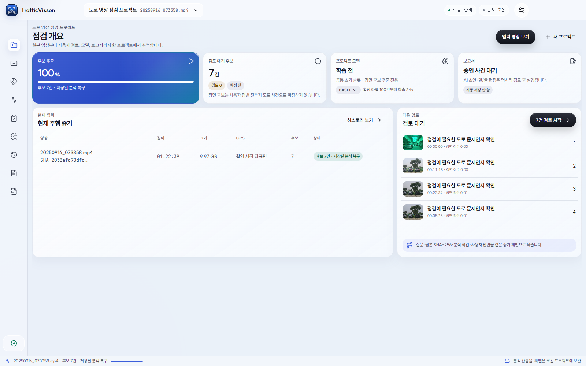

2. **홈 1600×900 — 보통**  
   카드가 깔끔하지만 하단의 큰 빈 공간 때문에 기준 이미지보다 세로 리듬이 약하다.  
   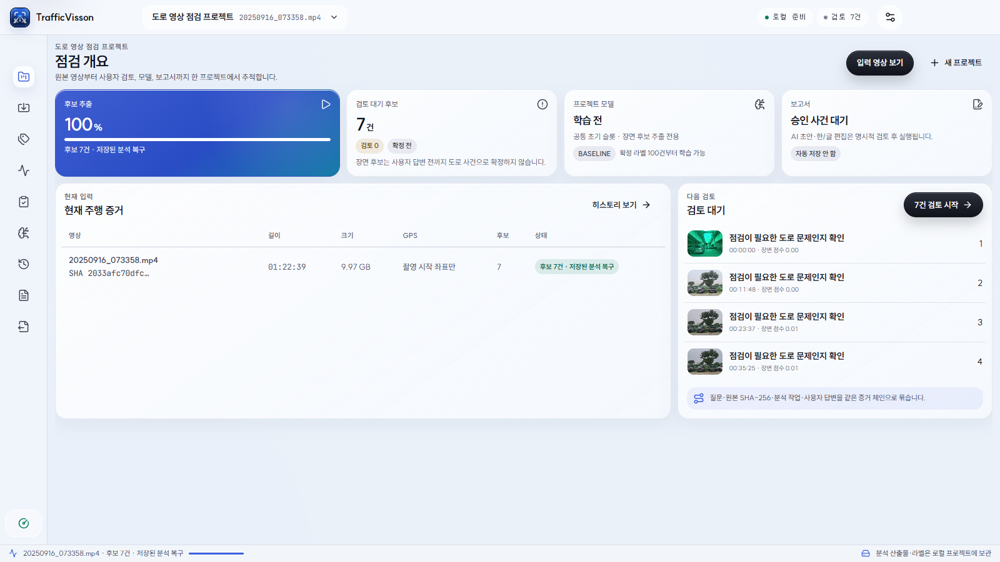

3. **홈 1280×720 — 양호**  
   핵심 지표·현재 영상·검토 시작이 한 화면에 있고 document scroll은 없다.  
   

4. **영상 가져오기 1280×720 — 양호**  
   출처→검사→GPS 3단계가 동시에 보인다. 긴 UNC path는 한 줄 축약되지만 title로 전체 경로가 제공된다.  
   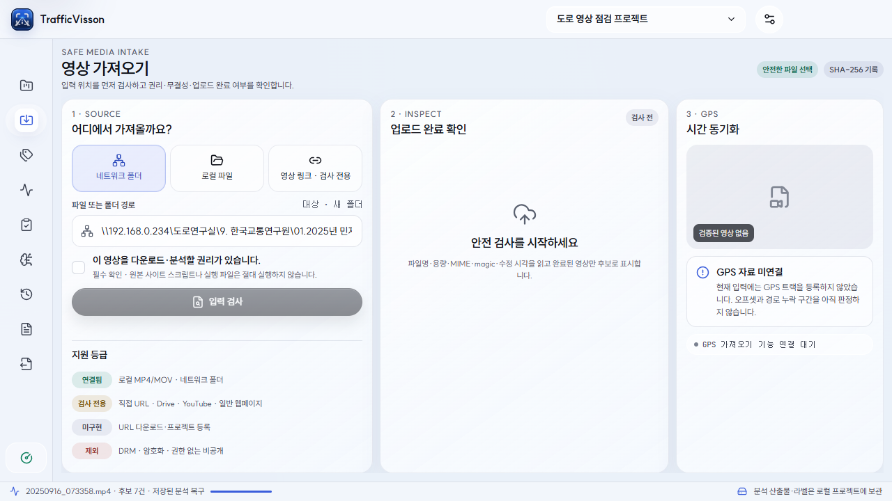

5. **질문 라벨링 1280×720 기본 — 양호**  
   대표 이미지, 질문, 유형 선택, 네 답변, 건너뛰기가 보인다.  
   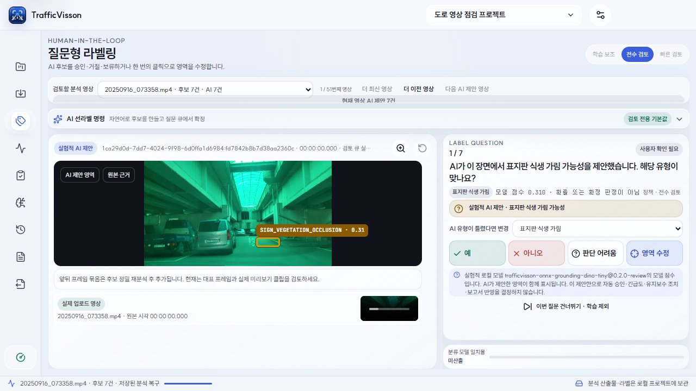

6. **질문 라벨링 1280×720 AI 명령 열림 — 실패**  
   질문 문장과 안전 안내가 잘린다.  
   

7. **질문 라벨링 1600×900 기본 — 실패**  
   핵심 답변과 진행 상태가 viewport 아래로 밀린다.  
   

8. **질문 라벨링 1600×900 AI 명령 열림 — 실패**  
   패널이 질문/근거 위에 겹친다.  
   

9. **분석 1280×720 — 주의**  
   상단 상태는 좋지만 작업 표가 한 행 높이로 압축된다.  
   

10. **분석 1600×900 — 실패**  
    서로 다른 세 개의 세로 scroll owner가 동시에 생긴다.  
    

11. **사건 검토 1280×720 — 양호**  
    프레임, provenance, 위치, 변경 이력, 다음 행동이 한 화면에 보인다.  
    

12. **모델 관리 1280×720 — 주의**  
    읽기는 가능하나 표의 한국어 단어 분리와 내부 scroll이 거슬린다.  
    

13. **모델 관리 1600×900 — 양호**  
    5개 소스가 모두 보이고 상태·라이선스·판정이 한 번에 읽힌다.  
    

14. **GPS 히스토리 1280×720 — 양호/주의**  
    영상·좌표·timeline·후보가 동기화된 구조는 강하다. 긴 trace 값은 과도하게 축약된다.  
    

15. **보고서 1280×720 — 양호**  
    provider, 전송 범위, 편집 계획, 문서 preview가 분리돼 있다. document preview만 내부 scroll을 가진다.  
    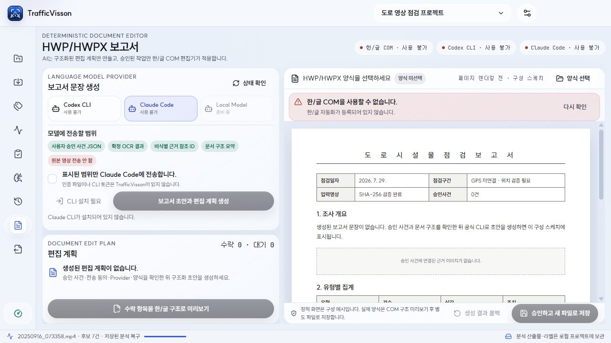

16. **보고서 1600×900 — 양호**  
    큰 화면을 가장 안정적으로 활용한 화면이다.  
    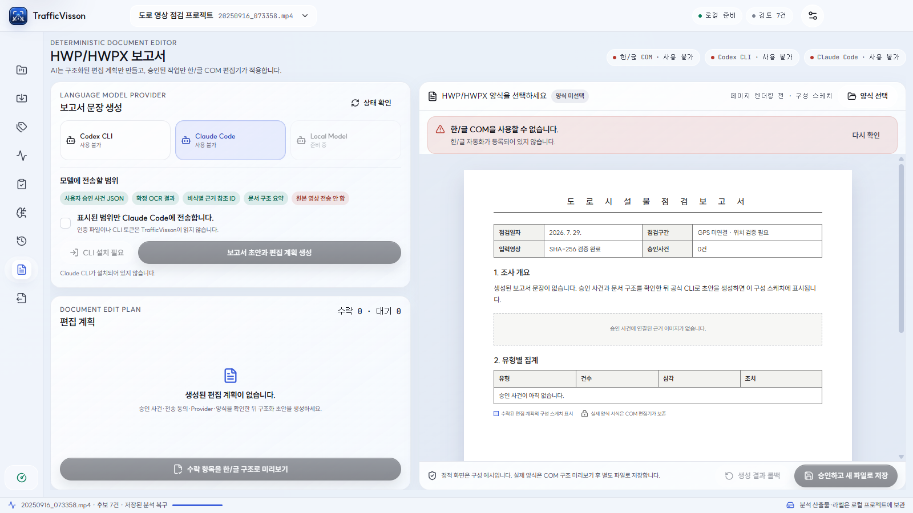

17. **내보내기 1280×720 — 양호/주의**  
    포함 항목은 모두 보이지만 오른쪽 표와 하단 badge bar의 경계가 혼잡하다.  
    

18. **키보드 포커스 — 양호**  
    nav와 첫 작업 CTA의 outline이 명확하다.  
    
    

## 비교용 contact sheet

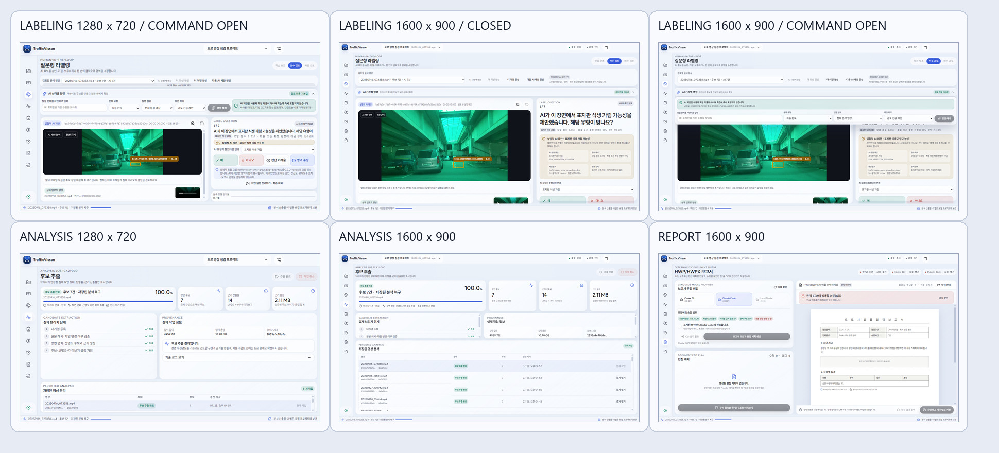

## 수정 우선순위

1. **즉시:** 1600×900 라벨링에서 질문·4개 답변·건너뛰기를 viewport 안에 고정한다.
2. **즉시:** AI 명령 패널이 질문을 덮지 않게 하고, 1280 질문 전문을 2줄 이상 보장한다.
3. **즉시:** 분석 화면의 세로 scroll owner를 저장된 작업 표 하나로 줄인다.
4. **다음:** 1600 홈의 빈 공간과 라벨링 과밀을 같은 세로 공간 시스템으로 통일한다.
5. **다음:** 1280 모델 소스 표를 compact row로 바꾸고 한국어 단어 중간 줄바꿈을 없앤다.
6. **다음:** trace id는 펼침/복사 상세로 보내고 사람이 읽는 영상·시각·구간명을 앞에 둔다.
7. **다음:** 30~34px icon/timeline target을 40px 이상으로 키운다.
8. **검증:** 100/125/150% Windows 배율, 고대비, screen reader, 장시간 영상 재생, 실제 AI 추론 중 메모리 peak를 별도 측정한다.

## 감사 한계

- 실제 Electron 소스 빌드와 현재 로컬 프로젝트 데이터를 사용했다.
- 9개 기본 화면, 1280×720 전체, 1600×900 주요 dense 화면, AI 명령 열림/닫힘, 키보드 focus, 27회 화면 전환을 확인했다.
- 실제 영상 연속 재생, 지도 경로 animation, 모델 inference, 새 학습, HWP COM 편집, 최종 export 실행은 이번 시각/성능 pass에서 수행하지 않았다.
- screenshot만으로 WCAG 전체 준수나 screen reader 호환을 확정하지 않았다.
- 발견과 증거만 기록했으며 이 감사에서는 UI 소스 코드를 수정하지 않았다.
