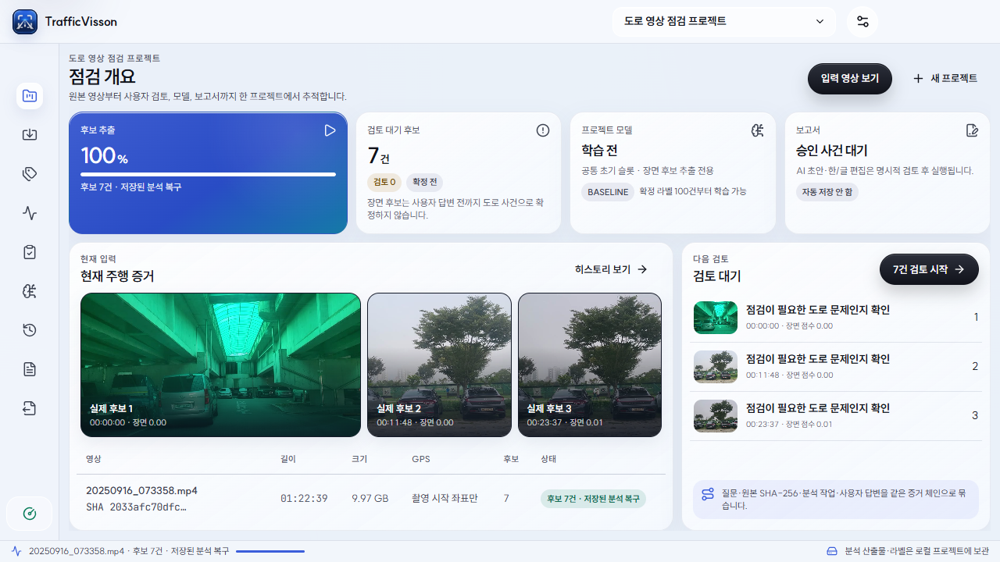
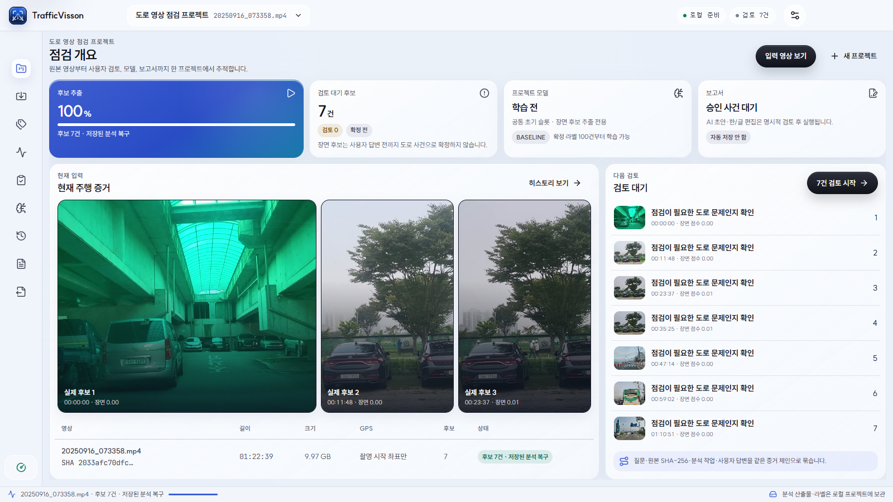
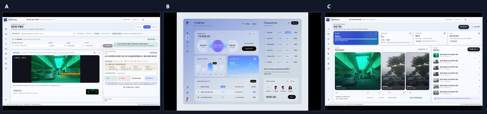

# TrafficVisson Postfix Design Audit

감사 일시: 2026-07-29  
감사 대상: Electron 소스 빌드 `desktop@0.1.0-alpha.10`  
판정: **NOT PASSED — P0 0건 / P1 0건 / P2 3건**

`PASSED`는 P0·P1·P2가 모두 0건일 때만 부여한다. 최신 화면은 브라우저 문서를 창 안에 다시 넣은 형태가 아니라, Electron 렌더러 전체를 사용하는 하나의 Windows 데스크톱 프로그램으로 동작한다. 1280×720에서 9개 주요 화면 모두 문서 스크롤 없이 핵심 기능이 한 화면에 들어오며, 홈은 실제 후보 이미지 3장까지 표시한다. 다만 라벨링의 안전 설명 일부가 말줄임되고, 히스토리 제목 한 줄이 잘리며, 여러 화면의 8~10px 보조 텍스트가 실제 판독 업무에 비해 작다. 따라서 핵심 흐름을 막는 P1은 없지만 최종 디자인 통과로 판정할 수는 없다.

## 감사 범위와 방법

- 최신 소스에서 `npm run build:desktop`을 다시 실행한 뒤, 격리된 임시 사용자 프로필로 실제 Electron을 새로 실행했다.
- 실행 창 제목은 `TrafficVisson · 로컬 AI 도로점검`, 렌더러 URL은 `trafficvisson://app/index.html`이었다.
- 1280×720에서 홈, 가져오기, 질문형 라벨링, 분석, 사건 검토, 모델 관리, GPS 히스토리, 보고서, 내보내기 등 9개 화면을 순서대로 열었다.
- 1600×900에서는 홈, 질문형 라벨링, 분석, 재생 중 히스토리, 모델 관리를 다시 확인했다.
- Electron 프로세스에 `--force-device-scale-factor=1.25`를 적용해 DPR 1.25 경로를 별도 실행했다. Windows 전역 설정을 바꾼 테스트는 아니지만, Electron이 보고한 `devicePixelRatio`와 display scale factor는 모두 1.25였다.
- 화면마다 문서 크기, 실제 스크롤 소유자, 가시 컨트롤 경계, 텍스트 클리핑, 계산된 글꼴, 한글 줄바꿈을 DOM에서 측정하고 스크린샷을 육안으로 다시 확인했다.
- 분석 테이블에 마우스 휠 520px을 입력했을 때 문서는 `scrollTop=0`을 유지하고 `.analysis-records-table-wrap`만 `0→520`으로 이동하는 것을 확인했다.
- 히스토리에서 재생을 누른 뒤 영상 시간이 약 2초 진행되고 재생 버튼이 일시정지 상태로 바뀐 화면을 캡처했다.
- 렌더러 상태 테스트는 `87/87 PASS`, 타입 체크와 최신 데스크톱 빌드는 성공했다.
- 감사자는 제품 소스 코드를 수정하지 않았다. 이 문서와 `postfix-audit` 증거 이미지만 작성했다.

## 핵심 결과

### 한 화면 구성

1280×720에서 `documentElement`의 client/scroll 크기는 모든 주요 화면에서 `1280×720`으로 동일했고 문서의 `scrollTop`은 0이었다. 긴 데이터는 문서가 아니라 필요한 영역 한 곳이 스크롤을 소유한다.

| 화면 | 문서 스크롤 | 실제 내부 스크롤 소유자 | 필수 영역 상태 | 증거 |
|---|---:|---|---|---|
| 홈 | 없음 | 없음 | 실제 후보 이미지 3장, 후보 큐 3건, 입력 표까지 표시 | [01 홈 1280](postfix-audit/01-home-1280x720-100.png) |
| 영상 가져오기 | 없음 | 없음 | 입력 방식·경로·검증 안내가 한 화면에 표시 | [02 가져오기](postfix-audit/02-import-1280x720-100.png) |
| 질문형 라벨링 | 없음 | 열린 상태에서도 실질 0~2px의 미디어 보정 여유만 존재 | 영상, 질문, 4개 답변, 건너뛰기까지 표시 | [03 닫힘](postfix-audit/03-labeling-1280x720-100-closed.png), [03b 열림](postfix-audit/03b-labeling-1280x720-100-open.png) |
| 분석 | 없음 | `.analysis-records-table-wrap` | 진행 요약·파이프라인·출처와 첫 분석 행 표시 | [04 분석](postfix-audit/04-analysis-1280x720-100.png) |
| 사건 검토 | 없음 | 없음 | 영상 근거·판정 데이터·이동 버튼 표시 | [05 사건 검토](postfix-audit/05-review-1280x720-100.png) |
| 모델 관리 | 없음 | `.model-table-wrap` 한 곳 | 학습 조건·소스 카탈로그·활성 모델·데이터셋 상태 표시 | [06 모델](postfix-audit/06-models-1280x720-100.png) |
| GPS 히스토리 | 없음 | `.incident-list` | 영상·지도 상태·타임라인·사건·근거 동시 표시 | [07 히스토리](postfix-audit/07-history-1280x720-100.png) |
| 보고서 | 없음 | `.document-stage` | Provider·편집 계획·문서 미리보기·저장 제어 표시 | [08 보고서](postfix-audit/08-report-1280x720-100.png) |
| 내보내기 | 없음 | `.artifact-table-wrap` | 패키지 선택·산출물 목록·provenance 표 동시 표시 | [09 내보내기](postfix-audit/09-export-1280x720-100.png) |

화면 밖으로 검출된 `본문 바로가기` 링크는 키보드 포커스를 받기 전 의도적으로 위쪽에 숨겨진 접근성 링크다. 분석·히스토리의 일부 행 버튼이 viewport 아래로 측정된 것은 내부 스크롤포트의 정상 콘텐츠이며 문서 잘림이 아니다.

### 최신 홈

홈은 마지막 수정분까지 재빌드한 뒤 다시 캡처했다.

- 1280×720: 문서 `1280×720`, 내부 스크롤 0개, 후보 이미지 3장의 하단 `559.27px`, 하단 패널의 하단 `680px`이다.
- 1600×900: 문서 `1600×900`, 내부 스크롤 0개, 실제 후보 이미지 3장과 후보 큐 7건을 모두 표시한다.
- 125% 프로세스 배율: CSS viewport `1282×722`, 문서 scroll 크기도 `1282×722`, 내부 스크롤 0개다. 2px 차이는 Windows/Electron 최소 창 크기의 DPI 반올림이며 콘텐츠 overflow가 아니다.

### 1600×900 주요 화면

| 화면 | 측정 결과 | 증거 |
|---|---|---|
| 홈 | 문서·viewport 1600×900, 스크롤 0, 후보 이미지 3장·큐 7건 | [10 홈](postfix-audit/10-home-1600x900-100.png) |
| 질문형 라벨링 | AI 명령 패널 열린 상태, 문서 스크롤 0, 답변 영역 전체 표시 | [11 라벨링](postfix-audit/11-labeling-1600x900-100-open.png) |
| 분석 | 문서 스크롤 0, 분석 기록 표만 내부 스크롤 | [12 분석](postfix-audit/12-analysis-1600x900-100.png) |
| GPS 히스토리 | 재생·영상·타임라인·사건·근거 동시 표시, 사건 목록만 내부 스크롤 | [13 재생 중](postfix-audit/13-history-1600x900-100-playing.png) |
| 모델 관리 | 문서·내부 스크롤 0, 상태 문장 하단 860px | [14 모델](postfix-audit/14-models-1600x900-100.png) |

### 125% 배율

| 화면 | CSS viewport / DPR | 결과 | 증거 |
|---|---|---|---|
| 홈 | 1282×722 / 1.25 | 문서 크기 일치, 스크롤 0, 실제 후보 3장 표시 | [15 홈 125%](postfix-audit/15-home-1280x720-125.png) |
| 질문형 라벨링 | 1282×722 / 1.25 | 4개 답변과 건너뛰기 표시, 문서 스크롤 0 | [16 라벨링 125%](postfix-audit/16-labeling-1280x720-125-open.png) |
| 분석 | 1282×722 / 1.25 | 문서 스크롤 0, 분석 표만 `1141×76 → scrollHeight 2210` | [17 분석 125%](postfix-audit/17-analysis-1280x720-125.png) |

초기 캡처 직후 한 차례 Electron compositor가 상단 56px를 생략한 프레임을 반환했지만, DOM의 titlebar rect는 정상이고 안정화 후 동일 화면을 재캡처했을 때 상단 바가 온전히 표시됐다. 최종 증거 파일은 안정화 후 프레임이다.

## 글꼴·한글·접근성

- 모든 측정 화면에서 `document.fonts.check("16px SUIT")`와 `document.fonts.check('16px "SUIT Variable"')`가 모두 `true`였다.
- `body`, 제목, 버튼의 계산된 글꼴은 `"SUIT Variable", SUIT, system-ui, sans-serif`였다.
- 일반 한글 문구의 계산값은 주로 `word-break: normal`, `overflow-wrap: normal`이었다. 눈에 띄는 음절 단위 강제 분할은 없었다.
- SHA, UUID, 긴 좌표·모델 ID는 폭이 부족할 때 말줄임 또는 `overflow-wrap:anywhere`를 사용한다. 이는 의미가 보조 정보일 때만 허용할 수 있다.
- 좌측 내비게이션 버튼에는 `프로젝트 홈 (1)`처럼 명시적 접근성 이름이 있고, 87개 렌더러 테스트 중 내비게이션 이름·본문 건너뛰기·진단 대화상자 포커스·타임라인 32px 타깃 테스트가 통과했다.
- 수동 스크린리더 낭독, Windows 고대비 모드, 200% 이상 확대는 이번 범위에 포함하지 않았다.

## 모델 화면 상태 문장 정밀 판정

1280 모델 화면의 마지막 상태 문장은 저해상도 전체 캡처에서 흐리게 보일 수 있으나 실제 glyph crop은 아니다.

- `.model-message`: `x=477.45, y=663, w=790.55, h=17, bottom=680`
- 실제 Range 텍스트 박스: `y=663, h=15, bottom=678`
- 계산 글꼴: `12px`, `line-height=16.8px`, `font-weight=400`
- client/scroll: `791×17 / 791×17`
- canvas 잉크 높이: ascent 10 + descent 1 = 11px
- `.model-main` 하단: `680px`
- 상태바 시작: `692px`
- 상태 문장과 상태바 사이: `12px`

따라서 이 항목은 P1 또는 P2가 아니다. [4배 최근접 확대](postfix-audit/06-models-status-detail-4x.png)에서도 하단 자모가 온전히 보인다.

## 블라인드 레퍼런스 비교

유일한 레퍼런스 PNG와 최신 현재 화면 두 장을 동일 시트에 A/B/C로 익명 배치하고, 파일 매핑을 알려주지 않은 별도 리뷰어가 시각 계층·리퀴드 글래스·밀도·데스크톱 제품 신뢰도를 평가했다.

매핑은 다음과 같다.

- A: 현재 질문형 라벨링
- B: 레퍼런스
- C: 현재 홈

블라인드 순위는 시각 계층 `C > A > B`, 리퀴드 글래스 일관성 `B > C > A`, 정보 밀도·가독성 `C > B > A`, 데스크톱 제품 신뢰도 `A > C > B`였다. 현재 홈은 레퍼런스보다 운영 정보의 계층과 데스크톱 활용이 강하고, 라벨링은 전문 작업 프로그램으로서 가장 신뢰감이 높았다. 반대로 레퍼런스는 가장 일관된 반투명 표면·부드러운 깊이·여백을 가진다. B 좌우의 검은 여백은 4:3 레퍼런스를 16:9 비교 칸에 왜곡 없이 넣으면서 생긴 컨택트시트 합성 여백이므로 레퍼런스 제품 결함으로 판정하지 않았다.

현재 화면에 대한 블라인드 P2 의견은 A의 작은 글자·중첩된 테두리·빽빽한 제어, C의 작은 반복 메타데이터·희미한 보조 텍스트였다. 이는 아래 실측 P2와 일치한다.

## P0 / P1 / P2 판정

### P0

없음.

### P1

없음. 1280×720에서 영상, 질문, 답변, 지도 상태, 보고서 제어, 내보내기 제어 등 핵심 작업 영역이 화면 밖으로 사라지거나 사용할 수 없는 경우는 발견하지 못했다.

### P2-1 — 라벨링 안전 설명 말줄임

AI 명령 패널이 열린 1280 최소 창과 125% 경로에서 다음 필수 설명이 잘린다.

- `낙하물·이정표/터널 OCR은 항상 검토하며, 긴급도는 사용자가 질문 카드에서 확정합니다.`  
  client width 316px, scroll width 382px, `text-overflow: ellipsis`.
- 실험 모델 설명은 client `401×15`, scroll `401×45`로 한 줄만 보인다. 뒤쪽의 `자동 승인·긴급도·유지보수 조치·보고서 반영을 결정하지 않습니다`가 화면에서 완전히 읽히지 않는다.

예·아니오·판단 어려움·영역 수정과 건너뛰기 버튼은 보이므로 핵심 조작을 막는 P1은 아니다. 그러나 자동 확정이 아니라는 안전 경계와 강제 검토 유형은 사용자가 오해하면 안 되는 내용이므로 P2다. 최소 창에서도 2줄을 허용하거나, 전체 문장을 즉시 열 수 있는 명시적 정보 제어가 필요하다.

### P2-2 — 1600 히스토리 제목 상단 잘림

1600×900 히스토리에서 `.screen`은 `y=68`인데, `.screen-header` 왼쪽 텍스트 묶음이 `y=61.5`에서 시작해 `SYNCHRONIZED EVIDENCE`의 위쪽 약 6.5px이 잘린다. 제목과 핵심 기능은 사용 가능하므로 P1은 아니지만 완성도 결함이 명확하다. 헤더의 고정 높이와 세로 중앙 정렬을 함께 사용하지 말고, 왼쪽 설명 블록 높이에 맞춰 시작점을 screen 안으로 고정해야 한다.

### P2-3 — 반복 보조 정보의 8~10px 크기와 낮은 대비

- 히스토리 타임라인의 `C-001`~`C-007`은 8px이다.
- 히스토리 사건 해시·점수는 9px, 시간은 10px이다.
- 홈 후보 시간·장면 점수는 10px이다.
- 라벨링 모델 ID·일부 상태 메타데이터는 10~10.5px이다.

장식 텍스트가 아니라 사건 시각·점수·후보 ID처럼 증거를 구분하는 정보가 포함돼 있다. 125%에서는 물리 픽셀이 늘지만 CSS 기준과 저시력 사용자의 판독 부담은 그대로다. 최소 11.5~12px, 더 높은 보조 글자 대비, 반복 행의 시각적 군집화를 권장한다.

## P3 및 범위 외 관찰

- 블라인드 비교에서 홈의 100% 파란 카드가 다른 요약 카드보다 강하다는 의견이 있었다. 현재는 완료 상태와 다음 행동을 강조하는 합리적인 주 앵커이므로 P2로 올리지 않았지만, 채도나 면적을 조금 낮추면 시선 분배가 더 안정적이다.
- 라벨링은 전문 도구로서 신뢰감이 높지만 테두리와 상태 스트립이 여러 겹이다. 기능을 줄이지 않고도 1차/2차 정보의 경계를 표면 톤 차이로 단순화할 수 있다.
- 빌드에서 HistoryScreen 청크가 약 969kB로 500kB 경고를 냈다. 현재는 무거운 화면이 lazy-load되고 초기 렌더러에 지도 CSS가 포함되지 않는 테스트가 통과했으므로 이번 시각 감사의 P2로 판정하지 않았다. 실제 저사양 PC에서 첫 히스토리 진입 시간을 별도 성능 예산으로 측정해야 한다.
- GPX가 연결되지 않은 현재 데이터에서는 실제 경로 대신 촬영 시작 좌표와 정직한 빈 상태가 표시된다. 이는 UI 누락이 아니라 입력 데이터 상태다.
- Windows 전역 디스플레이 설정을 100%와 125%로 직접 전환한 것은 아니다. 프로세스 단위 Electron DPI 경로에서 DPR·display scale factor 1.25를 확인했다.

## 통과를 위한 최소 수정

1. 1280 라벨링에서 안전 경계 두 문장을 말줄임 없이 읽을 수 있게 한다.
2. 1600 히스토리의 eyebrow 상단 6.5px 잘림을 제거한다.
3. 사건 식별·시간·점수에 쓰이는 8~10px 텍스트를 최소 11.5~12px 수준으로 올리고 대비를 확인한다.
4. 위 세 항목 수정 후 1280×720, 1600×900, DPR 1.25를 같은 절차로 재캡처하고 P0/P1/P2가 0인지 다시 판정한다.

현재 상태는 **실사용 가능한 한 화면 Electron 데스크톱 프로그램**이며, 핵심 흐름을 막는 문제는 없다. 다만 엄격한 최종 기준에서는 위 P2 3건 때문에 `PASSED`가 아니다.
