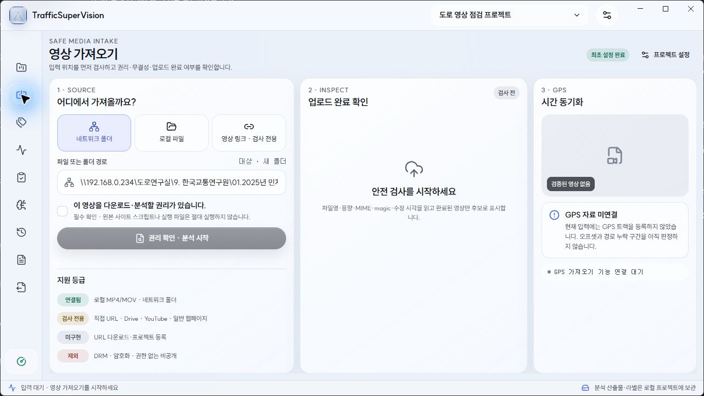
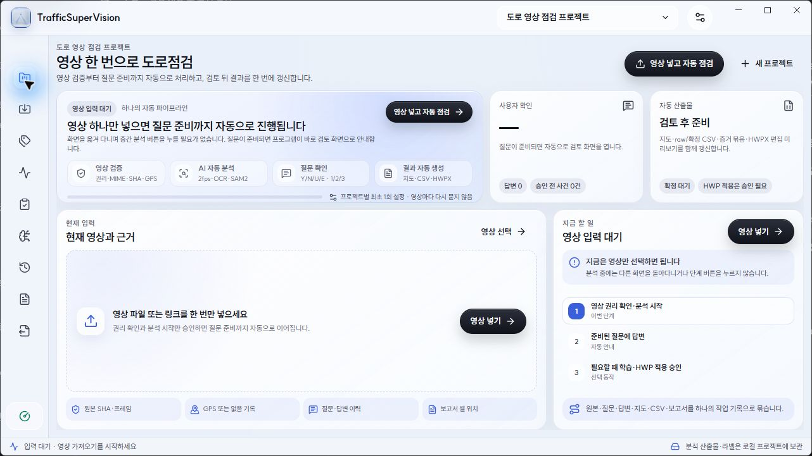
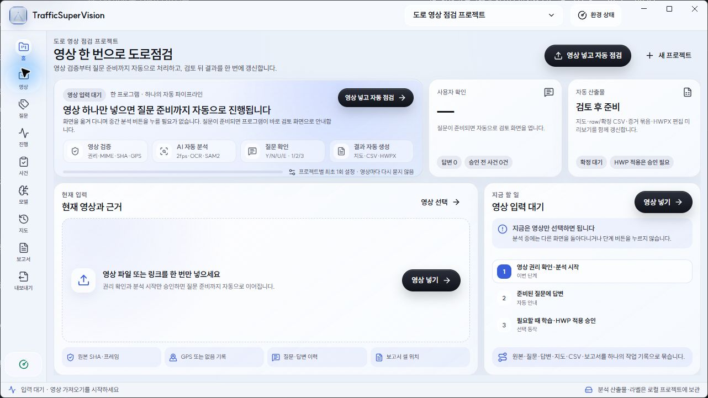
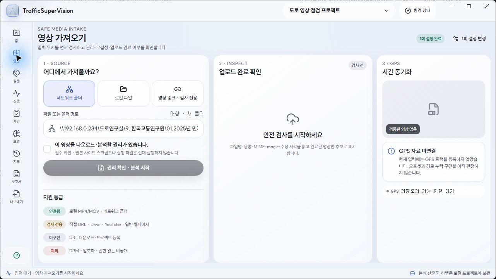
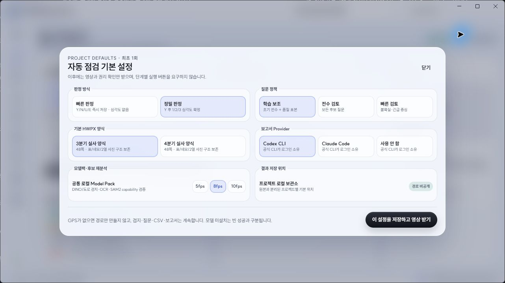
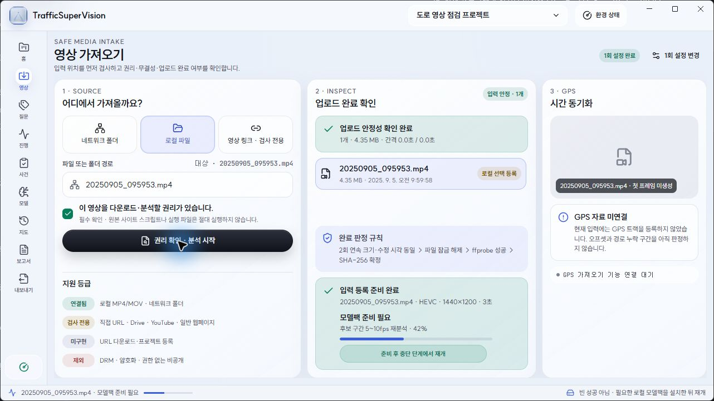
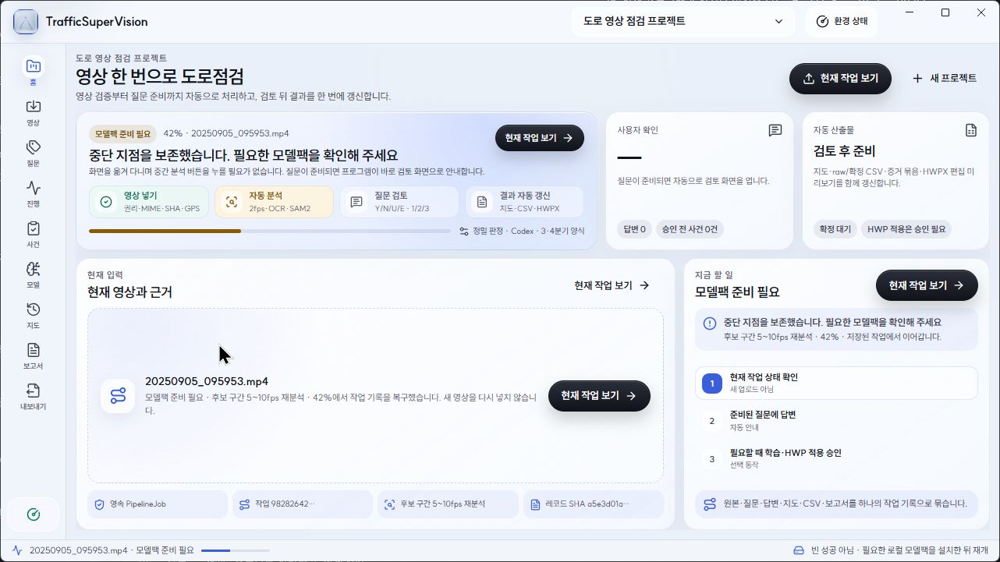
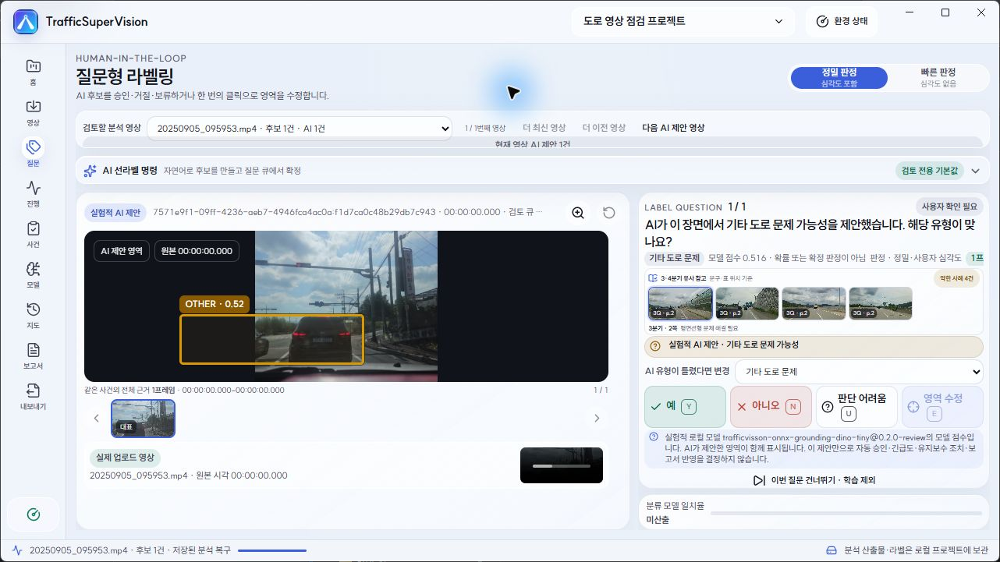
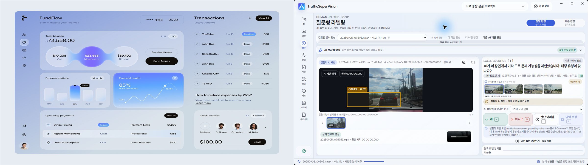

# TrafficSuperVision 단일 창·설정 구분 감사

## 범위

- 실행 화면: Electron Windows 프로그램
- 기준 해상도: 1280×720
- 사용자 목표: 현재 화면이 설정창인지, 실제 작업 화면인지, 기능이 삭제됐는지 즉시 구분

## 1. 영상 가져오기 — 개선 전

- 상태: 기능은 정상이나 왼쪽 메뉴가 아이콘만 보여 여러 작업 화면이 있다는 사실을 알아보기 어려웠음.
- UX 위험: 우측 상단 슬라이더 아이콘이 프로젝트 설정처럼 보였고, `프로젝트 설정` 버튼도 현재 화면 전체가 설정 화면이라는 오해를 만들 수 있었음.
- 접근성: 각 아이콘의 `aria-label`은 있었지만 화면을 보는 사용자는 글자를 볼 수 없었음.

## 2. 프로젝트 홈 — 자동 파이프라인 구조

- 상태: `영상 한 번 → 자동 분석 → 질문 → 결과` 구조는 구현되어 있었음.
- UX 위험: 창은 하나가 맞지만 화면 이동이 아이콘만으로 표현되어 “화면도 하나”처럼 보일 수 있었음.

## 3. 프로젝트 홈 — 메뉴·환경 상태 명확화

- 상태: 양호.
- 변경: 왼쪽에 `홈·영상·질문·진행·사건·모델·지도·보고서·내보내기`를 항상 표시함.
- 변경: 모호한 슬라이더 아이콘을 `환경 상태`로 명명함.
- 변경: 홈에 `한 프로그램 · 하나의 자동 파이프라인`을 명시함.
- 1280×720 확인: 문서 스크롤 없이 핵심 시작 동작과 전체 작업 메뉴가 보임.

## 4. 영상 가져오기 — 작업 화면과 설정 분리

- 상태: 양호.
- 변경: `최초 설정 완료`를 `1회 설정 완료`로, `프로젝트 설정`을 `1회 설정 변경`으로 수정함.
- 의미: 이 화면은 설정 화면이 아니라 실제 영상 입력 화면이며, 설정은 필요할 때만 여는 보조 동작임.

## 5. 자동 점검 기본 설정 — 일회성 모달

- 상태: 양호.
- 확인: 판정 방식, 질문 정책, HWPX 양식, Provider, 모델팩, 저장 위치가 한 모달에 들어가며 1280×720에서 별도 문서 스크롤 없이 보임.
- 확인: 모달 본문에 “최초 1회”와 “이후에는 영상과 권리 확인만”을 명시함.

## 6. 실제 NAS 영상 — 자동 파이프라인

- 상태: 당시 정직한 부분 성공. 아래 8번 재검증으로 후속 상태가 갱신됨.
- 실제 입력: `20250905_095953.mp4`, 4.35MB, 약 2.81초, HEVC, 1440×1200.
- 완료: 로컬 파일 등록, ffprobe, SHA-256, GPS 없음 기록, 2fps 프레임 6장 생성.
- 중단: 42% `candidate_rescan_5_10fps`에서 검증된 전체 도로 모델팩이 없어 `model_unavailable`로 중단.
- 데이터 경계: 이 상태에서 질문·답변·Annotation·Incident는 모두 0건이며 빈 성공으로 처리하지 않음.

## 7. 앱 재시작 뒤 영속 작업 복원

- 상태: 양호.
- 재현: 앱 런타임의 임시 `activeImport`가 비어 있어도 영속 PipelineJob `98282642…`를 홈의 현재 입력으로 사용함.
- 변경: 상단과 하단이 모두 `20250905_095953.mp4`, 42%, 후보 구간 5~10fps 재분석, 모델팩 준비 필요 상태를 동일하게 표시함.
- 변경: 진행 중인 작업이 있을 때 새 `영상 넣기`를 제안하지 않고 `현재 작업 보기`로 같은 작업에 복귀함.
- 정직성: 원본 길이·전체 SHA처럼 PipelineJob에 없는 값은 꾸며내지 않고 작업 ID와 레코드 SHA만 표시함.

## 8. 실제 NAS 영상 — 재시작 복구 후 질문 대기

- 상태: 질문 대기까지 통과.
- 동일 작업: PipelineJob `98282642…`, 동일 원본 SHA-256, 동일 2fps 프레임 인덱스를 재사용함.
- 재시작 복구: bridge-private grant의 파일 크기·생성/수정 시각·전체 SHA-256을 다시 검증하고, 절대 경로는 PipelineJob/API에 노출하지 않음.
- 호환성 수정: FFmpeg 4.4.1에서 1440×1200 영상을 1600×1333으로 확대해 H.264가 실패하던 필터를, 확대하지 않고 짝수 높이를 보장하는 필터로 교체함.
- 결과: 실제 후보 1건, 검토 전용 DINO 박스 1건, 유사 3·4분기 사례 5건, 질문 1건이 같은 작업에 결속됨.
- 정직성: 전용 도로 검지, 실제 5~10fps 재분석, 한국어 OCR, SAM2, 구조화 비전 LLM은 실행되지 않았다고 질문 체크포인트에 기록함.
- 승인 경계: 이 캡처 시점의 답변·Annotation·Incident는 모두 0건임.
- 1280×720 확인: 대표 프레임·박스·유사 사례·질문·Y/N/U/E·빠른/정밀 모드가 문서 스크롤 없이 한 화면에 보임.
- 콘셉트 비교: 옅은 청색 바탕, 반투명 흰 카드, 파란 활성 상태, 얇은 좌측 내비게이션을 유지하되 Windows 프로그램 자체를 다시 둥근 “창 안의 창”으로 감싸지는 않음.

## 결론

TrafficSuperVision은 설정창 하나가 아니라 여러 작업 화면을 가진 단일 Electron 프로그램이다. 기능은 삭제되지 않았고, 일회성 설정과 실제 작업 화면을 구분하는 문구·메뉴를 보강했다. 실제 NAS 영상은 입력·무결성·2fps 인덱스·재시작 복구·검토 전용 DINO 제안·질문 큐까지 통과했다. 다만 전용 도로 검지/OCR/SAM2/구조화 비전 LLM과 승인 이후 전체 산출물·HWPX 적용은 별도 미완료 범위이므로 “완성된 만능 검지”라고 주장하지 않는다.

## 증거 한계

- 화면 캡처만으로 전체 키보드 순서, 스크린리더 발화, 확대 200% 재배치까지 확인할 수 없음.
- 이번 실제 영상은 약 3초짜리 파이프라인 스모크용이며 도로 파손 검지 정확도 평가는 아님.
